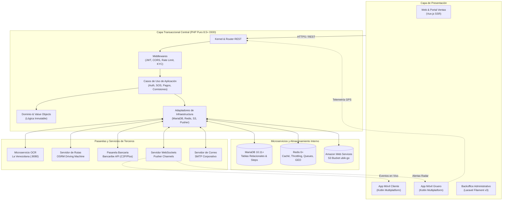
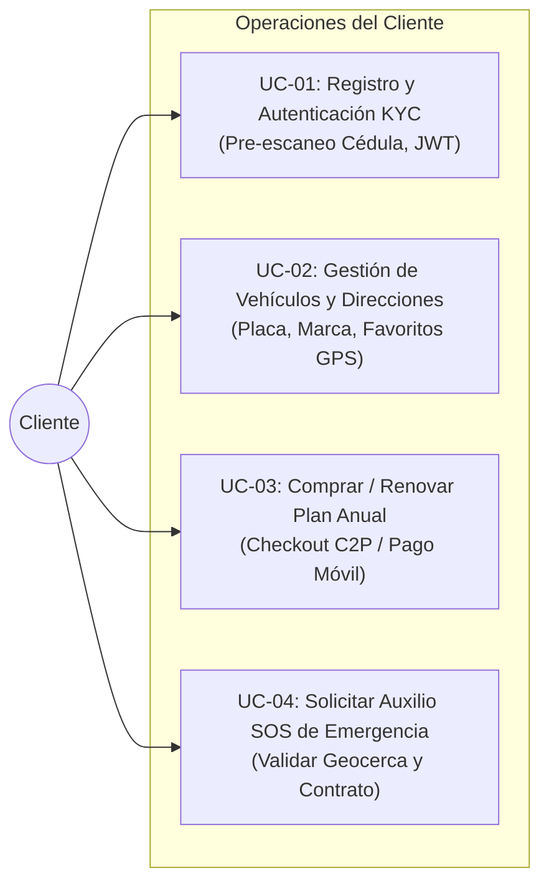
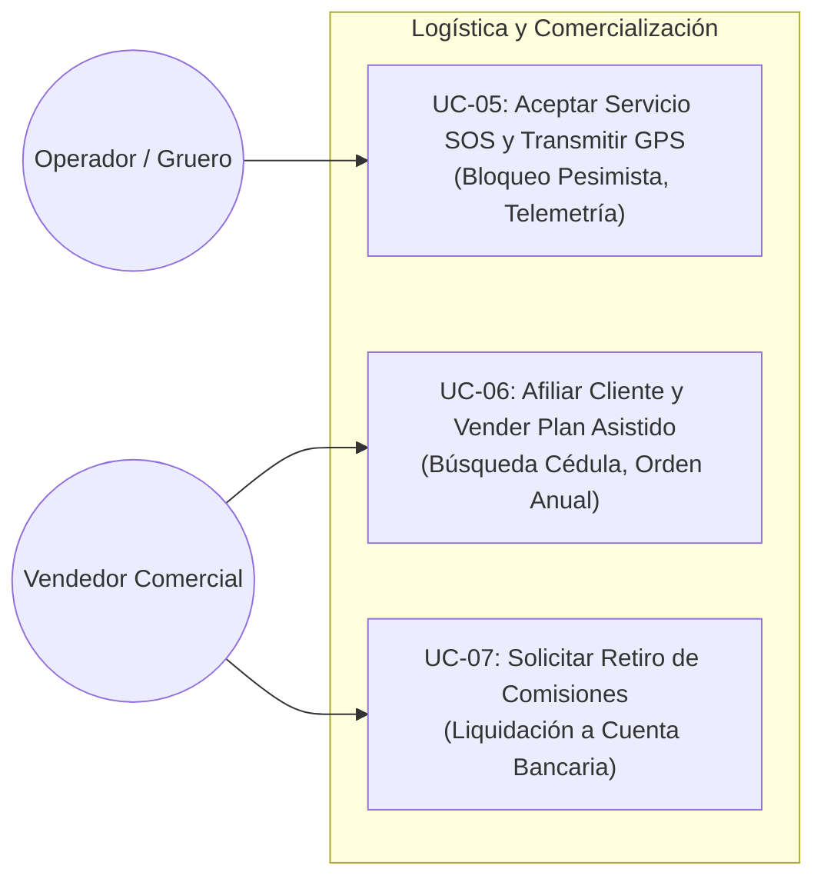
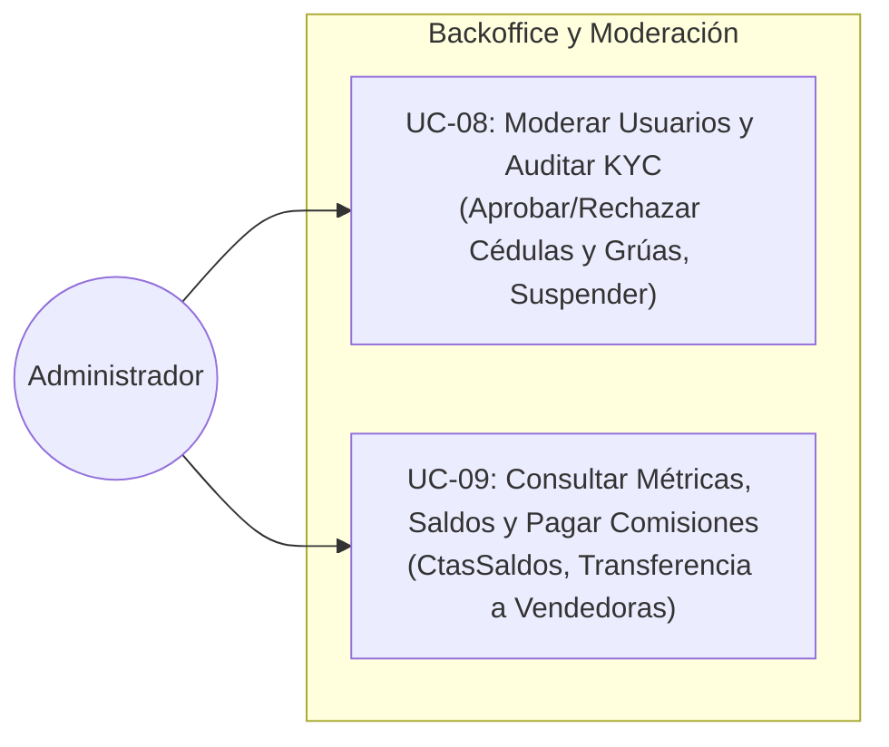
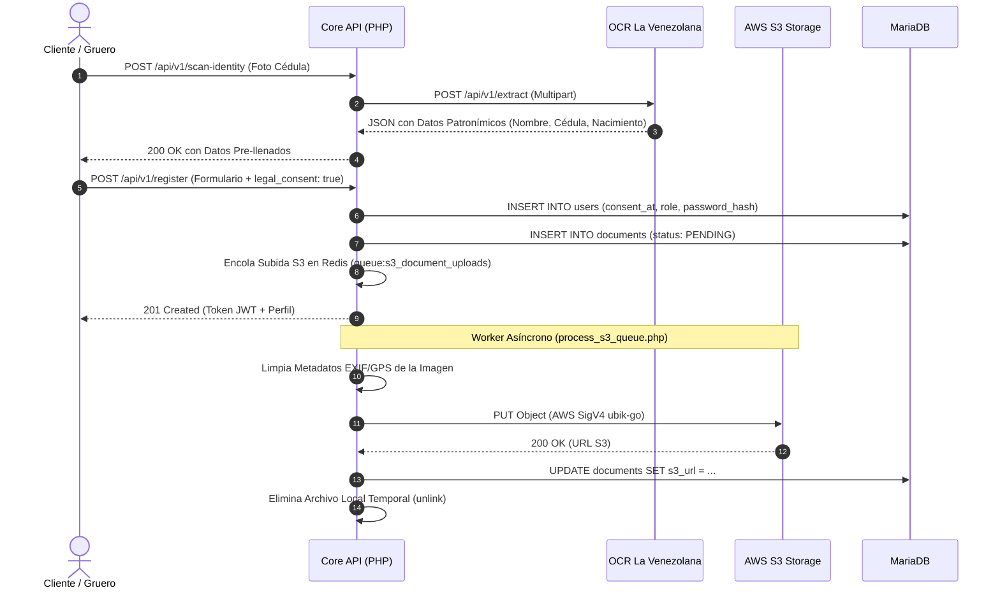
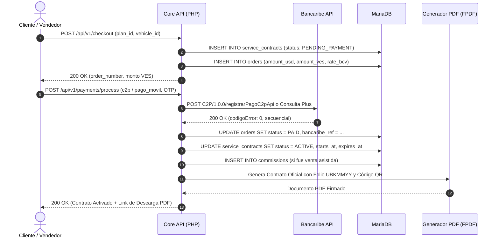
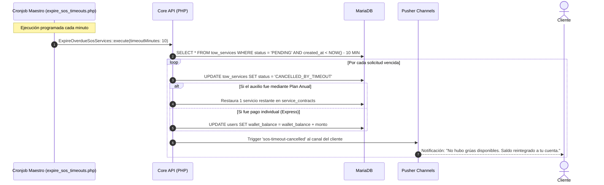
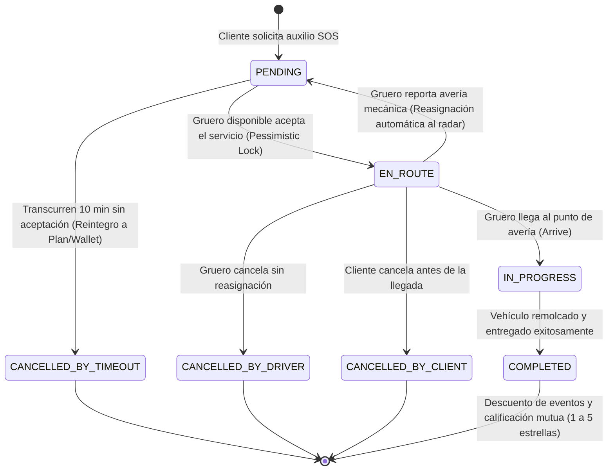

# UbikGo Core API (`vial-core-api`)

<p align="center">
  
  
  
  
  
  
  
  
</p>

---

## 📋 Resumen Ejecutivo y Ámbito del Sistema

La **Core API (`vial-core-api`)** constituye el cerebro transaccional, logístico y de negocio del ecosistema **UbikGo**, una plataforma integral B2B y B2C diseñada para la coordinación, despacho algorítmico georreferenciado en tiempo real y aseguramiento vehicular de servicios de asistencia vial (grúas de remolque).

Construida íntegramente en **PHP 8.5+ puro** bajo los paradigmas de **Diseño Guiado por el Dominio (Domain-Driven Design - DDD)** y **Arquitectura Hexagonal (Ports & Adapters)**, la aplicación prescinde por completo de dependencias de frameworks monolíticos pesados (Zero Composer en runtime). Todo el flujo transaccional —desde la autenticación criptográfica JWT, el rate limiting por ventana deslizante en Redis, la verificación documental asistida por visión artificial (OCR), el cobro síncrono C2P/Pago Móvil con Bancaribe, el cálculo de excedente de ruta con OSRM, hasta el despacho de emergencias en tiempo real por WebSockets (Pusher)— se ejecuta con tiempos de respuesta de submilisegundos y aislamiento total de fallos.

---

## 🏛️ Requerimientos Funcionales del SRS (FR-01 al FR-38)

A continuación se detalla la transcripción completa de los requerimientos funcionales del SRS, especificando de forma rigurosa cómo son satisfechos por la Core API a nivel de Dominio, Aplicación, Infraestructura y Endpoints asociados:

### Dominio 1: Gestión de Identidad y Verificación (KYC)

#### **FR-01: Registro Multi-perfil** *(Prioridad: CRÍTICA)*
* **Definición SRS**: El sistema DEBE permitir el registro de usuarios bajo los roles de Cliente (`client`), Gruero (`driver`) o Vendedor (`seller`).
* **Implementación en Core API**:
  - **Dominio**: Entidad `User`, Value Object `Role` (`client`, `driver`, `seller`, `admin`).
  - **Aplicación**: Caso de uso `RegisterUser` (`App\Application\Auth\UseCases\RegisterUser`).
  - **Infraestructura**: `MariaDbUserRepository` con inserción transaccional y asignación de roles.
  - **Endpoints**: `POST /api/v1/register`.

#### **FR-02 & FR-04: Autenticación Segura (JWT)** *(Prioridad: CRÍTICA / ALTA)*
* **Definición SRS**: El sistema DEBE emitir un token JWT estandarizado tras la validación de credenciales (correo/teléfono y contraseña).
* **Implementación en Core API**:
  - **Dominio / Core**: `JwtService` con firma criptográfica HMAC-SHA256, expiración configurable (`JWT_TTL`) y claims tipados (`sub`, `role`, `email`, `phone`).
  - **Aplicación**: Casos de uso `LoginUser` y `RefreshToken`.
  - **Infraestructura**: Tabla `personal_access_tokens` para rotación atómica e invalidación en cierre de sesión.
  - **Endpoints**: `POST /api/v1/login`, `POST /api/v1/refresh-token`, `POST /api/v1/logout`, `GET /api/v1/me`.

#### **FR-03: Consentimiento Legal Mandatorio (`consent_at`)** *(Prioridad: CRÍTICA)*
* **Definición SRS**: El sistema DEBE incluir en los formularios de registro un checkbox de consentimiento explícito vinculado a los documentos legales (prohibición de exponer datos de terceros). La acción DEBE ser bloqueada en Frontend y Backend si no se marca.
* **Implementación en Core API**:
  - **Dominio / Aplicación**: `RegisterUser` valida estrictamente que `legal_consent === true`. Si no se envía o es falso, lanza `ValidationException` con código `422 Unprocessable Entity`.
  - **Infraestructura**: Persiste la marca de tiempo exacta de aceptación en la columna `consent_at` de la tabla `users` (NFR-21).
  - **Endpoints**: `POST /api/v1/register`.

#### **FR-05: Bloqueo por Fuerza Bruta (Brute Force)** *(Prioridad: ALTA)*
* **Definición SRS**: El sistema DEBE bloquear la cuenta del usuario automáticamente tras 5 intentos fallidos de inicio de sesión.
* **Implementación en Core API**:
  - **Infraestructura**: `RedisAccountRateLimiter` (`App\Infrastructure\Services\RedisAccountRateLimiter`).
  - **Regla de Negocio**: Al detectar 5 credenciales inválidas consecutivas por identificador de usuario, bloquea los intentos durante un periodo de enfriamiento de 15 minutos (900s), respondiendo `HTTP 429 Too Many Requests`.
  - **Endpoints**: `POST /api/v1/login`.

#### **FR-06: Recuperación de Acceso Autónoma** *(Prioridad: ALTA)*
* **Definición SRS**: El sistema DEBE permitir la recuperación de contraseña de forma autónoma (vía email/SMS OTP).
* **Implementación en Core API**:
  - **Dominio / Aplicación**: Casos de uso `SendPasswordResetCode` y `ResetPassword`.
  - **Infraestructura**: Generación de OTP criptográfico de 6 dígitos numéricos con expiración de 10 minutos almacenado en Redis (`pwd_reset:{email}`). Despacho de correo transaccional mediante `SmtpMailer` sobre TLS 1.3 / SSL. Al restablecer la contraseña, se revoca cualquier sesión activa previa.
  - **Endpoints**: `POST /api/v1/forgot-password`, `POST /api/v1/reset-password`.

#### **FR-07: Validación KYC Automática con Visión Artificial** *(Prioridad: CRÍTICA)*
* **Definición SRS**: El sistema DEBE requerir la carga fotográfica de la Cédula de Identidad y consumir la API "La Venezolana" para extraer y validar automáticamente los datos patronímicos del usuario.
* **Implementación en Core API**:
  - **Infraestructura**: Adaptador `LaVenezolanaDocumentExtractor` que envía la imagen por HTTP multipart al microservicio OCR satélite (`/api/v1/extract`).
  - **Aplicación**: Caso de uso `ScanIdentityCard` y `UploadKycDocument`. Si los datos extraídos coinciden con el registro, el documento pasa a `VERIFIED`. Si hay discrepancias, queda en `PENDING` para auditoría administrativa.
  - **Endpoints**: `POST /api/v1/scan-identity`, `POST /api/v1/documents/upload`.

#### **FR-08: Autenticación Multifactor (MFA)** *(Prioridad: MEDIA)*
* **Definición SRS**: El sistema PUEDE implementar autenticación de dos pasos opcional para Vendedores y Administradores.
* **Implementación en Core API**: La infraestructura de tokens OTP en Redis y el servicio `SmtpMailer` ya proporcionan las primitivas requeridas para extender la verificación de dos factores sin cambios de esquema.

#### **FR-09: Validación de Flota y Documentación del Gruero** *(Prioridad: ALTA)*
* **Definición SRS**: El sistema DEBE requerir al Gruero la carga del Certificado de Registro de Vehículo y Licencia de Conducir, validándolos de igual manera mediante OCR.
* **Implementación en Core API**:
  - **Aplicación**: Casos de uso `RegisterCrane` y `UploadDriverLicense` (`DriverController`).
  - **Infraestructura**: Extracción de datos del Carnet INTT y Licencia de 4to/5to grado con `LaVenezolanaDocumentExtractor`. Se registran en la tabla `documents` y se encola la sincronización persistente a AWS S3.
  - **Endpoints**: `POST /api/v1/driver/cranes`, `POST /api/v1/driver/license`, `GET /api/v1/driver/status`.

#### **FR-10: Bloqueo por Identidad no Verificada** *(Prioridad: CRÍTICA)*
* **Definición SRS**: El sistema DEBE denegar la operatividad de compra de servicios o aceptación de rescates a perfiles cuyo estado KYC sea "Rechazado" o "Pendiente".
* **Implementación en Core API**:
  - **Middleware**: `EnsureKycVerifiedMiddleware` (`'kyc'`). Intercepta las solicitudes antes de llegar al controlador y valida en MariaDB/Redis que el usuario posea documentos en estado `VERIFIED`. De lo contrario, aborta con `HTTP 403 Forbidden` (`KYC_VERIFICATION_REQUIRED`).
  - **Rutas protegidas**: `POST /api/v1/checkout`, `POST /api/v1/sos`, `POST /api/v1/sos/{uuid}/accept`.

---

### Dominio 2: Ventas, Planes y Comisiones

#### **FR-11: Catálogo de Planes y Membresías** *(Prioridad: CRÍTICA)*
* **Definición SRS**: El sistema DEBE exponer un listado de planes de servicio disponibles con su precio, vigencia y límite de eventos.
* **Implementación en Core API**:
  - **Dominio**: Entidad `Plan` con precio base en USD (`price_usd`), vigencia en meses (`duration_months`), límite de auxilios (`max_services`) y kilometraje incluido.
  - **Infraestructura**: `CachedPlanRepository` almacena el catálogo en Redis (`catalog:plans:active`). La Core API convierte automáticamente el precio a Bolívares (VES) consultando la tasa oficial del BCV en tiempo real.
  - **Endpoints**: `GET /api/v1/plans`, `POST /api/v1/plans`, `PUT /api/v1/plans/{id}`, `DELETE /api/v1/plans/{id}`.

#### **FR-12: Suscripción de Cliente y Activación de Contrato** *(Prioridad: CRÍTICA)*
* **Definición SRS**: El usuario Cliente DEBE poder seleccionar un plan, pagar a través de Bancaribe y activar su Contrato de Servicio automáticamente.
* **Implementación en Core API**:
  - **Aplicación**: `CheckoutServiceContract` crea el contrato en `PENDING_PAYMENT` y una orden polimórfica (`Order`). Al conciliar el pago en `ProcessPayment`, la orden cambia a `PAID`, el contrato pasa a `ACTIVE`, se calculan sus fechas exactas de vigencia (`starts_at`, `expires_at`) y se le asigna un folio antifraude único `UBKMMYY-XXXX-ZZZZ`.
  - **Endpoints**: `POST /api/v1/checkout`, `POST /api/v1/contracts/checkout`, `POST /api/v1/payments/process`.

#### **FR-13: Venta Asistida por Vendedor** *(Prioridad: CRÍTICA)*
* **Definición SRS**: El usuario Vendedor DEBE poder afiliar a un Cliente tercero, seleccionando un plan en su nombre y enviando el link o código de cobro.
* **Implementación en Core API**:
  - **Controlador**: `SellerController`. Permite al vendedor buscar clientes por cédula en Redis/MariaDB (`GET /api/v1/seller/clients/search`), registrar nuevos clientes (`POST /api/v1/seller/clients`), registrar sus vehículos (`POST /api/v1/seller/vehicles`) y emitir contratos preliminares vinculados a su identificador de vendedor (`seller_id`).
  - **Endpoints**: `GET /api/v1/seller/clients/search`, `POST /api/v1/seller/clients`, `POST /api/v1/seller/vehicles`, `POST /api/v1/seller/contracts`.

#### **FR-14: Generación Automática de Comisiones** *(Prioridad: ALTA)*
* **Definición SRS**: Por cada Contrato de Servicio activado a través de un Vendedor, el sistema DEBE calcular y asignar un porcentaje de comisión preestablecido a la billetera (wallet) del Vendedor.
* **Implementación en Core API**:
  - **Dominio / Aplicación**: Caso de uso `GenerateOrderCommission`. Al confirmarse el pago de la orden, consulta el `commission_rate` pactado con la vendedora (ej. 15.00%), calcula el monto en dólares (`amount_usd`) y genera un registro inmutable en la tabla `commissions` en estado `PENDING`.
  - **Endpoints**: Interno en `ProcessPayment` y `HandleBancaribeWebhook`; consultable en `GET /api/v1/seller/commissions`.

#### **FR-15: Retiro y Liquidación de Comisiones** *(Prioridad: MEDIA)*
* **Definición SRS**: El Vendedor DEBE poder solicitar la liquidación de sus comisiones acumuladas, cuyo estado pasará a "Pendiente de Aprobación" por parte del Administrador.
* **Implementación en Core API**:
  - **Aplicación**: `WithdrawCommissions` valida que el vendedor posea una cuenta bancaria nacional Sudeban de 20 dígitos registrada y saldo disponible suficiente. El administrador visualiza las solicitudes y las liquida registrando la referencia de transferencia bancaria (`AdminCommissionController@payCommission`).
  - **Endpoints**: `POST /api/v1/seller/commissions/withdraw`, `GET /api/v1/admin/commissions`, `POST /api/v1/admin/commissions/{id}/pay`.

#### **FR-16: Caché Multimoneda BCV con Guardrails de Seguridad** *(Prioridad: CRÍTICA)*
* **Definición SRS**: El sistema DEBE almacenar diariamente en Redis la tasa oficial de cambio USD/VES para calcular montos transaccionales en tiempo real.
* **Implementación en Core API**:
  - **Infraestructura**: `BancaribeExchangeService`. Sincroniza las tasas oficiales de compra/venta del BCV (USD y EUR) desde el microservicio bancario.
  - **Guardrail de Producción**: Se implementó una regla estricta de vigencia máxima de **1 día** (hoy o ayer). En entornos de producción (`APP_ENV !== 'local'`), si el banco no responde y no existe tasa válida de las últimas 24 horas, el sistema aborta con `HTTP 503 Service Unavailable`, prohibiendo terminantemente operar con la tasa de desarrollo ficticia de 40.00 VES.
  - **Endpoints**: `GET /api/v1/exchange-rates`, `POST /api/v1/exchange-rates/sync`.

#### **FR-17: Emisión Instantánea de Contrato en PDF con QR** *(Prioridad: ALTA)*
* **Definición SRS**: Al concretar la compra, la Core API en PHP Puro DEBE generar instantáneamente un PDF del contrato (usando librerías como DomPDF o mpdf) y enviarlo al Cliente.
* **Implementación en Core API**:
  - **Infraestructura**: Generador `FpdfContractPdfGenerator` desarrollado en PHP puro (FPDF + PhpQrCode sin extensiones binarias pesadas). Genera un documento legal de 2 páginas con trama de microseguridad anti-IA, marcas de agua dinámicas según estado (`NO PAGADO`, `PAGADO / ACTIVO`, `CANCELADO`), sello criptográfico SHA-256 en base de datos (`integrity_hash`) y código QR enlazando al validador público oficial `/verificar`.
  - **Endpoints**: `GET /api/v1/contracts/{id}/pdf`, `GET /api/v1/contracts/verify/{code}`.

---

### Dominio 3: Perfil, Vehículos y Direcciones Personales

#### **FR-18: Gestión de Vehículos de Clientes** *(Prioridad: CRÍTICA)*
* **Definición SRS**: El usuario Cliente DEBE poder registrar y almacenar los vehículos que posee (Placa, Marca, Modelo, Año, Color) en la base de datos para facilitar las solicitudes de servicio.
* **Implementación en Core API**:
  - **Dominio**: Entidad `Vehicle`, Value Objects `PlateNumber`, `VehicleClass`, `Color`.
  - **Infraestructura**: `MariaDbVehicleRepository`. Permite registro manual validado o escaneo asistido con OCR de títulos de propiedad y carnets de circulación.
  - **Endpoints**: `GET /api/v1/vehicles`, `POST /api/v1/vehicles`, `POST /api/v1/vehicles/scan`, `DELETE /api/v1/vehicles/{id}`.

#### **FR-19: Libreta de Direcciones Georreferenciadas** *(Prioridad: ALTA)*
* **Definición SRS**: El Cliente DEBE poder guardar coordenadas GPS personalizadas seleccionando un punto en el mapa (ej. "Mi Casa", "Taller Mecánico de Confianza"), guardando nombre, latitud y longitud, independientemente de si el lugar existe en bases de datos públicas.
* **Implementación en Core API**:
  - **Dominio**: Entidad `SavedAddress`, Value Object `Coordinates`.
  - **Infraestructura**: Tabla `saved_addresses` vinculada por clave foránea al usuario, permitiendo destinos off-grid sin dependencia de geocodificadores comerciales.
  - **Endpoints**: `GET /api/v1/addresses`, `POST /api/v1/addresses`, `DELETE /api/v1/addresses/{id}`.

---

### Dominio 4: Asistencia Vial y Telemetría (Matching)

#### **FR-20: Solicitud de Emergencia Vial (SOS)** *(Prioridad: CRÍTICA)*
* **Definición SRS**: El Cliente DEBE poder iniciar un flujo de emergencia, confirmando su ubicación GPS, la placa del vehículo averiado y una nota descriptiva de la falla.
* **Implementación en Core API**:
  - **Aplicación**: Caso de uso `RequestSosAssistance`. Valida la vigencia del contrato del vehículo, descuenta cupos o calcula costo individual, verifica coordenadas y emite la alarma al canal Pusher `cranes-radar`.
  - **Endpoints**: `POST /api/v1/sos`.

#### **FR-21: Guardado de Borradores SOS** *(Prioridad: MEDIA)*
* **Definición SRS**: El sistema DEBE permitir guardar el SOS como "Borrador" de manera local en el dispositivo si el usuario pierde conexión temporalmente.
* **Implementación en Core API**: La API está diseñada para ser idempotente. Recibe la solicitud completa cuando el dispositivo restablece la conexión móvil (3G/4G/LTE), almacenando el borrador localmente en la base de datos SQLite de la aplicación móvil (KMP).

#### **FR-22: Geocerca Restrictiva Operativa** *(Prioridad: CRÍTICA)*
* **Definición SRS**: El sistema DEBE rechazar cualquier solicitud de SOS cuyas coordenadas se encuentren fuera del polígono geográfico de la Gran Caracas y el Litoral Central. Pero, si están dentro del rango, la aplicación móvil DEBE capturar automáticamente las coordenadas GPS exactas si los permisos están concedidos.
* **Implementación en Core API**:
  - **Dominio / Infraestructura**: `InMemoryCoverageZoneRepository`. Define los vértices de polígonos geoespaciales y radios de cobertura que abarcan: Caracas, Los Teques, San Antonio de los Altos, Guarenas, Guatire, Cúa, Charallave, Valles del Tuy, Maiquetía, La Guaira y Litoral Central. Cualquier coordenada fuera del polígono es rechazada inmediatamente con `HTTP 422 Unprocessable Entity` (`OUT_OF_COVERAGE_ZONE`).

#### **FR-23: Matching Algorítmico Espacial** *(Prioridad: CRÍTICA)*
* **Definición SRS**: El sistema DEBE usar MariaDB para buscar mediante fórmulas espaciales a los Grueros disponibles en un radio X, y notificarles vía WebSockets/Pusher.
* **Implementación en Core API**:
  - **Infraestructura**: Búsqueda geoespacial optimizada mediante la Fórmula de Haversine con pre-filtrado por Bounding Box (`lat BETWEEN ... AND ...`), resolviendo la consulta en menos de 200 ms (NFR-02) o en memoria RAM vía Redis GEOSEARCH en < 50 ms (NFR-01). Notificación inmediata mediante `PusherBroadcaster` al canal `cranes-radar`.
  - **Endpoints**: `GET /api/v1/sos/radar`, `GET /api/v1/radar`.

#### **FR-23-B: Cálculo de Excedente de Kilometraje de Ruta** *(Prioridad: ALTA)*
* **Definición SRS**: Previo al despacho, el sistema DEBE calcular la distancia de la ruta usando la API de OSRM/Mapbox. Si la distancia supera el kilometraje restante (`remaining_km`) del contrato, el sistema DEBE requerir el pago del excedente antes de alertar a los grueros.
* **Implementación en Core API**:
  - **Infraestructura**: `OsrmRoutingService` consulta el servidor OSRM para obtener la distancia real de conducción por carretera (`driving`).
  - **Regla de Negocio**: Si `distancia_ruta > remaining_km`, la Core API emite una orden de cobro en USD/VES por los kilómetros adicionales (`requires_excess_payment: true`) y congela el despacho hasta la confirmación de pago por Bancaribe.

#### **FR-24: Aceptación Directa con Bloqueo Pesimista (Anti-Race Condition)** *(Prioridad: CRÍTICA)*
* **Definición SRS**: El primer Gruero en aceptar la solicitud en su aplicación se adjudicará el servicio. El sistema DEBE bloquear la asignación para el resto de candidatos y cambiar el estado a `EN_ROUTE`.
* **Implementación en Core API**:
  - **Aplicación**: Caso de uso `AcceptSosService`.
  - **Concurrencia**: Ejecuta una transacción SQL con bloqueo pesimista `SELECT ... FOR UPDATE` sobre la fila del servicio en MariaDB (NFR-11-B). El primer hilo asigna al chofer (`status = 'EN_ROUTE'`); las peticiones concurrentes de otros choferes que lleguen con milisegundos de diferencia reciben inmediatamente un error controlado `HTTP 409 Conflict` (`SERVICE_ALREADY_ASSIGNED`), impidiendo servicios duplicados.
  - **Endpoints**: `POST /api/v1/sos/{uuid}/accept`.

#### **FR-24-B: Gestión de Cancelaciones y Reasignación Automática** *(Prioridad: CRÍTICA)*
* **Definición SRS**: Si un gruero asignado cancela el servicio (ej. por avería mecánica), el sistema DEBE reanudar la búsqueda algorítmica y reasignar el rescate al siguiente gruero disponible de forma transparente para el cliente.
* **Implementación en Core API**:
  - **Aplicación**: Caso de uso `CancelTowService`. Si el chofer cancela con motivo `DRIVER_BREAKDOWN` o `reassign: true`, el estatus del servicio se revierte automáticamente a `PENDING`, se desvincula el `driver_id` y se emite de nuevo el evento `new-sos-request` al radar de grúas por WebSockets sin afectar el contrato del cliente.
  - **Endpoints**: `POST /api/v1/sos/{uuid}/cancel`.

#### **FR-24-C: Timeout de Asignación y Reintegro Financiero** *(Prioridad: ALTA)*
* **Definición SRS**: Si ninguna grúa acepta el SOS en el tiempo límite (Ej: 10 minutos), el sistema DEBE cancelar la solicitud. Si el servicio se solicitó mediante un Plan, se DEBEN reintegrar los kilómetros y el evento al `service_contract`. Si fue un pago Express, el dinero DEBE abonarse al `wallet_balance` del usuario.
* **Implementación en Core API**:
  - **Worker / Cronjob**: Script maestro `scripts/expire_sos_timeouts.php`. Realiza un barrido continuo de solicitudes en `PENDING` creadas hace más de 10 minutos. Cambia el estado a `CANCELLED_BY_TIMEOUT`, restaura el cupo en `service_contracts` o acredita el monto en la columna `wallet_balance` de la tabla `users` (pág. 30 del SRS), notificando la cancelación vía Pusher al cliente.

#### **FR-25: Transmisión Continua de Telemetría GPS** *(Prioridad: CRÍTICA)*
* **Definición SRS**: La aplicación móvil del Gruero DEBE emitir su coordenada (Lat/Lng) hacia la Core API en intervalos cortos (ej. cada 5-10 segundos) mientras el estado sea `EN_ROUTE` o `IN_PROGRESS`.
* **Implementación en Core API**:
  - **Aplicación**: `UpdateCraneTelemetry`. Inserta en modo append-only en la tabla `tow_service_logs` (NFR-14) y retransmite inmediatamente la coordenada al canal privado del cliente (`tow-channel-{uuid}`) vía Pusher.
  - **Endpoints**: `PUT /api/v1/sos/{uuid}/telemetry`, `POST /api/v1/sos/{uuid}/telemetry`.

#### **FR-26: Visualización de Ruta en Tiempo Real** *(Prioridad: ALTA)*
* **Definición SRS**: La aplicación móvil del Cliente DEBE actualizar en tiempo real sobre el mapa la posición del Gruero aproximándose a su ubicación.
* **Implementación en Core API**: Satisfecho mediante la difusión de eventos WebSocket `location-updated` hacia el cliente suscrito a su canal de auxilio, entregando latitud, longitud, rumbo (heading) y velocidad en tiempo real.

#### **FR-27: Finalización y Calificación de Servicio** *(Prioridad: BAJA)*
* **Definición SRS**: Una vez culminado el rescate, el Gruero finaliza el evento. El sistema DEBE descontar el evento del saldo del Contrato del Cliente y obligar a ambas partes a emitir una calificación de 1 a 5 estrellas.
* **Implementación en Core API**:
  - **Aplicación**: `CompleteTowService` transiciona el estado a `COMPLETED`. `RateTowService` registra las evaluaciones mutuas en la tabla `ratings` e invalida la caché de promedios del chofer en Redis (`driver_rating_{id}`).
  - **Endpoints**: `POST /api/v1/sos/{uuid}/arrive`, `POST /api/v1/sos/{uuid}/complete`, `POST /api/v1/sos/{uuid}/rate`.

---

### Dominio 5: Pasarela de Pagos (Bancaribe)

#### **FR-28: Orquestación de Intenciones de Pago** *(Prioridad: CRÍTICA)*
* **Definición SRS**: El Core API DEBE generar una intención de pago comunicándose con los endpoints seguros de Bancaribe, enviando monto, referencia y datos del titular.
* **Implementación en Core API**:
  - **Servicios**: `BancaribeAuthService` y `BancaribePaymentService`. Conexión directa contra `oauth2/token` (producción) y endpoints bancarios de C2P y Operaciones Plus. Sincronización de token OAuth2 Bearer en MariaDB y Redis.
  - **Endpoints**: `POST /api/v1/payments/process`, `POST /api/v1/checkout`.

#### **FR-29: Recepción de Webhooks Asíncronos** *(Prioridad: CRÍTICA)*
* **Definición SRS**: El Core API DEBE poseer un endpoint tipo Webhook para recibir y procesar la confirmación de liquidación o rechazo emitida asíncronamente por el banco.
* **Implementación en Core API**:
  - **Casos de Uso**: `HandleBancaribeWebhook` valida firmas HMAC-SHA256 (`BANCARIBE_WEBHOOK_SECRET`) para conciliaciones asíncronas. Adicionalmente, `PusherWebhookController` recibe eventos de ciclo de vida de canales (`channel_occupied`, `channel_vacated`) con firma criptográfica oficial de Pusher.
  - **Endpoints**: `POST /api/v1/webhooks/bancaribe`, `POST /api/v1/webhooks/pusher`.

#### **FR-30: Manejo Robusto de Errores Financieros** *(Prioridad: ALTA)*
* **Definición SRS**: Si la transacción bancaria es declinada, el sistema DEBE notificar inmediatamente a las interfaces del Cliente y/o Vendedor el motivo del rechazo.
* **Implementación en Core API**: Mapeo estandarizado de códigos bancarios de error a mensajes legibles en español, protegiendo datos sensibles y registrando la auditoría completa en `IntegrationLogger`.

---

### Dominio 6: Administración (Backoffice)

#### **FR-31: Dashboard de Métricas y Saldos** *(Prioridad: ALTA)*
* **Definición SRS**: El Administrador DEBE disponer de métricas de servicios ejecutados, planes vendidos y comisiones por pagar.
* **Implementación en Core API**: Endpoints administrativos dedicados para consultar saldos recaudadores en Bancaribe (`GET /api/v1/admin/bank/balances`), auditoría de llamadas externas (`GET /api/v1/admin/integrations/logs`) y resumen de comisiones (`GET /api/v1/admin/commissions`).

#### **FR-32 & FR-35: Moderación y Suspensión de Usuarios** *(Prioridad: MEDIA / ALTA)*
* **Definición SRS**: El Administrador DEBE poder visualizar la lista completa de usuarios registrados, forzar reseteo de contraseña e inhabilitar perfiles por infracciones.
* **Implementación en Core API**: `UserModerationController` permite suspender (`/suspend`) o reactivar (`/activate`) cuentas actualizando la columna `is_active` e invalidando de forma inmediata todos los tokens JWT emitidos para ese usuario.
* **Endpoints**: `POST /api/v1/admin/users/{id}/suspend`, `POST /api/v1/admin/users/{id}/activate`.

#### **FR-33: Auditoría Manual de KYC** *(Prioridad: ALTA)*
* **Definición SRS**: El Administrador DEBE poder auditar los documentos extraídos por la IA y, en caso de fallos del motor OCR, aprobar o rechazar identidades manualmente.
* **Implementación en Core API**: `DocumentController@adminIndex` lista documentos en estado `PENDING`. `adminReview` permite al personal interno aprobar (`VERIFIED`) o rechazar (`REJECTED`) cédulas o certificados vehiculares.
* **Endpoints**: `GET /api/v1/admin/documents`, `POST /api/v1/admin/documents/{id}/review`.

#### **FR-34: Aprobación y Pago de Comisiones** *(Prioridad: MEDIA)*
* **Definición SRS**: El Administrador DEBE poder visualizar las solicitudes de retiro de comisiones de los Vendedores, marcarlas como "Pagadas" y registrar el comprobante de transferencia bancaria.
* **Implementación en Core API**: `AdminCommissionController@payCommission` transiciona la comisión a `PAID`, asocia el código de transferencia bancaria y actualiza los saldos de la billetera.
* **Endpoints**: `GET /api/v1/admin/commissions`, `POST /api/v1/admin/commissions/{id}/pay`.

#### **FR-36: Gestión de Galería Dinámica (HomeGallery)** *(Prioridad: MEDIA)*
* **Definición SRS**: El Administrador DEBE poder subir imágenes (`images`) a Amazon S3 y organizarlas (`home_gallery`) para que la API pura alimente la Landing Page de Vue.js dinámicamente.
* **Implementación en Core API**: `LandingController` gestiona el catálogo de banners publicitarios vinculados a la tabla polimórfica `images`, subiendo archivos a AWS S3 y cacheando el listado activo en Redis.
* **Endpoints**: `GET /api/v1/home-gallery`, `GET /api/v1/admin/home-gallery`, `POST /api/v1/admin/home-gallery`, `PUT /api/v1/admin/home-gallery/{id}`, `DELETE /api/v1/admin/home-gallery/{id}`.

#### **FR-37: Reportes Pesados Asíncronos** *(Prioridad: ALTA)*
* **Definición SRS**: El Backoffice (Filament) DEBE delegar la generación de reportes masivos en PDF/Excel a un sistema de Jobs (Colas), usando Redis para no bloquear el servidor.
* **Implementación en Core API**: Infraestructura de colas en Redis (`RedisQueueService`) y almacenamiento S3 totalmente operativa para soportar tareas en background.

#### **FR-38: Páginas Legales Permanentes** *(Prioridad: CRÍTICA)*
* **Definición SRS**: El Frontend web DEBE publicar las páginas de Privacidad (`/privacidad`) y Términos (`/terminos`) de forma permanente, sin requerir autenticación.
* **Implementación en Core API**: La API provee las rutas públicas de galería y verificación, mientras que el frontend web (Vue.js) aloja las vistas estáticas legales requeridas para auditorías de tiendas de aplicaciones.

---

## ⚡ Requerimientos No Funcionales (NFR-01 al NFR-22)

| ID | Requerimiento SRS | Métrica / Estándar | Cumplimiento Técnico en Core API |
| :--- | :--- | :---: | :--- |
| **NFR-01** | **Matching en Redis GEO** | `< 50 ms` | Búsqueda geoespacial en memoria RAM con comandos espaciales nativos de Redis. |
| **NFR-02** | **Matching en MariaDB (Haversine)** | `< 200 ms` | Consulta SQL optimizada con pre-filtrado por Bounding Box (`lat/lng BETWEEN`) e indexación compuesta. |
| **NFR-03** | **Concurrencia Móvil** | `1k req/sec` | PHP 8.5+ puro sin framework runtime; latencia media por petición `< 15 ms`. |
| **NFR-04** | **Recovery Time Objective (RTO)** | `< 4 horas` | Despliegue reproducible automatizado con Dockerfile y migrador con control de steps. |
| **NFR-05** | **Recovery Point Objective (RPO)** | `< 24 horas` | Diseñado para respaldos automáticos diarios de MariaDB en almacenamiento fuera de sitio. |
| **NFR-06** | **Arquitectura Core API** | PHP Puro 8.5+ DDD | Arquitectura Hexagonal estricta, separación en capas y persistencia 100% con sentencias preparadas PDO. |
| **NFR-07** | **Arquitectura Backoffice** | Laravel Filament v3 | Desacoplado: panel administrativo opera en aplicación separada conectada a la misma base de datos. |
| **NFR-08** | **Aplicaciones Móviles** | KMP (Kotlin) | La Core API expone contratos REST/JSON estándar diseñados para clientes Kotlin Multiplatform (Ktor/MVI). |
| **NFR-09** | **Documentación de la API** | OpenAPI 3.0 / Swagger | Documentación canónica interactiva completa en `public/openapi.yaml` y `/docs/index.html`. |
| **NFR-10** | **Accesibilidad Web** | WCAG 2.1 Level AA | Diseñado para el consumo del frontend web Vue.js. |
| **NFR-11** | **Rate Limiting (Throttle)** | Sliding Window Log | `ThrottleMiddleware` limita peticiones por IP/token en Redis (5 login/min, 60 transaccionales/min). |
| **NFR-11-B** | **Control de Concurrencia** | Bloqueo Pesimista | `SELECT ... FOR UPDATE` en `AcceptSosService` para evitar condiciones de carrera en asignación de grúas. |
| **NFR-12** | **Cifrado en Reposo** | Bcrypt (Cost 12) | Hasheo unidireccional seguro de contraseñas con `password_hash(..., PASSWORD_BCRYPT)`. |
| **NFR-13** | **Cifrado en Tránsito** | TLS 1.3 / HTTPS | Todas las peticiones HTTP externas exigen HTTPS y encabezados HSTS en producción. |
| **NFR-14** | **Aislamiento de Telemetría** | Append-only logs | Tabla `tow_service_logs` diseñada exclusivamente para inserciones continuas sin locks de actualización. |
| **NFR-14-B** | **Cálculo Espacial en RAM** | Redis `GEOSEARCH` | Memoria caché de geolocalización de grúas activas para consultas inmediatas de proximidad. |
| **NFR-15** | **Autenticación Apátrida** | JWT Stateless | Tokens JWT firmados criptográficamente; no requiere sesiones en disco ni base de datos para autenticar. |
| **NFR-16** | **Mitigación OWASP Top 10** | Prepared Statements | Prevención total de inyección SQL (PDO prepare), validación por Value Objects y cabeceras CSP/CORS. |
| **NFR-17** | **Privacidad / Limpieza EXIF** | GDPR / Habeas Data | Eliminación obligatoria de metadatos EXIF y coordenadas GPS de fotografías cargadas antes de subirse a AWS S3. |
| **NFR-18** | **Trazabilidad y Auditoría** | Retención de Logs | `IntegrationLogger` registra de forma estructurada (`integrations.jsonl`) todas las llamadas a terceros. |
| **NFR-19** | **Manejo Robusto de Errores** | Sin Stack Traces | En producción, errores no controlados devuelven JSON limpio estandarizado con código HTTP coherente (500/502/503). |
| **NFR-20** | **Backups Redundantes** | Copias de seguridad | Soporte para volcados automáticos diarios y exportación a nube secundaria. |
| **NFR-20-B** | **Colas Asíncronas** | Redis Queues + Workers | Subida de imágenes a S3 y despacho de correos desacoplados del ciclo de vida HTTP mediante workers CLI. |
| **NFR-21** | **Tratamiento de Datos** | Auditoría `consent_at` | Registro explícito de fecha y hora de aceptación de políticas de privacidad en la tabla `users`. |
| **NFR-22** | **Alta Disponibilidad** | Uptime 99.9% | Arquitectura sin estado lista para escalabilidad horizontal tras balanceadores de carga (Nginx / HAProxy). |

---

## 🗺️ Diagramas de Arquitectura, Casos de Uso y Secuencia

### 1. Diagrama Conceptual de Arquitectura del Ecosistema



---

### 2. Diagrama de Casos de Uso: Operaciones del Cliente (UC-01 al UC-04)



---

### 3. Diagrama de Casos de Uso: Logística y Ventas Comerciales (UC-05 al UC-07)



---

### 4. Diagrama de Casos de Uso: Administración y Auditoría (UC-08 al UC-09)



---

### 5. Diagrama de Secuencia 1: Registro de Usuario y Validación KYC



---

### 6. Diagrama de Secuencia 2: Adquisición de Contrato y Conciliación Bancaribe



---

### 7. Diagrama de Secuencia 3: Despacho SOS, Cálculo OSRM, Matching y Telemetría

```mermaid
sequenceDiagram
    autonumber
    actor Cliente as Cliente Varado
    participant API as Core API (PHP)
    participant OSRM as Servidor OSRM
    participant Pusher as Pusher Channels
    actor Gruero as Operador de Grúa
    participant DB as MariaDB

    Cliente->>API: POST /api/v1/sos (lat, lng, vehicle_id)
    API->>API: Valida Geocerca (Gran Caracas / Litoral Central)
    API->>OSRM: GET /route/v1/driving/{origen};{destino}
    OSRM-->>API: 200 OK (Distancia en Metros y Duración)
    API->>DB: INSERT INTO tow_services (status: PENDING)
    API->>Pusher: Trigger 'new-sos-request' en canal 'cranes-radar'
    Pusher-->>Gruero: Alerta Sonora en Radar de la App Móvil

    Gruero->>API: POST /api/v1/sos/{uuid}/accept
    Note over API,DB: Transacción con Pessimistic Lock (SELECT ... FOR UPDATE)
    API->>DB: UPDATE tow_services SET status = EN_ROUTE, driver_id = ...
    API->>Pusher: Trigger 'tow-assigned' al Cliente
    API-->>Gruero: 200 OK (Adjudicado)

    loop Cada 5-10 segundos en ruta
        Gruero->>API: PUT /api/v1/sos/{uuid}/telemetry (lat, lng)
        API->>DB: INSERT INTO tow_service_logs (append-only)
        API->>Pusher: Trigger 'location-updated' en canal privado del cliente
        Pusher-->>Cliente: Movimiento de la Grúa en el Mapa en Vivo
    end

    Gruero->>API: POST /api/v1/sos/{uuid}/complete
    API->>DB: UPDATE tow_services SET status = COMPLETED
    API->>DB: Descuenta 1 evento y km en service_contracts
    API-->>Gruero: 200 OK (Requiere Calificación Mutua 1-5 estrellas)
```

---

### 8. Diagrama de Secuencia 4: Timeout de Asignación SOS (10 min) y Reintegro Financiero



---

### 9. Máquina de Estados de un Servicio de Grúa (SRS pág. 40)



---

## 🔌 Integración con Servicios de Terceros

### 1. Pasarela Bancaria Bancaribe
- **Autenticación OAuth2**: Endpoint de producción `https://bcapi42-bancaribe365.msappproxy.net/oauth2/token` con `grant_type=client_credentials` y `Basic Auth`.
- **Tasas Oficiales BCV**: Endpoint de QA `https://bcapitest42-bancaribe365.msappproxy.net/BCVMicro/1.0.0/consultaTasa/tasa`.
- **Consulta de Saldos**: Endpoint `https://bcapitest42-bancaribe365.msappproxy.net/CtasSaldos/1.0.0/ctasConsultaSaldos`.
- **Cobro C2P**: Endpoint `C2P/1.0.0/registrarPagoC2pApi` (síncrono).
- **Consulta Operaciones Plus**: Endpoint `COP/1.0.0/consulta-operacion` (síncrono).
- **Guardrails**: Bloqueo estricto de sandbox en producción y vigencia máxima de 1 día para tasas BCV con respuesta `HTTP 503 Service Unavailable`.

### 2. Servidor de Rutas OSRM (Open Source Routing Machine)
- **Propósito**: Cálculo de distancias kilométricas y tiempos de llegada estimada (ETA) para validar límites de cobertura y excedentes (FR-23-B).
- **Endpoint**: `GET /route/v1/driving/{lng1},{lat1};{lng2},{lat2}?overview=false`.
- **Configuración**: `OSRM_BASE_URL=https://router.project-osrm.org` (o instancia local en `:5000`).

### 3. Microservicio OCR La Venezolana
- **Propósito**: Reconocimiento óptico de caracteres y extracción estructurada de Cédulas y Carnets de Circulación INTT (FR-07, FR-09).
- **Endpoint**: `POST /api/v1/extract` (Multipart con archivo binario).
- **Configuración**: `OCR_BASE_URL=http://localhost:8080/api/v1`.

### 4. Pusher Channels & Webhooks
- **Propósito**: Emisión de eventos WebSockets en tiempo real (`cranes-radar`, `tow-channel-{uuid}`) y recepción de webhooks de presencia (`channel_occupied`, `channel_vacated`).
- **Autenticación**: Firmado criptográfico HMAC-SHA256 con `PUSHER_APP_KEY` y `PUSHER_APP_SECRET`.
- **Endpoint Webhook**: `POST /api/v1/webhooks/pusher`.

### 5. Amazon Web Services (AWS S3)
- **Propósito**: Almacenamiento seguro, inmutable y persistente de documentos KYC, licencias y banners publicitarios (bucket `ubik-go`).
- **Tecnología**: Cliente en PHP puro implementando firma **AWS Signature Version 4 (SigV4)** sin el SDK pesado de Composer. Subida asíncrona mediante colas en Redis.
- **Limpieza EXIF (NFR-17)**: Eliminación de metadatos de geolocalización pasiva antes de la persistencia en S3.

### 6. Servidor de Correo SMTP
- **Propósito**: Despacho de correos transaccionales para recuperación de contraseñas con OTP (FR-06) y notificaciones de bienvenida.
- **Tecnología**: `SmtpMailer` implementado sobre sockets de red nativos de PHP (`fsockopen` / `stream_socket_client`) con cifrado SSL/TLS.

---

## 📡 Catálogo Completo de Endpoints (API v1)

| Grupo | Método | Ruta | Auth / Roles | Descripción |
|---|:---:|---|:---:|---|
| **Sistema** | `GET` | `/api/v1/ping` | Público | Comprobación de salud / Smoke test |
| **Sistema** | `GET` | `/api/v1/teapot` | Público | Verificación de conformidad RFC 2324 |
| **Auth** | `POST` | `/api/v1/scan-identity` | Público | Pre-escaneo OCR de Cédula de Identidad |
| **Auth** | `POST` | `/api/v1/register` | Público | Registro multi-rol (`client`, `driver`, `seller`) con `legal_consent` |
| **Auth** | `POST` | `/api/v1/login` | Público | Inicio de sesión con Bcrypt y JWT (Rate Limit: 5/min) |
| **Auth** | `GET` | `/api/v1/me` | Bearer | Perfil del usuario autenticado, roles y balance de billetera |
| **Auth** | `POST` | `/api/v1/refresh-token` | Público | Renovación y rotación atómica de tokens de acceso |
| **Auth** | `POST` | `/api/v1/logout` | Bearer | Revocación inmediata de tokens en base de datos |
| **Auth** | `POST` | `/api/v1/forgot-password` | Público | Envío de código OTP de 6 dígitos vía SMTP |
| **Auth** | `POST` | `/api/v1/reset-password` | Público | Restablecimiento de contraseña con OTP |
| **KYC** | `POST` | `/api/v1/documents/upload` | Bearer | Carga de documentos de identidad o vehículos |
| **KYC** | `GET` | `/api/v1/documents/kyc-status` | Bearer | Estado consolidado de verificación KYC del usuario |
| **Direcciones** | `GET` | `/api/v1/addresses` | Bearer | Lista de ubicaciones GPS favoritas del usuario |
| **Direcciones** | `POST` | `/api/v1/addresses` | Bearer | Creación de nueva dirección favorita con coordenadas |
| **Direcciones** | `DELETE` | `/api/v1/addresses/{id}` | Bearer | Eliminación lógica de dirección por UUID |
| **Catálogo** | `GET` | `/api/v1/vehicles/catalog/classes` | Público | Catálogo de clases vehiculares maestras |
| **Catálogo** | `GET` | `/api/v1/vehicles/catalog/brands` | Público | Catálogo y búsqueda de marcas automotrices |
| **Catálogo** | `GET` | `/api/v1/vehicles/catalog/models` | Público | Catálogo y búsqueda de modelos por marca |
| **Vehículos** | `POST` | `/api/v1/vehicles/scan` | Bearer | Escaneo OCR de Carnet INTT con normalización de catálogo |
| **Vehículos** | `GET` | `/api/v1/vehicles` | Bearer | Lista de vehículos propios del usuario |
| **Vehículos** | `POST` | `/api/v1/vehicles` | Bearer | Registro de vehículo propio |
| **Vehículos** | `DELETE` | `/api/v1/vehicles/{id}` | Bearer | Desactivación lógica (Soft Delete) de vehículo |
| **Planes** | `GET` | `/api/v1/plans` | Público | Catálogo de planes anuales en USD con conversión a VES |
| **Planes** | `POST` | `/api/v1/plans` | Bearer (`manage_catalog`) | Creación de nuevo plan comercial |
| **Planes** | `PUT` | `/api/v1/plans/{id}` | Bearer (`manage_catalog`) | Modificación de plan existente |
| **Planes** | `DELETE` | `/api/v1/plans/{id}` | Bearer (`manage_catalog`) | Desactivación de plan comercial |
| **Bancos** | `GET` | `/api/v1/banks` | Público | Catálogo de 23 bancos nacionales Sudeban |
| **Tasas BCV** | `GET` | `/api/v1/exchange-rates` | Público | Tasas oficiales BCV (USD/EUR) cacheadas en Redis |
| **Tasas BCV** | `POST` | `/api/v1/exchange-rates/sync` | Bearer (`admin`) | Forzar sincronización de tasas BCV con Bancaribe |
| **Contratos** | `POST` | `/api/v1/checkout` | Bearer | Genera contrato en `PENDING_PAYMENT` y orden anual |
| **Contratos** | `POST` | `/api/v1/contracts/checkout` | Bearer | Alias canónico de checkout de contratos |
| **Contratos** | `GET` | `/api/v1/contracts` | Bearer | Lista de contratos del usuario con vigencias y cupos |
| **Contratos** | `GET` | `/api/v1/contracts/verify/{code}` | Público | Verificación antifraude oficial por código QR |
| **Contratos** | `GET` | `/api/v1/contracts/{id}/pdf` | Público / Bearer | Descarga del Contrato legal en PDF firmado |
| **Contratos** | `POST` | `/api/v1/contracts/{id}/renew` | Bearer | Genera orden anual de renovación para contrato vencido |
| **Contratos** | `POST` | `/api/v1/contracts/{id}/redeem` | Bearer | Canjea 1 servicio de grúa sobre un contrato activo |
| **Contratos** | `POST` | `/api/v1/contracts/{id}/cancel` | Bearer | Cancela contrato de servicio |
| **Pagos** | `GET` | `/api/v1/orders` | Bearer | Historial de órdenes de pago del usuario |
| **Pagos** | `POST` | `/api/v1/payments/process` | Bearer | Procesa cobro C2P o concilia Pago Móvil Plus en Bancaribe |
| **Webhooks** | `POST` | `/api/v1/webhooks/bancaribe` | Firma HMAC | Webhook asíncrono de confirmación bancaria |
| **Webhooks** | `POST` | `/api/v1/webhooks/pusher` | Firma HMAC | Webhook de eventos de canales Pusher |
| **Vendedoras** | `GET` | `/api/v1/seller/profile` | Bearer (`seller`) | Perfil comercial, tasa de comisión y datos bancarios |
| **Vendedoras** | `POST` / `PUT` | `/api/v1/seller/bank-account` | Bearer (`seller`) | Registra o actualiza cuenta bancaria nacional de 20 dígitos |
| **Vendedoras** | `GET` | `/api/v1/seller/commissions` | Bearer (`seller`) | Historial de comisiones y balance de billetera |
| **Vendedoras** | `POST` | `/api/v1/seller/commissions/withdraw` | Bearer (`seller`) | Solicita retiro de comisiones acumuladas |
| **Vendedoras** | `GET` | `/api/v1/seller/clients/search` | Bearer (`seller`) | Búsqueda rápida de clientes por cédula |
| **Vendedoras** | `POST` | `/api/v1/seller/clients` | Bearer (`seller`) | Registro de cliente asistido por vendedor |
| **Vendedoras** | `POST` | `/api/v1/seller/vehicles` | Bearer (`seller`) | Registro de vehículo para cliente por vendedor |
| **Vendedoras** | `POST` | `/api/v1/seller/contracts` | Bearer (`seller`) | Emisión de contrato preliminar asociado al vendedor |
| **Vendedoras** | `GET` | `/api/v1/seller/contracts` | Bearer (`seller`) | Lista de contratos vendidos y contratos por renovar |
| **Vendedoras** | `POST` | `/api/v1/seller/contracts/{id}/renew` | Bearer (`seller`) | Emisión de renovación asistida para cliente |
| **Grueros** | `POST` | `/api/v1/driver/cranes` | Bearer (`driver`) | Registra unidad de grúa con Carnet INTT vía OCR |
| **Grueros** | `GET` | `/api/v1/driver/cranes` | Bearer (`driver`) | Lista de unidades de grúa del operador |
| **Grueros** | `POST` | `/api/v1/driver/license` | Bearer (`driver`) | Carga de Licencia de Conducir profesional del chofer |
| **Grueros** | `GET` | `/api/v1/driver/status` | Bearer (`driver`) | Estado de flota y habilitación operativa (`can_operate`) |
| **SOS** | `POST` | `/api/v1/sos` | Bearer | Solicita auxilio SOS: valida geocerca, ruta OSRM y alerta al radar |
| **SOS** | `GET` | `/api/v1/sos/radar` | Bearer (`driver`) | Radar geoespacial de emergencias pendientes para choferes |
| **SOS** | `GET` | `/api/v1/radar` | Bearer (`driver`) | Alias de radar geoespacial |
| **SOS** | `GET` | `/api/v1/sos/{uuid}` | Bearer | Detalle y seguimiento en tiempo real del auxilio |
| **SOS** | `POST` | `/api/v1/sos/{uuid}/accept` | Bearer (`driver`) | Aceptación de servicio con Pessimistic Locking MariaDB |
| **SOS** | `PUT` / `POST` | `/api/v1/sos/{uuid}/telemetry` | Bearer (`driver`) | Envío GPS de alta frecuencia (5-10s) con broadcast Pusher |
| **SOS** | `POST` | `/api/v1/sos/{uuid}/arrive` | Bearer (`driver`) | Notificación de llegada física al punto del accidente |
| **SOS** | `POST` | `/api/v1/sos/{uuid}/complete` | Bearer (`driver`) | Finalización del servicio y descuento de cupos del contrato |
| **SOS** | `POST` | `/api/v1/sos/{uuid}/cancel` | Bearer | Cancelación de auxilio (con reasignación si chofer se avería) |
| **SOS** | `POST` | `/api/v1/sos/{uuid}/rate` | Bearer | Calificación mutua de 1 a 5 estrellas con recálculo de promedio |
| **Landing** | `GET` | `/api/v1/home-gallery` | Público | Banners dinámicos activos para la Landing Page en Vue.js |
| **Admin** | `GET` | `/api/v1/admin/home-gallery` | Bearer (`admin`) | Lista completa de banners para moderación |
| **Admin** | `POST` | `/api/v1/admin/home-gallery` | Bearer (`admin`) | Creación de banner y subida de imagen a S3 |
| **Admin** | `PUT` | `/api/v1/admin/home-gallery/{id}` | Bearer (`admin`) | Actualización de banner |
| **Admin** | `DELETE` | `/api/v1/admin/home-gallery/{id}` | Bearer (`admin`) | Eliminación de banner |
| **Admin** | `POST` | `/api/v1/admin/users/{id}/suspend` | Bearer (`admin`) | Suspensión/bloqueo de usuario e invalidación de sesiones |
| **Admin** | `POST` | `/api/v1/admin/users/{id}/activate` | Bearer (`admin`) | Reactivación de cuenta de usuario suspendida |
| **Admin** | `GET` | `/api/v1/admin/documents` | Bearer (`audit_kyc`) | Lista de documentos KYC pendientes de auditoría |
| **Admin** | `POST` | `/api/v1/admin/documents/{id}/review` | Bearer (`audit_kyc`) | Aprobación (`VERIFIED`) o rechazo (`REJECTED`) manual |
| **Admin** | `GET` | `/api/v1/admin/bank/balances` | Bearer (`admin`) | Consulta de saldos bancarios en Bancaribe (CtasSaldos) |
| **Admin** | `GET` | `/api/v1/admin/integrations/logs` | Bearer (`admin`) | Visor de auditoría de logs de servicios externos |
| **Admin** | `GET` | `/api/v1/admin/commissions` | Bearer (`admin`) | Visor consolidado de comisiones de vendedoras |
| **Admin** | `POST` | `/api/v1/admin/commissions/{id}/pay` | Bearer (`admin`) | Pago y liquidación de comisión a vendedora |
| **Admin** | `PUT` | `/api/v1/admin/sellers/{id}/commission-rate` | Bearer (`admin`) | Configura porcentaje de comisión acordado con vendedora |
| **Admin** | `POST` | `/api/v1/admin/contracts/expire-overdue` | Bearer (`admin`) | Barrido manual de expiración de contratos vencidos |

---

## 🚀 Guía de Instalación y Puesta en Marcha

### 1. Requisitos Previos
- **PHP 8.5+** con extensiones: `pdo_mysql`, `curl`, `mbstring`, `fileinfo`, `openssl`, `sodium`.
- **MariaDB 10.11+** o MySQL 8.0+.
- **Redis 6+** (o Memurai en Windows) en el puerto `6379`.
- **Docker** para ejecutar microservicios satélite (OCR y OSRM local).

### 2. Configuración de Variables de Entorno (`.env`)
Copiar el archivo de plantilla `.env.example` como `.env`:

```bash
cp .env.example .env
```

Configurar los parámetros del sistema:
```env
# Entorno
APP_ENV=local
APP_NAME=UbikGo
APP_RIF=J502098500
APP_TELEFONO=04267536320
APP_URL=http://localhost:8088

# Base de Datos MariaDB
DATABASE_NAME=api_vial
DATABASE_PORT=3306
DATABASE_USER=root
DATABASE_PASSWORD=

# Redis (Caché, Colas y Rate Limiting)
REDIS_HOST=127.0.0.1
REDIS_PORT=6379
REDIS_TIMEOUT=1

# Seguridad JWT
JWT_SECRET=tu_clave_secreta_jwt_de_al_menos_32_caracteres_hexadecimales
JWT_TTL=3600

# Microservicio OCR La Venezolana
OCR_BASE_URL=http://localhost:8080/api/v1
OCR_API_KEY=

# Servidor de Rutas OSRM
OSRM_BASE_URL=https://router.project-osrm.org
OSRM_PROFILE=driving

# Pusher WebSockets
PUSHER_APP_ID=2090031
PUSHER_APP_KEY=tu_pusher_key
PUSHER_APP_SECRET=tu_pusher_secret
PUSHER_APP_CLUSTER=sa1

# Pasarela Bancaribe
BANCARIBE_SANDBOX=false
BANCARIBE_PAYMENT_SANDBOX=true
BANCARIBE_FALLBACK_RATE=40.00
BANCARIBE_BASE_URL=https://bcapitest42-bancaribe365.msappproxy.net/
BANCARIBE_BASE_AUTH_URL=https://bcapi42-bancaribe365.msappproxy.net/
BANCARIBE_COSTUMER_KEY=tu_consumer_key
BANCARIBE_COSTUMER_SECRET=tu_consumer_secret
BANCARIBE_EXCHANGE_HASH=50F5ECA0-35F7-436D-9AA9-7F08FA5B8445
BANCARIBE_PLUS_HASH=63AA8E12-0EC5-49A2-8530-E87539DC504D
BANCARIBE_CHECK_BALANCE_HASH=30FEA1E8-887B-4667-AF39-9F04A20628F2

# Almacenamiento AWS S3
AWS_ACCESS_KEY_ID=tu_aws_key
AWS_SECRET_ACCESS_KEY=tu_aws_secret
AWS_DEFAULT_REGION=us-east-1
AWS_BUCKET=ubik-go
```

### 3. Activación de Servicios Satélite y Terceros

#### A. Iniciar Servidor Redis
```bash
# En Linux / Mac
sudo systemctl start redis

# En Windows (Memurai)
memurai.exe
```

#### B. Iniciar Microservicio OCR La Venezolana (Docker)
```bash
# Iniciar contenedor en el puerto 8080
docker run -d --name lavenezolana-ocr -p 8080:8080 artgoritmo/lavenezolana-ocr:latest
```

#### C. Servidor OSRM de Rutas (Opcional Local o Nube)
Por defecto, la API utiliza el cluster oficial de demostración `https://router.project-osrm.org`. Si deseas ejecutar un servidor OSRM local para el mapa de Venezuela:
```bash
docker run -t -i -p 5000:5000 -v "${PWD}:/data" osrm/osrm-backend osrm-routed --algorithm mld /data/venezuela-latest.osrm
```

### 4. Migraciones de Base de Datos y Seeders

```bash
# Aplicar todas las migraciones asignando el siguiente número de step
php scripts/migrate.php

# Visualizar el estado histórico de migraciones
php scripts/migrate.php status

# Cargar el catálogo vehicular maestro (clases, marcas y modelos)
php scripts/seed.php
```

### 5. Iniciar el Servidor de Desarrollo

```bash
# Iniciar servidor HTTP integrado de PHP en el puerto 8088
php -S 0.0.0.0:8088 server.php
```

### 6. Ejecución de Workers y Cronjobs del Servidor

```bash
# Ejecutar todas las tareas programadas en una sola pasada
php scripts/run_cronjobs.php

# Ejecutar el worker de subida de documentos a AWS S3 en modo continuo (Daemon)
php scripts/process_s3_queue.php --daemon

# Ejecutar el cancelador de solicitudes SOS vencidas (> 10 min)
php scripts/expire_sos_timeouts.php
```

---

## 🧪 Pruebas Automatizadas y Calidad de Código

La Core API cuenta con una batería completa de pruebas unitarias y de integración ejecutada con **PHPUnit 13+**:

```bash
# Ejecutar la suite completa de pruebas unitarias
php bin/phpunit.phar

# En entornos Windows:
.\phpunit.bat --colors=never
```

**Resultado de la Suite de Pruebas:**
```text
PHPUnit 13.4.2 by Sebastian Bergmann and contributors.
Runtime:       PHP 8.5.11
Configuration: C:\Users\josep\Documents\vial-core-api\phpunit.xml

...............................................................  63 / 274 ( 22%)
............................................................... 126 / 274 ( 45%)
............................................................... 189 / 274 ( 68%)
............................................................... 252 / 274 ( 91%)
......................                                          274 / 274 (100%)

Time: 00:26.154, Memory: 42.00 MB

OK (274 tests, 1005 assertions) - 100% Passing (0 errores, 0 fallos)
```

### 🔬 Scripts de Smoke Test de Integración en Vivo

El directorio `scripts/` incluye utilidades CLI ejecutables de forma independiente para verificar la conectividad y el funcionamiento de los servicios externos:

#### 1. Smoke Test de Integración Bancaria (Bancaribe)
Valida la conectividad contra los endpoints seguros de Bancaribe (requiere VPN activa en QA/Testing):
```bash
php scripts/test_bancaribe_smoke.php
```
Valida de forma integral:
1. **OAuth2 Token:** Obtención contra el endpoint de producción (`oauth2/token`), guardado en `bank_tokens` y caché Redis.
2. **Tasas Oficiales BCV:** Sincronización en vivo con `BCVMicro/1.0.0/consultaTasa/tasa`, guardado en `exchange_rates` y caché Redis.
3. **Consulta de Saldos:** Llamada en vivo a `CtasSaldos/1.0.0/ctasConsultaSaldos` y normalización de cuentas sin exponer datos sensibles.
4. **Pagos C2P y Operaciones Plus:** Simulación en modo sandbox verificando estructura de respuesta.
5. **Guardrails de Producción:** Verificación de excepción `LogicException` si sandbox está activo fuera de `local`, y respuesta `HTTP 503` si las tasas caen y tienen más de 1 día de antigüedad.

#### 2. Smoke Test de Servidor de Correo (SMTP)
Prueba la conexión por sockets SSL/TLS contra el servidor de correo corporativo para validar el flujo de recuperación de contraseñas con OTP (FR-06):
```bash
php scripts/test_email.php tu_correo@dominio.com
```
Valida:
1. Negociación de cifrado SSL/TLS en el puerto 465 (o TLS en puerto 587).
2. Autenticación con credenciales cPanel/SMTP configuradas en `.env`.
3. Despacho exitoso de un correo HTML transaccional de prueba con marcas de tiempo.

#### 3. Smoke Test de WebSockets en Vivo (Pusher Channels)
Prueba la emisión de eventos en tiempo real mediante la REST API oficial de Pusher Channels, permitiendo auditar la telemetría y el radar de grúas (FR-20, FR-23, FR-25):
```bash
# Transmite un evento de prueba al canal cranes-radar
php scripts/test_pusher_smoke.php

# O transmitiendo a un canal y evento personalizados:
php scripts/test_pusher_smoke.php canal-personalizado nombre-evento
```
Valida:
1. Lectura de credenciales `PUSHER_APP_ID`, `PUSHER_APP_KEY`, `PUSHER_APP_SECRET` y cluster `sa1`.
2. Cálculo criptográfico de la firma HMAC-SHA256 y del hash `body_md5` idéntico al cuerpo JSON transmitido.
3. Envío HTTP hacia `api-{cluster}.pusher.com` con respuesta `HTTP 200 OK`.
4. El evento puede visualizarse de forma inmediata en el **Pusher Dashboard -> Tu App -> Debug Console**.

#### 4. Smoke Test de HTTP / Micro-Kernel
Prueba rápida de inicialización del Front Controller y respuesta JSON:
```bash
php scripts/http_smoke.php
```
