# UbikGo Core API (`vial-core-api`)

<!-- <p align="center">
  
  
  
  
  
  
  
  
</p> -->

---

## 📋 Resumen Ejecutivo y Ámbito del Sistema

La **Core API (`vial-core-api`)** constituye el cerebro transaccional, logístico y de negocio del ecosistema **UbikGo**, una plataforma integral B2B y B2C diseñada para la coordinación, despacho algorítmico georreferenciado en tiempo real y aseguramiento vehicular de servicios de asistencia vial (grúas de remolque).

Construida íntegramente en **PHP 8.5+ puro** bajo los paradigmas de **Diseño Guiado por el Dominio (Domain-Driven Design - DDD)** y **Arquitectura Hexagonal (Ports & Adapters)**, la aplicación prescinde por completo de dependencias de frameworks monolíticos pesados (Zero Composer en runtime). Todo el flujo transaccional —desde la autenticación criptográfica JWT, el rate limiting por ventana deslizante en Redis, la verificación documental asistida por visión artificial (OCR), el cobro síncrono C2P/Pago Móvil con Bancaribe, el cálculo de excedente de ruta con OSRM, hasta el despacho de emergencias en tiempo real por WebSockets (Pusher)— se ejecuta con tiempos de respuesta de submilisegundos y aislamiento total de fallos.

---

## 🏛️ Requerimientos Funcionales del SRS (FR-01 al FR-38)

A continuación se detalla la transcripción completa de los requerimientos funcionales del SRS, especificando de forma rigurosa cómo son satisfechos por la Core API a nivel de Dominio, Aplicación, Infraestructura y Endpoints asociados:

### Dominio 1: Gestión de Identidad y Verificación (KYC)

#### **FR-01: Registro Multi-perfil** *(Prioridad: CRÍTICA)*
* **Definición SRS**: El sistema DEBE permitir el registro de usuarios bajo los roles de Cliente (`client`), Gruero (`driver`) o Vendedor (`seller`).
* **Implementación en Core API**:
  - **Dominio**: Entidad `User`, Value Object `Role` (`client`, `driver`, `seller`, `admin`).
  - **Aplicación**: Caso de uso `RegisterUser` (`App\Application\Auth\UseCases\RegisterUser`).
  - **Infraestructura**: `MariaDbUserRepository` con inserción transaccional y asignación de roles.
  - **Endpoints**: `POST /api/v1/register`.

#### **FR-02 & FR-04: Autenticación Segura (JWT)** *(Prioridad: CRÍTICA / ALTA)*
* **Definición SRS**: El sistema DEBE emitir un token JWT estandarizado tras la validación de credenciales (correo/teléfono y contraseña).
* **Implementación en Core API**:
  - **Dominio / Core**: `JwtService` con firma criptográfica HMAC-SHA256, expiración configurable (`JWT_TTL`) y claims tipados (`sub`, `role`, `email`, `phone`).
  - **Aplicación**: Casos de uso `LoginUser` y `RefreshToken`.
  - **Infraestructura**: Tabla `personal_access_tokens` para rotación atómica e invalidación en cierre de sesión.
  - **Endpoints**: `POST /api/v1/login`, `POST /api/v1/refresh-token`, `POST /api/v1/logout`, `GET /api/v1/me`.

#### **FR-03: Consentimiento Legal Mandatorio (`consent_at`)** *(Prioridad: CRÍTICA)*
* **Definición SRS**: El sistema DEBE incluir en los formularios de registro un checkbox de consentimiento explícito vinculado a los documentos legales (prohibición de exponer datos de terceros). La acción DEBE ser bloqueada en Frontend y Backend si no se marca.
* **Implementación en Core API**:
  - **Dominio / Aplicación**: `RegisterUser` valida estrictamente que `legal_consent === true`. Si no se envía o es falso, lanza `ValidationException` con código `422 Unprocessable Entity`.
  - **Infraestructura**: Persiste la marca de tiempo exacta de aceptación en la columna `consent_at` de la tabla `users` (NFR-21).
  - **Endpoints**: `POST /api/v1/register`.

#### **FR-05: Bloqueo por Fuerza Bruta (Brute Force)** *(Prioridad: ALTA)*
* **Definición SRS**: El sistema DEBE bloquear la cuenta del usuario automáticamente tras 5 intentos fallidos de inicio de sesión.
* **Implementación en Core API**:
  - **Infraestructura**: `RedisAccountRateLimiter` (`App\Infrastructure\Services\RedisAccountRateLimiter`).
  - **Regla de Negocio**: Al detectar 5 credenciales inválidas consecutivas por identificador de usuario, bloquea los intentos durante un periodo de enfriamiento de 15 minutos (900s), respondiendo `HTTP 429 Too Many Requests`.
  - **Endpoints**: `POST /api/v1/login`.

#### **FR-06: Recuperación de Acceso Autónoma** *(Prioridad: ALTA)*
* **Definición SRS**: El sistema DEBE permitir la recuperación de contraseña de forma autónoma (vía email/SMS OTP).
* **Implementación en Core API**:
  - **Dominio / Aplicación**: Casos de uso `SendPasswordResetCode` y `ResetPassword`.
  - **Infraestructura**: Generación de OTP criptográfico de 6 dígitos numéricos con expiración de 10 minutos almacenado en Redis (`pwd_reset:{email}`). Despacho de correo transaccional mediante `SmtpMailer` sobre TLS 1.3 / SSL. Al restablecer la contraseña, se revoca cualquier sesión activa previa.
  - **Endpoints**: `POST /api/v1/forgot-password`, `POST /api/v1/reset-password`.

#### **FR-07: Validación KYC Automática con Visión Artificial** *(Prioridad: CRÍTICA)*
* **Definición SRS**: El sistema DEBE requerir la carga fotográfica de la Cédula de Identidad y consumir la API "La Venezolana" para extraer y validar automáticamente los datos patronímicos del usuario.
* **Implementación en Core API**:
  - **Infraestructura**: Adaptador `LaVenezolanaDocumentExtractor` que envía la imagen por HTTP multipart al microservicio OCR satélite (`/api/v1/extract`).
  - **Aplicación**: Caso de uso `ScanIdentityCard` y `UploadKycDocument`. Si los datos extraídos coinciden con el registro, el documento pasa a `VERIFIED`. Si hay discrepancias, queda en `PENDING` para auditoría administrativa.
  - **Endpoints**: `POST /api/v1/scan-identity`, `POST /api/v1/documents/upload`.

#### **FR-08: Autenticación Multifactor (MFA)** *(Prioridad: MEDIA)*
* **Definición SRS**: El sistema PUEDE implementar autenticación de dos pasos opcional para Vendedores y Administradores.
* **Implementación en Core API**: La infraestructura de tokens OTP en Redis y el servicio `SmtpMailer` ya proporcionan las primitivas requeridas para extender la verificación de dos factores sin cambios de esquema.

#### **FR-09: Validación de Flota y Documentación del Gruero** *(Prioridad: ALTA)*
* **Definición SRS**: El sistema DEBE requerir al Gruero la carga del Certificado de Registro de Vehículo y Licencia de Conducir, validándolos de igual manera mediante OCR.
* **Implementación en Core API**:
  - **Aplicación**: Casos de uso `RegisterCrane` y `UploadDriverLicense` (`DriverController`).
  - **Infraestructura**: Extracción de datos del Carnet INTT y Licencia de 4to/5to grado con `LaVenezolanaDocumentExtractor`. Se registran en la tabla `documents` y se encola la sincronización persistente a AWS S3.
  - **Endpoints**: `POST /api/v1/driver/cranes`, `POST /api/v1/driver/license`, `GET /api/v1/driver/status`.

#### **FR-10: Bloqueo por Identidad no Verificada** *(Prioridad: CRÍTICA)*
* **Definición SRS**: El sistema DEBE denegar la operatividad de compra de servicios o aceptación de rescates a perfiles cuyo estado KYC sea "Rechazado" o "Pendiente".
* **Implementación en Core API**:
  - **Middleware**: `EnsureKycVerifiedMiddleware` (`'kyc'`). Intercepta las solicitudes antes de llegar al controlador y valida en MariaDB/Redis que el usuario posea documentos en estado `VERIFIED`. De lo contrario, aborta con `HTTP 403 Forbidden` (`KYC_VERIFICATION_REQUIRED`).
  - **Rutas protegidas**: `POST /api/v1/checkout`, `POST /api/v1/sos`, `POST /api/v1/sos/{uuid}/accept`.

---

### Dominio 2: Ventas, Planes y Comisiones

#### **FR-11: Catálogo de Planes y Membresías** *(Prioridad: CRÍTICA)*
* **Definición SRS**: El sistema DEBE exponer un listado de planes de servicio disponibles con su precio, vigencia y límite de eventos.
* **Implementación en Core API**:
  - **Dominio**: Entidad `Plan` con precio base en USD (`price_usd`), vigencia en meses (`duration_months`), límite de auxilios (`max_services`) y kilometraje incluido.
  - **Infraestructura**: `CachedPlanRepository` almacena el catálogo en Redis (`catalog:plans:active`). La Core API convierte automáticamente el precio a Bolívares (VES) consultando la tasa oficial del BCV en tiempo real.
  - **Endpoints**: `GET /api/v1/plans`, `POST /api/v1/plans`, `PUT /api/v1/plans/{id}`, `DELETE /api/v1/plans/{id}`.

#### **FR-12: Suscripción de Cliente y Activación de Contrato** *(Prioridad: CRÍTICA)*
* **Definición SRS**: El usuario Cliente DEBE poder seleccionar un plan, pagar a través de Bancaribe y activar su Contrato de Servicio automáticamente.
* **Implementación en Core API**:
  - **Aplicación**: `CheckoutServiceContract` crea el contrato en `PENDING_PAYMENT` y una orden polimórfica (`Order`). Al conciliar el pago en `ProcessPayment`, la orden cambia a `PAID`, el contrato pasa a `ACTIVE`, se calculan sus fechas exactas de vigencia (`starts_at`, `expires_at`) y se le asigna un folio antifraude único `UBKMMYY-XXXX-ZZZZ`.
  - **Endpoints**: `POST /api/v1/checkout`, `POST /api/v1/contracts/checkout`, `POST /api/v1/payments/process`.

#### **FR-13: Venta Asistida por Vendedor** *(Prioridad: CRÍTICA)*
* **Definición SRS**: El usuario Vendedor DEBE poder afiliar a un Cliente tercero, seleccionando un plan en su nombre y enviando el link o código de cobro.
* **Implementación en Core API**:
  - **Controlador**: `SellerController`. Permite al vendedor buscar clientes por cédula en Redis/MariaDB (`GET /api/v1/seller/clients/search`), registrar nuevos clientes (`POST /api/v1/seller/clients`), registrar sus vehículos (`POST /api/v1/seller/vehicles`) y emitir contratos preliminares vinculados a su identificador de vendedor (`seller_id`).
  - **Endpoints**: `GET /api/v1/seller/clients/search`, `POST /api/v1/seller/clients`, `POST /api/v1/seller/vehicles`, `POST /api/v1/seller/contracts`.

#### **FR-14: Generación Automática de Comisiones** *(Prioridad: ALTA)*
* **Definición SRS**: Por cada Contrato de Servicio activado a través de un Vendedor, el sistema DEBE calcular y asignar un porcentaje de comisión preestablecido a la billetera (wallet) del Vendedor.
* **Implementación en Core API**:
  - **Dominio / Aplicación**: Caso de uso `GenerateOrderCommission`. Al confirmarse el pago de la orden, consulta el `commission_rate` pactado con la vendedora (ej. 15.00%), calcula el monto en dólares (`amount_usd`) y genera un registro inmutable en la tabla `commissions` en estado `PENDING`.
  - **Endpoints**: Interno en `ProcessPayment` y `HandleBancaribeWebhook`; consultable en `GET /api/v1/seller/commissions`.

#### **FR-15: Retiro y Liquidación de Comisiones** *(Prioridad: MEDIA)*
* **Definición SRS**: El Vendedor DEBE poder solicitar la liquidación de sus comisiones acumuladas, cuyo estado pasará a "Pendiente de Aprobación" por parte del Administrador.
* **Implementación en Core API**:
  - **Aplicación**: `WithdrawCommissions` valida que el vendedor posea una cuenta bancaria nacional Sudeban de 20 dígitos registrada y saldo disponible suficiente. El administrador visualiza las solicitudes y las liquida registrando la referencia de transferencia bancaria (`AdminCommissionController@payCommission`).
  - **Endpoints**: `POST /api/v1/seller/commissions/withdraw`, `GET /api/v1/admin/commissions`, `POST /api/v1/admin/commissions/{id}/pay`.

#### **Módulo B2B de Comisiones y Vendedoras (Arquitectura Limpia & Response DTOs)**
El módulo de comisiones se encuentra 100% blindado bajo principios **SOLID**, con respuestas tipadas mediante **Response DTOs inmutables**, agrupamiento estructurado de namespaces en imports y cobertura de pruebas unitarias e integradas (MariaDB rollback).

##### **1. Response DTOs del Módulo**
Todas las respuestas de los controladores retornan DTOs fuertemente tipados antes de la serialización JSON:
- **`CommissionResponseDto`**: Representa una comisión individual enriquecida con datos del vendedor (`seller`), datos bancarios (`seller_bank`) y de la orden origen (`order`).
- **`SellerProfileResponseDto`**: Información del perfil comercial de la vendedora (`user_id`, `commission_rate`, `bank_id`, `account_number`, `account_type`, `account_holder_name`, `account_holder_id`, `phone_pago_movil`, `has_bank_details`).
- **`CommissionWithdrawalResponseDto`**: Resumen de solicitud de retiro (`requested_amount_usd`, `commissions_count`, listado de comisiones en `WITHDRAWAL_REQUESTED`, y copia inmutable de `bank_details`).
- **`SellerCommissionsSummaryResponseDto`**: Estado de billetera de la vendedora (`pending_balance_usd`, `paid_balance_usd`, `withdrawal_requested_balance_usd`, `total_earned_usd`), perfil, cuenta bancaria e historial filtrado.
- **`AdminCommissionsSummaryResponseDto`**: Métricas financieras consolidadas para administradores (`total_commissions_usd`, `total_pending_usd`, `total_requested_usd`, `total_paid_usd`), metadatos de paginación (`total`, `limit`, `offset`) y colección de `CommissionResponseDto`.

##### **2. Especificación Detallada de Endpoints**

| Método | Endpoint | Rol / Auth | Descripción | DTO de Respuesta |
| :--- | :--- | :--- | :--- | :--- |
| `GET` | `/api/v1/seller/profile` | Bearer (`seller`) | Consulta el perfil comercial de la vendedora, su tasa de comisión activa y sus datos bancarios registrados. | `SellerProfileResponseDto` |
| `POST` / `PUT` | `/api/v1/seller/bank-account` | Bearer (`seller`) | Registra o actualiza la cuenta bancaria nacional de 20 dígitos validando código Sudeban y titular. | `SellerProfileResponseDto` |
| `GET` | `/api/v1/seller/commissions` | Bearer (`seller`) | Retorna el balance de la billetera y el historial de comisiones (filtrable por `?status=PENDING\|WITHDRAWAL_REQUESTED\|PAID`). | `SellerCommissionsSummaryResponseDto` |
| `POST` | `/api/v1/seller/commissions/withdraw` | Bearer (`seller`) | Solicita la liquidación de comisiones pendientes. Valida que existan datos bancarios y saldo. | `CommissionWithdrawalResponseDto` |
| `GET` | `/api/v1/admin/commissions` | Bearer (`admin`) | Tablero general de comisiones con métricas globales de saldos, filtros por vendedora y paginación. | `AdminCommissionsSummaryResponseDto` |
| `POST` | `/api/v1/admin/commissions/{id}/pay` | Bearer (`admin`) | Liquida una comisión transfiriendo fondos y registrando la referencia de pago (`payment_reference`). Transiciona a `PAID`. | `CommissionResponseDto` |
| `PUT` | `/api/v1/admin/sellers/{id}/commission-rate` | Bearer (`admin`) | Configura el porcentaje de comisión pactado con la vendedora (ej. `12.50%`). | `SellerProfileResponseDto` |

##### **3. Ciclo de Vida y Reglas de Negocio de Comisiones**
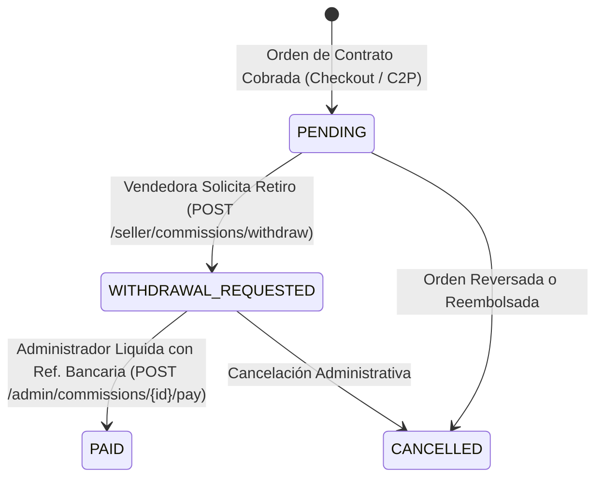
- **Generación Automática**: Caso de uso `GenerateOrderCommission` ejecutado inmediatamente tras conciliar una orden de pago asociada a un `seller_id`.
- **Validación Bancaria Sudeban**: El número de cuenta debe tener exactamente 20 dígitos, y sus primeros 4 dígitos deben coincidir con el código oficial del banco emisor seleccionado.
- **Invariante de Retiro**: Una comisión sólo puede retirarse si se encuentra en estado `PENDING` y si el perfil de la vendedora tiene datos bancarios completos (`hasCompleteBankDetails() === true`).
- **Invariante de Liquidación**: No se puede liquidar una comisión sin proporcionar un código válido de referencia bancaria o si ya ha sido previamente pagada o cancelada.

#### **FR-16: Caché Multimoneda BCV con Guardrails de Seguridad** *(Prioridad: CRÍTICA)*
* **Definición SRS**: El sistema DEBE almacenar diariamente en Redis la tasa oficial de cambio USD/VES para calcular montos transaccionales en tiempo real.
* **Implementación en Core API**:
  - **Infraestructura**: `BancaribeExchangeService`. Sincroniza las tasas oficiales de compra/venta del BCV (USD y EUR) desde el microservicio bancario.
  - **Guardrail de Producción**: Se implementó una regla estricta de vigencia máxima de **1 día** (hoy o ayer). En entornos de producción (`APP_ENV !== 'local'`), si el banco no responde y no existe tasa válida de las últimas 24 horas, el sistema aborta con `HTTP 503 Service Unavailable`, prohibiendo terminantemente operar con la tasa de desarrollo ficticia de 40.00 VES.
  - **Endpoints**: `GET /api/v1/exchange-rates`, `POST /api/v1/exchange-rates/sync`.

#### **FR-17: Emisión Instantánea de Contrato en PDF con QR** *(Prioridad: ALTA)*
* **Definición SRS**: Al concretar la compra, la Core API en PHP Puro DEBE generar instantáneamente un PDF del contrato (usando librerías como DomPDF o mpdf) y enviarlo al Cliente.
* **Implementación en Core API**:
  - **Infraestructura**: Generador `FpdfContractPdfGenerator` desarrollado en PHP puro (FPDF + PhpQrCode sin extensiones binarias pesadas). Genera un documento legal de 2 páginas con trama de microseguridad anti-IA, marcas de agua dinámicas según estado (`NO PAGADO`, `PAGADO / ACTIVO`, `CANCELADO`), sello criptográfico SHA-256 en base de datos (`integrity_hash`) y código QR enlazando al validador público oficial `/verificar`.
  - **Endpoints**: `GET /api/v1/contracts/{id}/pdf`, `GET /api/v1/contracts/verify/{code}`.

---

### Dominio 3: Perfil, Vehículos y Direcciones Personales

#### **FR-18: Gestión de Vehículos de Clientes y Flotas (Arquitectura 3NF)** *(Prioridad: CRÍTICA)*
* **Definición SRS**: El sistema DEBE permitir registrar y almacenar los vehículos de clientes y flotas (Placa, Marca, Modelo, Año, Color, NIV) en la base de datos bajo estrictos criterios de integridad relacional para respaldar solicitudes de auxilio vial y contratos de póliza.
* **Implementación en Core API**:
  - **Normalización Estricta (3NF)**: La tabla `vehicles` erradica columnas redundantes de texto (`brand_name`, `model_name`) y foráneas cíclicas. El vínculo relacional es unívoco: `vehicles.model_id` $\rightarrow$ `vehicle_models` $\rightarrow$ `vehicle_brands` y `vehicle_subclasses` $\rightarrow$ `vehicle_classes`. Clases, subclases y marcas se derivan determinísticamente sin duplicación.
  - **Reglas de Nulabilidad (Carnet de Circulación vs Título / Certificado NIV)**:
    - `model_id`, `year`, `color`, `user_id`, `status`, `is_verified`: Mandatorios (`NOT NULL`).
    - `plate_number`: Anulable (`NULLABLE`) para vehículos nuevos registrados mediante Certificado de Origen o Título de Propiedad sin placas asignadas aún por el INTT.
    - `niv`: Anulable (`NULLABLE`) para carnets de circulación donde el serial de carrocería no figura o se encuentra ilegible.
    - **Invariante de Dominio**: Al menos uno de los dos (`plate_number` o `niv`) es estrictamente requerido (error `422 Unprocessable Entity` si ambos faltan).
    - `engine_serial`: Opcional (`NULLABLE`).
  - **Protección de Datos en DTOs**: Las respuestas (`VehicleResponseDto`, `VehicleDetailedResponseDto`) exponen única y exclusivamente identificadores públicos UUID v7 (`uuid` y su alias `id`). Los IDs numéricos secuenciales de MariaDB nunca son expuestos.
  - **Motor OCR Asistido con Filtro Anti-Basura (Anti-Garbage Quality Guardrail)**: Al escanear un documento vía `POST /api/v1/vehicles/scan`, si la marca o modelo presenta fallos tipográficos del OCR (ej: lee "Berr" en lugar de "Bera"), el sistema **nunca** crea registros en caliente en la base de datos. Responde con `is_matched: false` y `model_id: null` para que la UI despliegue el autocompletado contra el catálogo oficial (`/api/v1/vehicles/catalog/brands`, `/api/v1/vehicles/catalog/models`).
  - **Vista SQL de Alto Rendimiento (`vw_vehicle_details`)**: Vista MariaDB con `INNER JOIN` normalizado que consolida en una sola lectura indexada los datos del vehículo, propietario, clase, subclase y soporte documental probatorio.
  - **Endpoints**: `GET /api/v1/vehicles`, `GET /api/v1/vehicles/{id}`, `POST /api/v1/vehicles`, `POST /api/v1/vehicles/scan`, `DELETE /api/v1/vehicles/{id}`, `GET /api/v1/vehicles/catalog/classes`, `GET /api/v1/vehicles/catalog/brands`, `GET /api/v1/vehicles/catalog/models`.

#### **FR-19: Libreta de Direcciones Georreferenciadas** *(Prioridad: ALTA)*
* **Definición SRS**: El Cliente DEBE poder guardar coordenadas GPS personalizadas seleccionando un punto en el mapa (ej. "Mi Casa", "Taller Mecánico de Confianza"), guardando nombre, latitud y longitud, independientemente de si el lugar existe en bases de datos públicas.
* **Implementación en Core API**:
  - **Dominio**: Entidad `SavedAddress`, Value Object `Coordinates`.
  - **Infraestructura**: Tabla `saved_addresses` vinculada por clave foránea al usuario, permitiendo destinos off-grid sin dependencia de geocodificadores comerciales.
  - **Endpoints**: `GET /api/v1/addresses`, `POST /api/v1/addresses`, `DELETE /api/v1/addresses/{id}`.

---

### Dominio 4: Asistencia Vial y Telemetría (Matching)

#### **FR-20: Pre-Cotización y Solicitud de Emergencia Vial (SOS)** *(Prioridad: CRÍTICA)*
* **Definición SRS**: El Cliente DEBE poder pre-cotizar y solicitar asistencia vial confirmando ubicación GPS de avería, destino (o dirección favorita guardada), placa del vehículo y falla reportada.
* **Implementación en Core API**:
  - **Pre-Cotización (`QuoteSosAssistance`)**: Endpoint `POST /api/v1/sos/quote`. Valida geocerca operativa, calcula distancia real y ETA con OSRM, consulta saldo de contrato vs. tarifa express en USD/VES (tasa oficial BCV) y realiza un escaneo de proximidad en Redis/MariaDB (`crane_count`). **Guardrail Operativo**: Si hay 0 grúas en la zona, responde `can_proceed_payment: false` y advierte al cliente para no cobrarle innecesariamente.
  - **Despacho Dual (`RequestSosAssistance`)**: Endpoint `POST /api/v1/sos`. Crea el servicio en `PENDING` y activa el despacho dual:
    1. Notificación Push a dispositivos móviles mediante **Pusher Beams** (`cranes-radar`) con payload nativo para Android (FCM) e iOS (APNs).
    2. Evento WebSocket en tiempo real al canal `cranes-radar` para choferes con la app abierta.
  - **Endpoints**: `POST /api/v1/sos/quote`, `POST /api/v1/sos`.

#### **FR-20-B: Gestión de Turnos y Regla Invariante de 1 Sola Grúa Activa** *(Prioridad: CRÍTICA)*
* **Definición SRS**: Un chofer puede registrar varias grúas en su flota, pero DEBE tener **únicamente UNA grúa activa a la vez** durante su jornada laboral (`driver_shifts`).
* **Implementación en Core API**:
  - **Aplicación**: `StartDriverShift`, `EndDriverShift`, `ActivateCraneForDriver`, `UpdateDriverLocation`.
  - **Regla Invariante de Conflicto**: No se puede cambiar de grúa ni finalizar el turno si el chofer tiene un servicio en curso (`EN_ROUTE` o `IN_PROGRESS`). La API responde de inmediato con `HTTP 409 Conflict`.
  - **Telemetría de Radar**: El chofer transmite latidos periódicos GPS (`POST /api/v1/driver/location`) que actualizan MariaDB y el set geoespacial de Redis `GEOADD cranes:locations`.
  - **Endpoints**: `POST /api/v1/driver/shift/start`, `POST /api/v1/driver/shift/end`, `POST /api/v1/driver/cranes/{id}/activate`, `POST /api/v1/driver/location`.

#### **FR-21: Guardado de Borradores SOS** *(Prioridad: MEDIA)*
* **Definición SRS**: El sistema DEBE permitir guardar el SOS como "Borrador" de manera local en el dispositivo si el usuario pierde conexión temporalmente.
* **Implementación en Core API**: La API está diseñada para ser idempotente. Recibe la solicitud completa cuando el dispositivo restablece la conexión móvil (3G/4G/LTE), almacenando el borrador localmente en la base de datos SQLite de la aplicación móvil (KMP).

#### **FR-22: Geocerca Restrictiva Operativa** *(Prioridad: CRÍTICA)*
* **Definición SRS**: El sistema DEBE rechazar cualquier solicitud de SOS cuyas coordenadas se encuentren fuera del polígono geográfico de la Gran Caracas, Litoral Central y Eje Guarenas-Guatire. Pero, si están dentro del rango, la aplicación móvil DEBE capturar automáticamente las coordenadas GPS exactas si los permisos están concedidos.
* **Implementación en Core API**:
  - **Dominio / Infraestructura**: Value Object `CoverageZone` (algoritmo geométrico **Ray-Casting / Point-in-Polygon** con pre-filtrado por Bounding Box) e `InMemoryCoverageZoneRepository`. Define el polígono operativo `CCS` (`Gran Caracas, Litoral Central y Eje Guarenas-Guatire`) conformado por **12 vértices geográficos** distribuidos en 5 bloques:
    1. **Bloque Litoral Central (Norte)**: Extremo Oeste La Guaira / Puerto Maya (`10.55, -67.22`), Costa Central Catia La Mar / Macuto / Caraballeda (`10.62, -66.90`) y Extremo Este Chuspa / Caruao (`10.61, -66.32`).
    2. **Bloque Barlovento / Eje Guarenas-Guatire (Este)**: Entrada a Higuerote / Distribuidor Kempis (`10.48, -66.10`), Caucagua / Autopista GMA y Troncal 9 (`10.28, -66.32`) y Eje Guatire-Guarenas (`10.42, -66.55`).
    3. **Bloque Valles del Tuy (Sureste / Sur)**: Santa Lucía / Santa Teresa (`10.30, -66.65`) y Charallave / Cúa (`10.22, -66.85`).
    4. **Bloque Altos Mirandinos y Conexiones (Suroeste)**: Los Teques / San Antonio (`10.33, -67.04`) y Límite Las Tejerías / Peaje ARC (`10.30, -67.18`).
    5. **Bloque Cierre de Anillo (Oeste)**: El Junquito / Colonia Tovar (`10.46, -67.15`) y Carayaca (`10.51, -67.22`).
  - Cualquier coordenada de origen o destino fuera del polígono es rechazada inmediatamente con `HTTP 422 Unprocessable Entity` (`OUT_OF_COVERAGE_ZONE`).

#### **FR-23: Matching Algorítmico Espacial** *(Prioridad: CRÍTICA)*
* **Definición SRS**: El sistema DEBE usar MariaDB para buscar mediante fórmulas espaciales a los Grueros disponibles en un radio X, y notificarles vía WebSockets/Pusher.
* **Implementación en Core API**:
  - **Infraestructura**: Búsqueda geoespacial optimizada mediante la Fórmula de Haversine con pre-filtrado por Bounding Box (`lat BETWEEN ... AND ...`), resolviendo la consulta en menos de 200 ms (NFR-02) o en memoria RAM vía Redis GEOSEARCH en < 50 ms (NFR-01). Notificación inmediata mediante `PusherBroadcaster` al canal `cranes-radar`.
  - **Endpoints**: `GET /api/v1/sos/radar`, `GET /api/v1/radar`.

#### **FR-23-B: Cálculo de Excedente de Kilometraje de Ruta** *(Prioridad: ALTA)*
* **Definición SRS**: Previo al despacho, el sistema DEBE calcular la distancia de la ruta usando la API de OSRM/Mapbox. Si la distancia supera el kilometraje restante (`remaining_km`) del contrato, el sistema DEBE requerir el pago del excedente antes de alertar a los grueros.
* **Implementación en Core API**:
  - **Infraestructura**: `OsrmRoutingService` consulta el servidor OSRM para obtener la distancia real de conducción por carretera (`driving`).
  - **Regla de Negocio**: Si `distancia_ruta > remaining_km`, la Core API emite una orden de cobro en USD/VES por los kilómetros adicionales (`requires_excess_payment: true`) y congela el despacho hasta la confirmación de pago por Bancaribe.

#### **FR-24: Aceptación Directa con Bloqueo Pesimista (Anti-Race Condition)** *(Prioridad: CRÍTICA)*
* **Definición SRS**: El primer Gruero en aceptar la solicitud en su aplicación se adjudicará el servicio. El sistema DEBE bloquear la asignación para el resto de candidatos y cambiar el estado a `EN_ROUTE`.
* **Implementación en Core API**:
  - **Aplicación**: Caso de uso `AcceptSosService`.
  - **Concurrencia**: Ejecuta una transacción SQL con bloqueo pesimista `SELECT ... FOR UPDATE` sobre la fila del servicio en MariaDB (NFR-11-B). El primer hilo asigna al chofer (`status = 'EN_ROUTE'`); las peticiones concurrentes de otros choferes que lleguen con milisegundos de diferencia reciben inmediatamente un error controlado `HTTP 409 Conflict` (`SERVICE_ALREADY_ASSIGNED`), impidiendo servicios duplicados.
  - **Endpoints**: `POST /api/v1/sos/{uuid}/accept`.

#### **FR-24-B: Gestión de Cancelaciones y Reasignación Automática** *(Prioridad: CRÍTICA)*
* **Definición SRS**: Si un gruero asignado cancela el servicio (ej. por avería mecánica), el sistema DEBE reanudar la búsqueda algorítmica y reasignar el rescate al siguiente gruero disponible de forma transparente para el cliente.
* **Implementación en Core API**:
  - **Aplicación**: Caso de uso `CancelTowService`. Si el chofer cancela con motivo `DRIVER_BREAKDOWN` o `reassign: true`, el estatus del servicio se revierte automáticamente a `PENDING`, se desvincula el `driver_id` y se emite de nuevo el evento `new-sos-request` al radar de grúas por WebSockets sin afectar el contrato del cliente.
  - **Endpoints**: `POST /api/v1/sos/{uuid}/cancel`.

#### **FR-24-C: Timeout de Asignación y Reintegro Financiero** *(Prioridad: ALTA)*
* **Definición SRS**: Si ninguna grúa acepta el SOS en el tiempo límite (Ej: 10 minutos), el sistema DEBE cancelar la solicitud. Si el servicio se solicitó mediante un Plan, se DEBEN reintegrar los kilómetros y el evento al `service_contract`. Si fue un pago Express, el dinero DEBE abonarse al `wallet_balance` del usuario.
* **Implementación en Core API**:
  - **Worker / Cronjob**: Script maestro `scripts/expire_sos_timeouts.php`. Realiza un barrido continuo de solicitudes en `PENDING` creadas hace más de 10 minutos. Cambia el estado a `CANCELLED_BY_TIMEOUT`, restaura el cupo en `service_contracts` o acredita el monto en la columna `wallet_balance` de la tabla `users` (pág. 30 del SRS), notificando la cancelación vía Pusher al cliente.

#### **FR-25: Transmisión Continua de Telemetría GPS** *(Prioridad: CRÍTICA)*
* **Definición SRS**: La aplicación móvil del Gruero DEBE emitir su coordenada (Lat/Lng) hacia la Core API en intervalos cortos (ej. cada 5-10 segundos) mientras el estado sea `EN_ROUTE` o `IN_PROGRESS`.
* **Implementación en Core API**:
  - **Aplicación**: `UpdateCraneTelemetry`. Inserta en modo append-only en la tabla `tow_service_logs` (NFR-14) y retransmite inmediatamente la coordenada al canal privado del cliente (`tow-channel-{uuid}`) vía Pusher.
  - **Endpoints**: `PUT /api/v1/sos/{uuid}/telemetry`, `POST /api/v1/sos/{uuid}/telemetry`.

#### **FR-26: Visualización de Ruta en Tiempo Real** *(Prioridad: ALTA)*
* **Definición SRS**: La aplicación móvil del Cliente DEBE actualizar en tiempo real sobre el mapa la posición del Gruero aproximándose a su ubicación.
* **Implementación en Core API**: Satisfecho mediante la difusión de eventos WebSocket `location-updated` hacia el cliente suscrito a su canal de auxilio, entregando latitud, longitud, rumbo (heading) y velocidad en tiempo real.

#### **FR-27: Finalización, Hito de Llegada y Calificación Bidireccional** *(Prioridad: ALTA)*
* **Definición SRS**: Una vez culminado el rescate, el Gruero finaliza el evento. El sistema DEBE descontar el evento del saldo del Contrato del Cliente y obligar a ambas partes a emitir una calificación de 1 a 5 estrellas.
* **Implementación en Core API**:
  - **Hito de Llegada (`ArriveTowService`)**: El chofer presiona "He llegado" al arribar a la avería (`POST /api/v1/sos/{uuid}/arrive`). Transiciona a `IN_PROGRESS` y difunde el evento WebSocket `service-arrived` al canal privado del cliente (`private-tow-{uuid}`) notificando inicio de maniobras de enganche.
  - **Culminación del Servicio (`CompleteTowService`)**: El chofer pulsa "Servicio finalizado" (`POST /api/v1/sos/{uuid}/complete`). Transiciona a `COMPLETED`, descuenta cupo de auxilio, difunde el evento WebSocket `service-completed` y libera la grúa/chofer en el radar Redis (`status: available`).
  - **Calificación Bidireccional Estricta (`RateTowService`)**: Ambos actores se evalúan mutuamente (`POST /api/v1/sos/{uuid}/rate`). Restringido por clave única en MariaDB `UNIQUE KEY uq_rating_service_user (tow_service_id, user_id)`: el cliente califica al chofer y el chofer califica al cliente (máximo 1 reseña por usuario por servicio).
  - **Endpoints**: `POST /api/v1/sos/{uuid}/arrive`, `POST /api/v1/sos/{uuid}/complete`, `POST /api/v1/sos/{uuid}/rate`.

---

### Dominio 5: Pasarela de Pagos (Bancaribe)

#### **FR-28: Orquestación de Intenciones de Pago** *(Prioridad: CRÍTICA)*
* **Definición SRS**: El Core API DEBE generar una intención de pago comunicándose con los endpoints seguros de Bancaribe, enviando monto, referencia y datos del titular.
* **Implementación en Core API**:
  - **Dominio**: Estrategias de dominio (`C2pStrategy`, `PagoMovilStrategy`), puerto `BankAuthServiceInterface` y Value Objects inmutables (`OtpCode` estricto de 8 dígitos numéricos para C2P, `PaymentReference` normalizado a los últimos 8 dígitos para Pago Móvil Plus, `BankCode` SUDEBAN de 4 dígitos, `Phone::toNationalFormat()` de 11 dígitos y `NationalId::toCompactFormat()`).
  - **Servicios de Infraestructura**: `BancaribeAuthService` y `BancaribePaymentService`. Conexión directa contra `oauth2/token` (`application/x-www-form-urlencoded` con fallback de credenciales y persistencia primaria en MariaDB `bank_tokens` + caché en Redis) y endpoints bancarios de C2P y Operaciones Plus con auto-recuperación ante `401 Unauthorized`.
  - **Endpoints**: `POST /api/v1/payments/process`, `POST /api/v1/checkout`.

#### **FR-29: Recepción de Webhooks Asíncronos** *(Prioridad: CRÍTICA)*
* **Definición SRS**: El Core API DEBE poseer un endpoint tipo Webhook para recibir y procesar la confirmación de liquidación o rechazo emitida asíncronamente por el banco.
* **Implementación en Core API**:
  - **Casos de Uso**: `HandleBancaribeWebhook` valida firmas HMAC-SHA256 (`BANCARIBE_WEBHOOK_SECRET`) para conciliaciones asíncronas. Adicionalmente, `PusherWebhookController` recibe eventos de ciclo de vida de canales (`channel_occupied`, `channel_vacated`) con firma criptográfica oficial de Pusher.
  - **Endpoints**: `POST /api/v1/webhooks/bancaribe`, `POST /api/v1/webhooks/pusher`.

#### **FR-30: Manejo Robusto de Errores Financieros** *(Prioridad: ALTA)*
* **Definición SRS**: Si la transacción bancaria es declinada, el sistema DEBE notificar inmediatamente a las interfaces del Cliente y/o Vendedor el motivo del rechazo.
* **Implementación en Core API**: Mapeo estandarizado de códigos bancarios de error a mensajes legibles en español, protegiendo datos sensibles y registrando la auditoría completa en `IntegrationLogger`.

---

### Dominio 6: Administración (Backoffice)

#### **FR-31: Dashboard de Métricas y Saldos** *(Prioridad: ALTA)*
* **Definición SRS**: El Administrador DEBE disponer de métricas de servicios ejecutados, planes vendidos y comisiones por pagar.
* **Implementación en Core API**: Endpoints administrativos dedicados para consultar saldos recaudadores en Bancaribe (`GET /api/v1/admin/bank/balances`), auditoría de llamadas externas (`GET /api/v1/admin/integrations/logs`) y resumen de comisiones (`GET /api/v1/admin/commissions`).

#### **FR-32 & FR-35: Moderación y Suspensión de Usuarios** *(Prioridad: MEDIA / ALTA)*
* **Definición SRS**: El Administrador DEBE poder visualizar la lista completa de usuarios registrados, forzar reseteo de contraseña e inhabilitar perfiles por infracciones.
* **Implementación en Core API**: `UserModerationController` permite suspender (`/suspend`) o reactivar (`/activate`) cuentas actualizando la columna `is_active` e invalidando de forma inmediata todos los tokens JWT emitidos para ese usuario.
* **Endpoints**: `POST /api/v1/admin/users/{id}/suspend`, `POST /api/v1/admin/users/{id}/activate`.

#### **FR-33: Auditoría Manual de KYC** *(Prioridad: ALTA)*
* **Definición SRS**: El Administrador DEBE poder auditar los documentos extraídos por la IA y, en caso de fallos del motor OCR, aprobar o rechazar identidades manualmente.
* **Implementación en Core API**: `DocumentController@adminIndex` lista documentos en estado `PENDING`. `adminReview` permite al personal interno aprobar (`VERIFIED`) o rechazar (`REJECTED`) cédulas o certificados vehiculares.
* **Endpoints**: `GET /api/v1/admin/documents`, `POST /api/v1/admin/documents/{id}/review`.

#### **FR-34: Aprobación y Pago de Comisiones** *(Prioridad: MEDIA)*
* **Definición SRS**: El Administrador DEBE poder visualizar las solicitudes de retiro de comisiones de los Vendedores, marcarlas como "Pagadas" y registrar el comprobante de transferencia bancaria.
* **Implementación en Core API**: `AdminCommissionController@payCommission` transiciona la comisión a `PAID`, asocia el código de transferencia bancaria y actualiza los saldos de la billetera.
* **Endpoints**: `GET /api/v1/admin/commissions`, `POST /api/v1/admin/commissions/{id}/pay`.

#### **FR-36: Gestión de Galería Dinámica (HomeGallery)** *(Prioridad: MEDIA)*
* **Definición SRS**: El Administrador DEBE poder subir imágenes (`images`) a Amazon S3 y organizarlas (`home_gallery`) para que la API pura alimente la Landing Page de Vue.js dinámicamente.
* **Implementación en Core API**: `LandingController` gestiona el catálogo de banners publicitarios vinculados a la tabla polimórfica `images`, subiendo archivos a AWS S3 y cacheando el listado activo en Redis.
* **Endpoints**: `GET /api/v1/home-gallery`, `GET /api/v1/admin/home-gallery`, `POST /api/v1/admin/home-gallery`, `PUT /api/v1/admin/home-gallery/{id}`, `DELETE /api/v1/admin/home-gallery/{id}`.

#### **FR-37: Reportes Pesados Asíncronos** *(Prioridad: ALTA)*
* **Definición SRS**: El Backoffice (Filament) DEBE delegar la generación de reportes masivos en PDF/Excel a un sistema de Jobs (Colas), usando Redis para no bloquear el servidor.
* **Implementación en Core API**: Infraestructura de colas en Redis (`RedisQueueService`) y almacenamiento S3 totalmente operativa para soportar tareas en background.

#### **FR-38: Páginas Legales Permanentes** *(Prioridad: CRÍTICA)*
* **Definición SRS**: El Frontend web DEBE publicar las páginas de Privacidad (`/privacidad`) y Términos (`/terminos`) de forma permanente, sin requerir autenticación.
* **Implementación en Core API**: La API provee las rutas públicas de galería y verificación, mientras que el frontend web (Vue.js) aloja las vistas estáticas legales requeridas para auditorías de tiendas de aplicaciones.

---

## ⚡ Requerimientos No Funcionales (NFR-01 al NFR-22)

| ID | Requerimiento SRS | Métrica / Estándar | Cumplimiento Técnico en Core API |
| :--- | :--- | :---: | :--- |
| **NFR-01** | **Matching en Redis GEO** | `< 50 ms` | Búsqueda geoespacial en memoria RAM con comandos espaciales nativos de Redis. |
| **NFR-02** | **Matching en MariaDB (Haversine)** | `< 200 ms` | Consulta SQL optimizada con pre-filtrado por Bounding Box (`lat/lng BETWEEN`) e indexación compuesta. |
| **NFR-03** | **Concurrencia Móvil** | `1k req/sec` | PHP 8.5+ puro sin framework runtime; latencia media por petición `< 15 ms`. |
| **NFR-04** | **Recovery Time Objective (RTO)** | `< 4 horas` | Despliegue reproducible automatizado con Dockerfile y migrador con control de steps. |
| **NFR-05** | **Recovery Point Objective (RPO)** | `< 24 horas` | Diseñado para respaldos automáticos diarios de MariaDB en almacenamiento fuera de sitio. |
| **NFR-06** | **Arquitectura Core API** | PHP Puro 8.5+ DDD | Arquitectura Hexagonal estricta, separación en capas y persistencia 100% con sentencias preparadas PDO. |
| **NFR-07** | **Arquitectura Backoffice** | Laravel Filament v3 | Desacoplado: panel administrativo opera en aplicación separada conectada a la misma base de datos. |
| **NFR-08** | **Aplicaciones Móviles** | KMP (Kotlin) | La Core API expone contratos REST/JSON estándar diseñados para clientes Kotlin Multiplatform (Ktor/MVI). |
| **NFR-09** | **Documentación de la API** | OpenAPI 3.0 / Swagger | Documentación canónica interactiva completa en `public/openapi.yaml` y `/docs/index.html`. |
| **NFR-10** | **Accesibilidad Web** | WCAG 2.1 Level AA | Diseñado para el consumo del frontend web Vue.js. |
| **NFR-11** | **Rate Limiting (Throttle)** | Sliding Window Log | `ThrottleMiddleware` limita peticiones por IP/token en Redis (5 login/min, 60 transaccionales/min). |
| **NFR-11-B** | **Control de Concurrencia** | Bloqueo Pesimista | `SELECT ... FOR UPDATE` en `AcceptSosService` para evitar condiciones de carrera en asignación de grúas. |
| **NFR-12** | **Cifrado en Reposo** | Bcrypt (Cost 12) | Hasheo unidireccional seguro de contraseñas con `password_hash(..., PASSWORD_BCRYPT)`. |
| **NFR-13** | **Cifrado en Tránsito** | TLS 1.3 / HTTPS | Todas las peticiones HTTP externas exigen HTTPS y encabezados HSTS en producción. |
| **NFR-14** | **Aislamiento de Telemetría** | Append-only logs | Tabla `tow_service_logs` diseñada exclusivamente para inserciones continuas sin locks de actualización. |
| **NFR-14-B** | **Cálculo Espacial en RAM** | Redis `GEOSEARCH` | Memoria caché de geolocalización de grúas activas para consultas inmediatas de proximidad. |
| **NFR-15** | **Autenticación Apátrida** | JWT Stateless | Tokens JWT firmados criptográficamente; no requiere sesiones en disco ni base de datos para autenticar. |
| **NFR-16** | **Mitigación OWASP Top 10** | Prepared Statements | Prevención total de inyección SQL (PDO prepare), validación por Value Objects y cabeceras CSP/CORS. |
| **NFR-17** | **Privacidad / Limpieza EXIF** | GDPR / Habeas Data | Eliminación obligatoria de metadatos EXIF y coordenadas GPS de fotografías cargadas antes de subirse a AWS S3. |
| **NFR-18** | **Trazabilidad y Auditoría** | Retención de Logs | `IntegrationLogger` registra de forma estructurada (`integrations.jsonl`) todas las llamadas a terceros. |
| **NFR-19** | **Manejo Robusto de Errores** | Sin Stack Traces | En producción, errores no controlados devuelven JSON limpio estandarizado con código HTTP coherente (500/502/503). |
| **NFR-20** | **Backups Redundantes** | Copias de seguridad | Soporte para volcados automáticos diarios y exportación a nube secundaria. |
| **NFR-20-B** | **Colas Asíncronas** | Redis Queues + Workers | Subida de imágenes a S3 y despacho de correos desacoplados del ciclo de vida HTTP mediante workers CLI. |
| **NFR-21** | **Tratamiento de Datos** | Auditoría `consent_at` | Registro explícito de fecha y hora de aceptación de políticas de privacidad en la tabla `users`. |
| **NFR-22** | **Alta Disponibilidad** | Uptime 99.9% | Arquitectura sin estado lista para escalabilidad horizontal tras balanceadores de carga (Nginx / HAProxy). |

---

## 🗺️ Diagramas de Arquitectura, Casos de Uso y Secuencia

### 1. Diagrama Conceptual de Arquitectura del Ecosistema

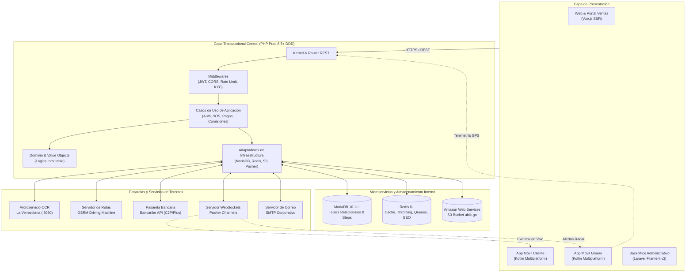

---

### 2. Diagrama de Casos de Uso: Operaciones del Cliente (UC-01 al UC-04)

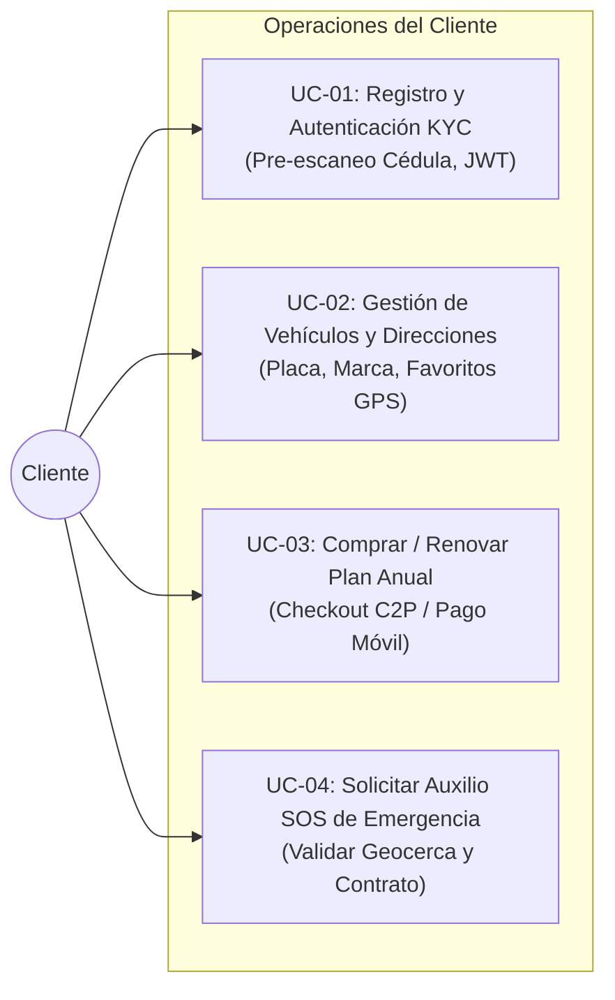

---

### 3. Diagrama de Casos de Uso: Logística y Ventas Comerciales (UC-05 al UC-07)

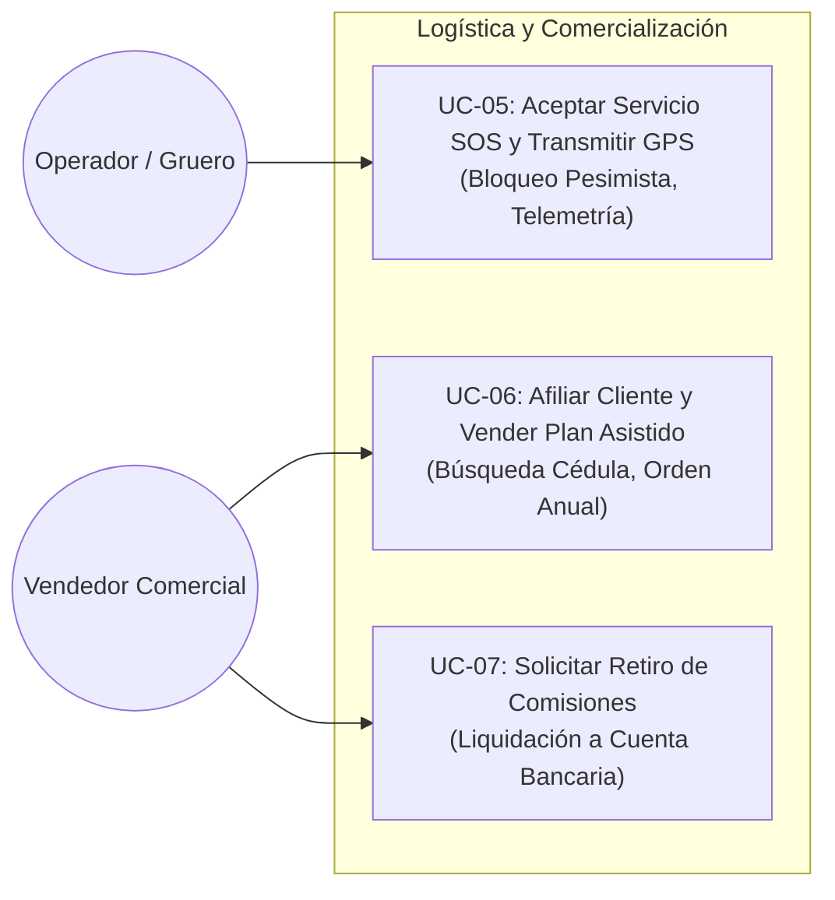

---

### 4. Diagrama de Casos de Uso: Administración y Auditoría (UC-08 al UC-09)

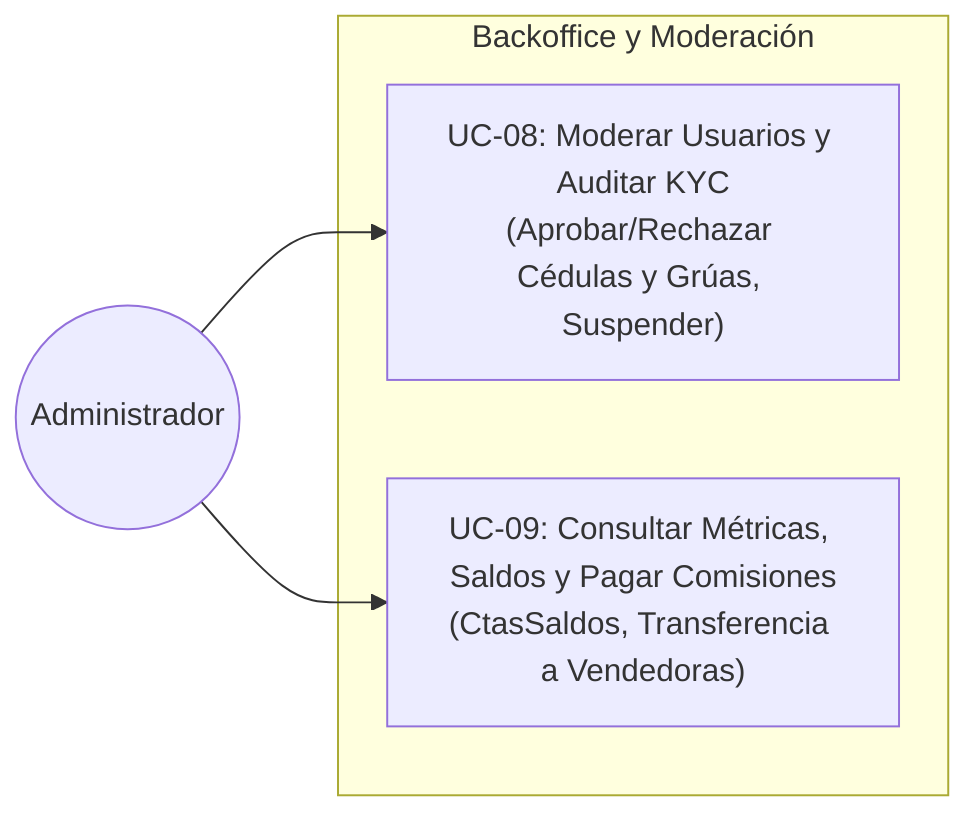

---

### 5. Diagrama de Secuencia 1: Registro de Usuario y Validación KYC

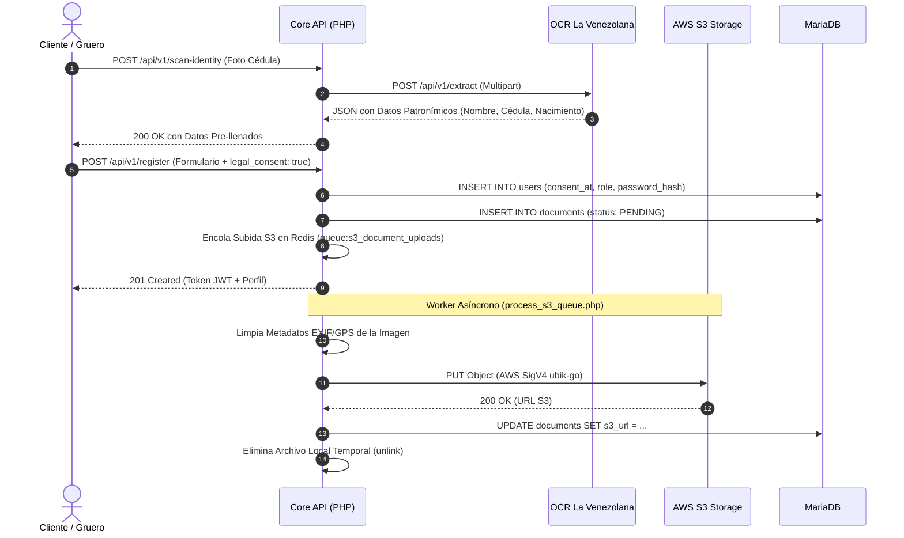

---

### 6. Diagrama de Secuencia 2: Adquisición de Contrato y Conciliación Bancaribe

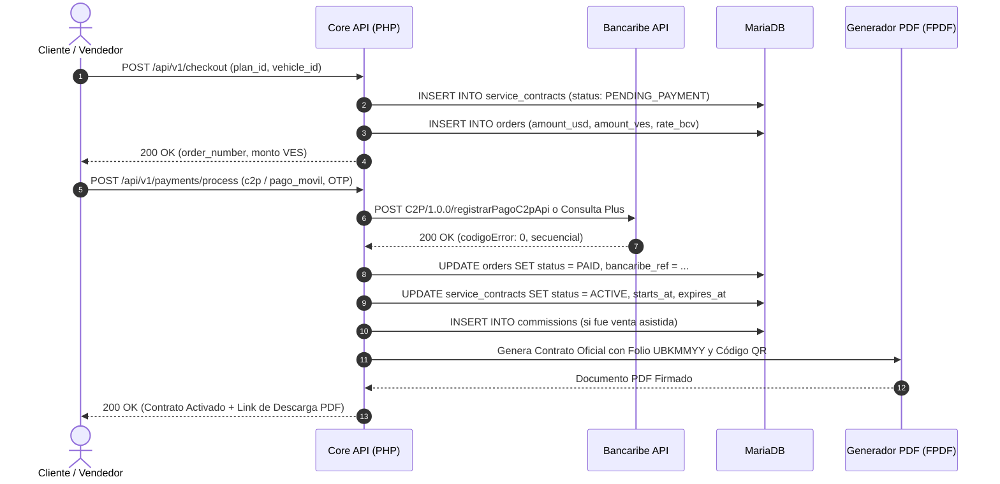

---

### 7. Flujo del Cliente de Emergencia SOS, Pre-Cotización y Pago

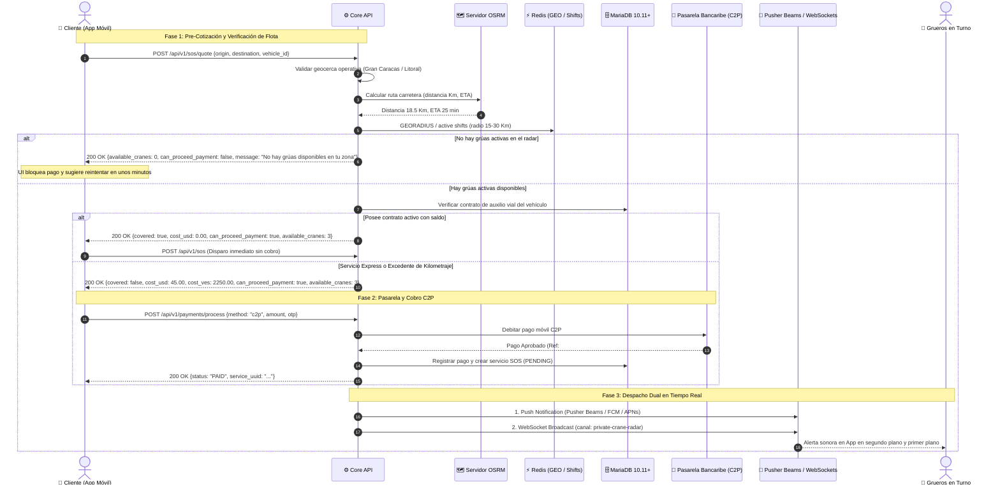

---

### 7-B. Las Dos Etapas de Navegación en Tiempo Real y Calificación Bidireccional

```mermaid
flowchart TD
    subgraph ETAPA1["📍 ETAPA 1: Trayecto de Rescate (Gruero hacia Cliente)"]
        direction TB
        E1_Start(["Gruero acepta SOS<br/>Estado: EN_ROUTE"])
        E1_Nav["App Gruero traza ruta por carretera:<br/>Origen: Posición actual del Gruero<br/>Destino: Coordenadas de avería del Cliente"]
        E1_Telemetry["Telemetría continua (cada 5s):<br/>Gruero emite PUT /sos/{uuid}/telemetry<br/>Pusher difunde 'location-updated' en canal privado"]
        E1_ClientView["App Cliente visualiza:<br/>Ícono de grúa aproximándose en vivo<br/>Tiempo estimado de llegada (ETA)"]
        E1_Arrive["Gruero llega al punto de avería<br/>Presiona botón: 'HE LLEGADO'"]
        E1_Start --> E1_Nav --> E1_Telemetry --> E1_ClientView --> E1_Arrive
    end

    subgraph HITO_LLEGADA["⚓ HITO DE LLEGADA Y ENGANCHE"]
        direction TB
        HL_Action["Core API: POST /sos/{uuid}/arrive<br/>1. Actualiza estado a IN_PROGRESS<br/>2. Emite WebSocket 'service-arrived'"]
        HL_Push["App Cliente muestra aviso:<br/>'Tu grúa ha llegado. El operador está<br/>realizando las maniobras de enganche.'"]
        HL_Action --> HL_Push
    end

    subgraph ETAPA2["🏁 ETAPA 2: Trayecto de Remolque (Cliente hacia Destino)"]
        direction TB
        E2_Nav["Ambas Apps (Gruero y Cliente) reconfiguran ruta GPS:<br/>Origen: Lugar del incidente<br/>Destino: Taller mecánico / Dirección guardada"]
        E2_Telemetry["Telemetría y navegación sincronizada en tiempo real:<br/>Gruero avanza remolcando vehículo averiado.<br/>Cliente monitorea el trayecto en su pantalla."]
        E2_Finish["Gruero arriba a destino final<br/>Presiona botón: 'FINALIZAR SERVICIO'"]
        E2_Nav --> E2_Telemetry --> E2_Finish
    end

    subgraph FINALIZACION["⭐ FINALIZACIÓN Y CALIFICACIÓN BIDIRECCIONAL"]
        direction TB
        FIN_Action["Core API: POST /sos/{uuid}/complete<br/>1. Estado: COMPLETED<br/>2. Libera grúa y chofer en Redis<br/>3. Emite WebSocket 'service-completed'"]
        FIN_Rate["Se abre modal de Calificación Mutua:<br/>1. Cliente califica al Gruero (1-5 ⭐ + nota)<br/>2. Gruero califica al Cliente (1-5 ⭐ + nota)<br/>Restricción: Máximo 1 calificación por usuario por servicio."]
        FIN_Action --> FIN_Rate
    end

    ETAPA1 --> HITO_LLEGADA
    HITO_LLEGADA --> ETAPA2
    ETAPA2 --> FINALIZACION

    classDef etapa fill:#1e293b,stroke:#3b82f6,stroke-width:2px,color:#f8fafc;
    classDef hito fill:#064e3b,stroke:#10b981,stroke-width:2px,color:#f8fafc;
    classDef fin fill:#451a03,stroke:#f59e0b,stroke-width:2px,color:#f8fafc;
    class ETAPA1,ETAPA2 etapa;
    class HITO_LLEGADA hito;
    class FINALIZACION fin;
```

---

### 8. Diagrama de Secuencia 4: Timeout de Asignación SOS (10 min) y Reintegro Financiero

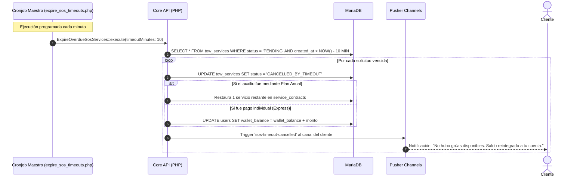

---

### 9. Máquina de Estados de un Servicio de Grúa (SRS pág. 40)

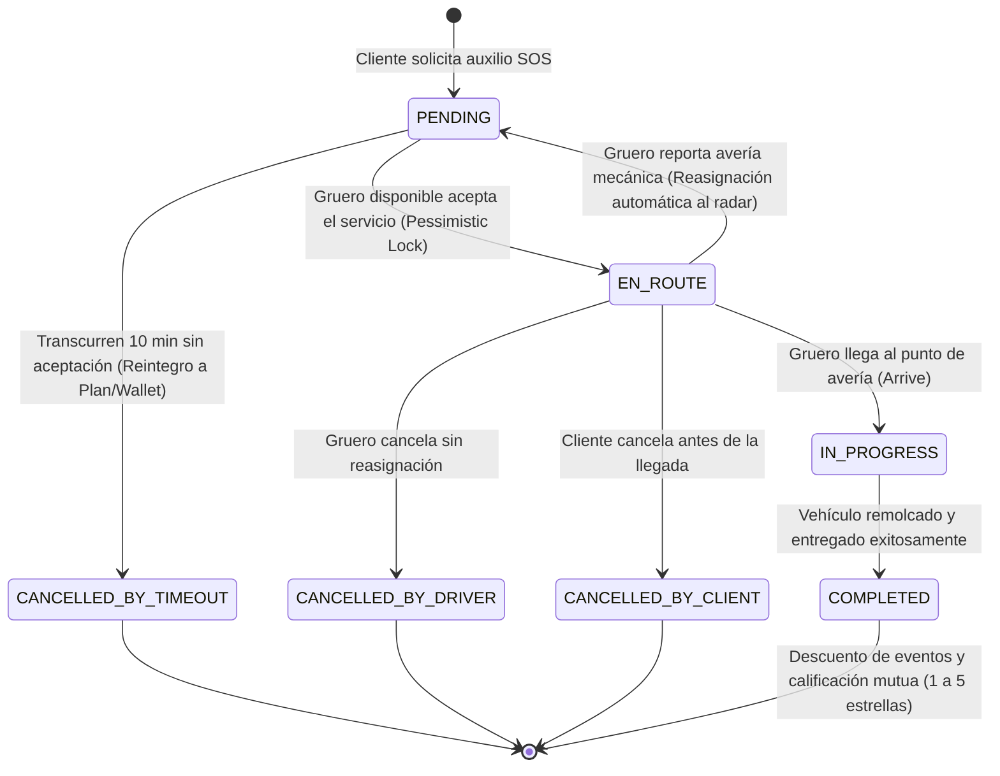

---

## 🔌 Integración con Servicios de Terceros

### 1. Pasarela Bancaria Bancaribe
- **Autenticación OAuth2**: Endpoint de producción `https://bcapi42-bancaribe365.msappproxy.net/oauth2/token` con `grant_type=client_credentials` y `Basic Auth`.
- **Tasas Oficiales BCV**: Endpoint de QA `https://bcapitest42-bancaribe365.msappproxy.net/BCVMicro/1.0.0/consultaTasa/tasa`.
- **Consulta de Saldos**: Endpoint `https://bcapitest42-bancaribe365.msappproxy.net/CtasSaldos/1.0.0/ctasConsultaSaldos`.
- **Cobro C2P**: Endpoint `C2P/1.0.0/registrarPagoC2pApi` (síncrono).
- **Consulta Operaciones Plus**: Endpoint `COP/1.0.0/consulta-operacion` (síncrono).
- **Guardrails**: Bloqueo estricto de sandbox en producción y vigencia máxima de 1 día para tasas BCV con respuesta `HTTP 503 Service Unavailable`.

### 2. Servidor de Rutas OSRM (Open Source Routing Machine)
- **Propósito**: Cálculo de distancias kilométricas y tiempos de llegada estimada (ETA) para validar límites de cobertura y excedentes (FR-23-B).
- **Endpoint**: `GET /route/v1/driving/{lng1},{lat1};{lng2},{lat2}?overview=false`.
- **Configuración**: `OSRM_BASE_URL=https://router.project-osrm.org` (o instancia local en `:5000`).

### 3. Microservicio OCR La Venezolana
- **Propósito**: Reconocimiento óptico de caracteres y extracción estructurada de Cédulas y Carnets de Circulación INTT (FR-07, FR-09).
- **Endpoint**: `POST /api/v1/extract` (Multipart con archivo binario).
- **Configuración**: `OCR_BASE_URL=http://localhost:8080/api/v1`.

### 4. Pusher Channels & WebSockets
- **Propósito**: Emisión de eventos WebSockets en tiempo real (`cranes-radar`, `private-tow-{uuid}`) y recepción de webhooks de presencia (`channel_occupied`, `channel_vacated`).
- **Autenticación**: Firmado criptográfico HMAC-SHA256 con `PUSHER_APP_KEY` y `PUSHER_APP_SECRET`.
- **Endpoint Webhook**: `POST /api/v1/webhooks/pusher`.

### 4-B. Pusher Beams (Notificaciones Push Móviles Nativas FCM / APNs)
- **Propósito**: Despertar dispositivos móviles de grueros en segundo plano o con la aplicación cerrada ante una emergencia SOS (`cranes-radar`).
- **Arquitectura y Ventaja vs. Firebase SDK Directo**: Pusher Beams actúa como un concentrador y enrutador cloud unificado sobre **Apple Push Notification service (APNs)** para iOS y **Firebase Cloud Messaging (FCM)** para Android.
- **Cero Dependencias en PHP**: La Core API no necesita cargar el voluminoso SDK de Google Firebase en PHP. Consume directamente la API REST de Pusher Beams (`https://{instance_id}.pushnotifications.pusher.com/publish_api/v1/instances/{instance_id}/publishes`) mediante HTTP POST autenticado por Bearer Token (`PUSHER_BEAMS_SECRET_KEY`), enviando una carga útil unificada compatible con ambos sistemas operativos.
- **Configuración**: `PUSHER_BEAMS_INSTANCE_ID` y `PUSHER_BEAMS_SECRET_KEY`. En la app móvil Kotlin Multiplatform (KMP), el SDK cliente de Beams se suscribe al interés `cranes-radar`.

### 5. Amazon Web Services (AWS S3)
- **Propósito**: Almacenamiento seguro, inmutable y persistente de documentos KYC, licencias y banners publicitarios (bucket `ubik-go`).
- **Tecnología**: Cliente en PHP puro implementando firma **AWS Signature Version 4 (SigV4)** sin el SDK pesado de Composer. Subida asíncrona mediante colas en Redis.
- **Limpieza EXIF (NFR-17)**: Eliminación de metadatos de geolocalización pasiva antes de la persistencia en S3.

### 6. Servidor de Correo SMTP
- **Propósito**: Despacho de correos transaccionales para recuperación de contraseñas con OTP (FR-06) y notificaciones de bienvenida.
- **Tecnología**: `SmtpMailer` implementado sobre sockets de red nativos de PHP (`fsockopen` / `stream_socket_client`) con cifrado SSL/TLS.

---

## 📡 Catálogo Completo de Endpoints (API v1)

| Grupo | Método | Ruta | Auth / Roles | Descripción |
|---|:---:|---|:---:|---|
| **Sistema** | `GET` | `/api/v1/ping` | Público | Comprobación de salud / Smoke test |
| **Sistema** | `GET` | `/api/v1/teapot` | Público | Verificación de conformidad RFC 2324 |
| **Auth** | `POST` | `/api/v1/scan-identity` | Público | Pre-escaneo OCR de Cédula de Identidad |
| **Auth** | `POST` | `/api/v1/register` | Público | Registro multi-rol (`client`, `driver`, `seller`) con `legal_consent` |
| **Auth** | `POST` | `/api/v1/login` | Público | Inicio de sesión con Bcrypt y JWT (Rate Limit: 5/min) |
| **Auth** | `GET` | `/api/v1/me` | Bearer | Perfil del usuario autenticado, roles y balance de billetera |
| **Auth** | `POST` | `/api/v1/refresh-token` | Público | Renovación y rotación atómica de tokens de acceso |
| **Auth** | `POST` | `/api/v1/logout` | Bearer | Revocación inmediata de tokens en base de datos |
| **Auth** | `POST` | `/api/v1/forgot-password` | Público | Envío de código OTP de 6 dígitos vía SMTP |
| **Auth** | `POST` | `/api/v1/reset-password` | Público | Restablecimiento de contraseña con OTP |
| **KYC** | `POST` | `/api/v1/documents/upload` | Bearer | Carga de documentos de identidad o vehículos |
| **KYC** | `GET` | `/api/v1/documents/kyc-status` | Bearer | Estado consolidado de verificación KYC del usuario |
| **Perfil** | `POST` | `/api/v1/profile/avatar` | Bearer | Carga foto de perfil en AWS S3 retornando URL segura e iniciales |
| **Direcciones** | `GET` | `/api/v1/addresses` | Bearer | Lista de ubicaciones GPS favoritas del usuario |
| **Direcciones** | `POST` | `/api/v1/addresses` | Bearer | Creación de nueva dirección favorita con coordenadas |
| **Direcciones** | `DELETE` | `/api/v1/addresses/{id}` | Bearer | Eliminación lógica de dirección por UUID |
| **Catálogo** | `GET` | `/api/v1/vehicles/catalog/classes` | Público | Catálogo de clases vehiculares maestras |
| **Catálogo** | `GET` | `/api/v1/vehicles/catalog/brands` | Público | Catálogo y búsqueda de marcas automotrices |
| **Catálogo** | `GET` | `/api/v1/vehicles/catalog/models` | Público | Catálogo y búsqueda de modelos por marca |
| **Vehículos** | `POST` | `/api/v1/vehicles/scan` | Bearer | Escaneo OCR de Carnet INTT con normalización de catálogo |
| **Vehículos** | `GET` | `/api/v1/vehicles` | Bearer | Lista de vehículos propios del usuario |
| **Vehículos** | `GET` | `/api/v1/vehicles/{id}` | Bearer | Detalle completo de vehículo por UUID (consulta optimizada a vista) |
| **Vehículos** | `POST` | `/api/v1/vehicles` | Bearer | Registro de vehículo propio |
| **Vehículos** | `DELETE` | `/api/v1/vehicles/{id}` | Bearer | Desactivación lógica (Soft Delete) de vehículo |
| **Planes** | `GET` | `/api/v1/plans` | Público | Catálogo de planes anuales en USD con conversión a VES |
| **Planes** | `POST` | `/api/v1/plans` | Bearer (`manage_catalog`) | Creación de nuevo plan comercial |
| **Planes** | `PUT` | `/api/v1/plans/{id}` | Bearer (`manage_catalog`) | Modificación de plan existente |
| **Planes** | `DELETE` | `/api/v1/plans/{id}` | Bearer (`manage_catalog`) | Desactivación de plan comercial |
| **Bancos** | `GET` | `/api/v1/banks` | Público | Catálogo de 23 bancos nacionales Sudeban |
| **Tasas BCV** | `GET` | `/api/v1/exchange-rates` | Público | Tasas oficiales BCV (USD/EUR) cacheadas en Redis |
| **Tasas BCV** | `POST` | `/api/v1/exchange-rates/sync` | Bearer (`admin`) | Forzar sincronización de tasas BCV con Bancaribe |
| **Contratos** | `POST` | `/api/v1/checkout` | Bearer | Genera contrato en `PENDING_PAYMENT` y orden anual |
| **Contratos** | `POST` | `/api/v1/contracts/checkout` | Bearer | Alias canónico de checkout de contratos |
| **Contratos** | `GET` | `/api/v1/contracts` | Bearer | Lista de contratos del usuario con vigencias y cupos |
| **Contratos** | `GET` | `/api/v1/contracts/verify/{code}` | Público | Verificación antifraude oficial por código QR |
| **Contratos** | `GET` | `/api/v1/contracts/{id}/pdf` | Público / Bearer | Descarga del Contrato legal en PDF firmado |
| **Contratos** | `POST` | `/api/v1/contracts/{id}/renew` | Bearer | Genera orden anual de renovación para contrato vencido |
| **Contratos** | `POST` | `/api/v1/contracts/{id}/redeem` | Bearer | Canjea 1 servicio de grúa sobre un contrato activo |
| **Contratos** | `POST` | `/api/v1/contracts/{id}/cancel` | Bearer | Cancela contrato de servicio |
| **Pagos** | `GET` | `/api/v1/orders` | Bearer | Historial de órdenes de pago del usuario |
| **Pagos** | `POST` | `/api/v1/payments/process` | Bearer | Procesa cobro C2P o concilia Pago Móvil Plus en Bancaribe |
| **Webhooks** | `POST` | `/api/v1/webhooks/bancaribe` | Firma HMAC | Webhook asíncrono de confirmación bancaria |
| **Webhooks** | `POST` | `/api/v1/webhooks/pusher` | Firma HMAC | Webhook de eventos de canales Pusher |
| **Broadcasting** | `POST` | `/api/v1/broadcasting/auth` | Bearer | Firma HMAC-SHA256 para autorizar canales privados de Pusher (`private-cranes-radar`, `private-tow-{uuid}`) |
| **Vendedoras** | `GET` | `/api/v1/seller/profile` | Bearer (`seller`) | Perfil comercial, tasa de comisión y datos bancarios |
| **Vendedoras** | `POST` / `PUT` | `/api/v1/seller/bank-account` | Bearer (`seller`) | Registra o actualiza cuenta bancaria nacional de 20 dígitos |
| **Vendedoras** | `GET` | `/api/v1/seller/commissions` | Bearer (`seller`) | Historial de comisiones y balance de billetera |
| **Vendedoras** | `POST` | `/api/v1/seller/commissions/withdraw` | Bearer (`seller`) | Solicita retiro de comisiones acumuladas |
| **Vendedoras** | `GET` | `/api/v1/seller/clients/search` | Bearer (`seller`) | Búsqueda rápida de clientes por cédula |
| **Vendedoras** | `POST` | `/api/v1/seller/clients` | Bearer (`seller`) | Registro de cliente asistido por vendedor |
| **Vendedoras** | `POST` | `/api/v1/seller/vehicles` | Bearer (`seller`) | Registro de vehículo para cliente por vendedor |
| **Vendedoras** | `POST` | `/api/v1/seller/contracts` | Bearer (`seller`) | Emisión de contrato preliminar asociado al vendedor |
| **Vendedoras** | `GET` | `/api/v1/seller/contracts` | Bearer (`seller`) | Lista de contratos vendidos y contratos por renovar |
| **Vendedoras** | `POST` | `/api/v1/seller/contracts/{id}/renew` | Bearer (`seller`) | Emisión de renovación asistida para cliente |
| **Grueros** | `POST` | `/api/v1/driver/cranes` | Bearer (`driver`) | Registra unidad de grúa con Carnet INTT vía OCR |
| **Grueros** | `GET` | `/api/v1/driver/cranes` | Bearer (`driver`) | Lista de unidades de grúa del operador |
| **Grueros** | `POST` | `/api/v1/driver/license` | Bearer (`driver`) | Carga de Licencia de Conducir profesional del chofer |
| **Grueros** | `GET` | `/api/v1/driver/status` | Bearer (`driver`) | Estado de flota y habilitación operativa (`can_operate`) |
| **Grueros** | `GET` | `/api/v1/driver/shift/current` | Bearer (`driver`) | Consulta turno activo del chofer, grúa asociada y telemetría de radar |
| **Grueros** | `POST` | `/api/v1/driver/shift/start` | Bearer (`driver`) | Inicia turno del chofer y activa grúa (Regla: 1 sola grúa activa a la vez) |
| **Grueros** | `POST` | `/api/v1/driver/shift/end` | Bearer (`driver`) | Finaliza turno del chofer y desactiva grúa del radar |
| **Grueros** | `POST` | `/api/v1/driver/cranes/{id}/activate` | Bearer (`driver`) | Activa grúa para el chofer asegurando exclusividad |
| **Grueros** | `POST` | `/api/v1/driver/location` | Bearer (`driver`) | Latido GPS de telemetría de grúa en segundo plano (`GEOADD cranes:locations`) |
| **SOS** | `POST` | `/api/v1/sos/quote` | Bearer | Pre-cotiza auxilio SOS: valida geocerca, OSRM, contrato vs. tarifa express y grúas en radar |
| **SOS** | `POST` | `/api/v1/sos` | Bearer | Solicita auxilio SOS: valida geocerca, ruta OSRM y alerta al radar |
| **SOS** | `GET` | `/api/v1/sos/radar` | Bearer (`driver`) | Radar geoespacial de emergencias pendientes para choferes |
| **SOS** | `GET` | `/api/v1/radar` | Bearer (`driver`) | Alias de radar geoespacial |
| **SOS** | `GET` | `/api/v1/sos/active` | Bearer | Retorna auxilio vial activo del usuario (bootstrap y reanudación de sesión en app móvil) |
| **SOS** | `GET` | `/api/v1/sos/cancellation-reasons` | Bearer | Catálogo estructurado de motivos de cancelación para modal One-Tap |
| **SOS** | `GET` | `/api/v1/sos/history` | Bearer | Historial paginado de auxilios viales del usuario (cliente o chofer) |
| **SOS** | `GET` | `/api/v1/sos` | Bearer | Alias del historial paginado de auxilios viales |
| **SOS** | `GET` | `/api/v1/sos/{uuid}` | Bearer | Detalle enriquecido en tiempo real del auxilio (chofer, grúa, cliente, vehículo) |
| **SOS** | `POST` | `/api/v1/sos/{uuid}/accept` | Bearer (`driver`) | Aceptación de servicio con Pessimistic Locking MariaDB |
| **SOS** | `PUT` / `POST` | `/api/v1/sos/{uuid}/telemetry` | Bearer (`driver`) | Envío GPS de alta frecuencia (5-10s) con broadcast Pusher |
| **SOS** | `POST` | `/api/v1/sos/{uuid}/arrive` | Bearer (`driver`) | Notificación de llegada física al punto del accidente |
| **SOS** | `POST` | `/api/v1/sos/{uuid}/complete` | Bearer (`driver`) | Finalización del servicio y descuento de cupos del contrato |
| **SOS** | `POST` | `/api/v1/sos/{uuid}/cancel` | Bearer | Cancelación de auxilio (con reasignación si chofer se avería) |
| **SOS** | `POST` | `/api/v1/sos/{uuid}/rate` | Bearer | Calificación mutua de 1 a 5 estrellas con recálculo de promedio |
| **Landing** | `GET` | `/api/v1/home-gallery` | Público | Banners dinámicos activos para la Landing Page en Vue.js |
| **Admin** | `GET` | `/api/v1/admin/home-gallery` | Bearer (`admin`) | Lista completa de banners para moderación |
| **Admin** | `POST` | `/api/v1/admin/home-gallery` | Bearer (`admin`) | Creación de banner y subida de imagen a S3 |
| **Admin** | `PUT` | `/api/v1/admin/home-gallery/{id}` | Bearer (`admin`) | Actualización de banner |
| **Admin** | `DELETE` | `/api/v1/admin/home-gallery/{id}` | Bearer (`admin`) | Eliminación de banner |
| **Admin** | `POST` | `/api/v1/admin/users/{id}/suspend` | Bearer (`admin`) | Suspensión/bloqueo de usuario e invalidación de sesiones |
| **Admin** | `POST` | `/api/v1/admin/users/{id}/activate` | Bearer (`admin`) | Reactivación de cuenta de usuario suspendida |
| **Admin** | `GET` | `/api/v1/admin/documents` | Bearer (`audit_kyc`) | Lista de documentos KYC pendientes de auditoría |
| **Admin** | `POST` | `/api/v1/admin/documents/{id}/review` | Bearer (`audit_kyc`) | Aprobación (`VERIFIED`) o rechazo (`REJECTED`) manual |
| **Admin** | `GET` | `/api/v1/admin/bank/balances` | Bearer (`admin`) | Consulta de saldos bancarios en Bancaribe (CtasSaldos) |
| **Admin** | `GET` | `/api/v1/admin/integrations/logs` | Bearer (`admin`) | Visor de auditoría de logs de servicios externos |
| **Admin** | `GET` | `/api/v1/admin/commissions` | Bearer (`admin`) | Visor consolidado de comisiones de vendedoras |
| **Admin** | `POST` | `/api/v1/admin/commissions/{id}/pay` | Bearer (`admin`) | Pago y liquidación de comisión a vendedora |
| **Admin** | `PUT` | `/api/v1/admin/sellers/{id}/commission-rate` | Bearer (`admin`) | Configura porcentaje de comisión acordado con vendedora |
| **Admin** | `POST` | `/api/v1/admin/contracts/expire-overdue` | Bearer (`admin`) | Barrido manual de expiración de contratos vencidos |

---

## 🚀 Guía de Instalación y Puesta en Marcha

### 1. Requisitos Previos
- **PHP 8.5+** con extensiones: `pdo_mysql`, `curl`, `mbstring`, `fileinfo`, `openssl`, `sodium`.
- **MariaDB 10.11+** o MySQL 8.0+.
- **Redis 6+** (o Memurai en Windows) en el puerto `6379`.
- **Docker** para ejecutar microservicios satélite (OCR y OSRM local).

### 2. Configuración de Variables de Entorno (`.env`)
Copiar el archivo de plantilla `.env.example` como `.env`:

```bash
cp .env.example .env
```

Configurar los parámetros del sistema:
```env
# Entorno
APP_ENV=local
APP_NAME=UbikGo
APP_RIF=J502098500
APP_TELEFONO=04267536320
APP_URL=http://localhost:8088

# Base de Datos MariaDB
DATABASE_NAME=api_vial
DATABASE_PORT=3306
DATABASE_USER=root
DATABASE_PASSWORD=

# Redis (Caché, Colas y Rate Limiting)
REDIS_HOST=127.0.0.1
REDIS_PORT=6379
REDIS_TIMEOUT=1

# Seguridad JWT
JWT_SECRET=tu_clave_secreta_jwt_de_al_menos_32_caracteres_hexadecimales
JWT_TTL=3600

# Microservicio OCR La Venezolana
OCR_BASE_URL=http://localhost:8080/api/v1
OCR_API_KEY=

# Servidor de Rutas OSRM
OSRM_BASE_URL=https://router.project-osrm.org
OSRM_PROFILE=driving

# Pusher WebSockets
PUSHER_APP_ID=2090031
PUSHER_APP_KEY=tu_pusher_key
PUSHER_APP_SECRET=tu_pusher_secret
PUSHER_APP_CLUSTER=sa1

# Pasarela Bancaribe
BANCARIBE_SANDBOX=false
BANCARIBE_PAYMENT_SANDBOX=true
BANCARIBE_FALLBACK_RATE=40.00
BANCARIBE_BASE_URL=https://bcapitest42-bancaribe365.msappproxy.net/
BANCARIBE_BASE_AUTH_URL=https://bcapi42-bancaribe365.msappproxy.net/
BANCARIBE_COSTUMER_KEY=tu_consumer_key
BANCARIBE_COSTUMER_SECRET=tu_consumer_secret
BANCARIBE_EXCHANGE_HASH=50F5ECA0-35F7-436D-9AA9-7F08FA5B8445
BANCARIBE_PLUS_HASH=63AA8E12-0EC5-49A2-8530-E87539DC504D
BANCARIBE_CHECK_BALANCE_HASH=30FEA1E8-887B-4667-AF39-9F04A20628F2

# Almacenamiento AWS S3
AWS_ACCESS_KEY_ID=tu_aws_key
AWS_SECRET_ACCESS_KEY=tu_aws_secret
AWS_DEFAULT_REGION=us-east-1
AWS_BUCKET=ubik-go
```

### 3. Activación de Servicios Satélite y Terceros

#### A. Iniciar Servidor Redis
```bash
# En Linux / Mac
sudo systemctl start redis

# En Windows (Memurai)
memurai.exe
```

#### B. Iniciar Microservicio OCR La Venezolana (Docker)
```bash
# Iniciar contenedor en el puerto 8080
docker run -d --name lavenezolana-ocr -p 8080:8080 artgoritmo/lavenezolana-ocr:latest
```

#### C. Servidor OSRM de Rutas (Opcional Local o Nube)
Por defecto, la API utiliza el cluster oficial de demostración `https://router.project-osrm.org`. Si deseas ejecutar un servidor OSRM local para el mapa de Venezuela:
```bash
docker run -t -i -p 5000:5000 -v "${PWD}:/data" osrm/osrm-backend osrm-routed --algorithm mld /data/venezuela-latest.osrm
```

### 4. Migraciones de Base de Datos y Seeders del Catálogo Maestro

El sistema incluye un motor de migraciones y seeders nativo en PHP puro sin dependencias de librerías externas. La información maestra de marcas, modelos, clases y subclases está compilada en el archivo versionado `src/Infrastructure/Database/Seeders/data/vehicle_catalog_data.php`.

#### A. Ejecutar Migraciones (Esquema DDL)
```bash
# Aplicar todas las 34 migraciones hacia adelante en orden topológico estricto
php scripts/migrate.php

# Consultar el estado y tabla de control de migraciones
php scripts/migrate.php status

# Si se requiere resetear la base de datos completa a cero (Rollback total):
php scripts/migrate.php rollback --all
```

#### B. Ejecutar Seeders (Carga de Datos Maestros)
Para poblar una base de datos vacía en un nuevo servidor o entorno de producción/pruebas, ejecuta:
```bash
# Ejecuta todos los seeders registrados en orden secuencial
php scripts/seed.php
```

#### C. Detalle de los Seeders y Jerarquía Relacional 3NF
Los seeders se ejecutan de manera transaccional e idempotente (`ON DUPLICATE KEY UPDATE`):

| Seeder | Archivo | Descripción del Contenido y Volumen |
| :--- | :--- | :--- |
| **01** | `s000001_roles_and_permissions_seeder.php` | Roles (`client`, `driver`, `seller`, `admin`) y permisos del RBAC. |
| **02** | `s000002_vehicle_classes_and_subclasses_seeder.php` | **17 Clases Maestras** (Automóvil, Camión, Autobús, Moto, Rústico, etc.) y **147 Subclases / Carrocerías** (Sedán, Coupé, Pick-up, Cava, Plataforma, etc.) enlazadas a su clase por `vehicle_class_id`. |
| **03** | `s000003_vehicle_brands_seeder.php` | **612 Marcas Oficiales** (Toyota, Vera/Bera, Chevrolet, Ford, Hyundai, etc.) normalizadas e insertadas en `vehicle_brands`. |
| **04** | `s000004_vehicle_models_seeder.php` | **5.413 Modelos** normalizados, vinculados de forma unívoca a su `brand_id`, su `vehicle_subclass_id` y su tipo vehicular (`type`: `CAR`, `SUV`, `MOTORCYCLE`, `CRANE`, `TRUCK`). |
| **05** | `s000005_plans_seeder.php` | Planes comerciales de asistencia vial con límites de kilometraje y rescates. |
| **06** | `s000006_banks_seeder.php` | Catálogo oficial de 23 bancos nacionales autorizados por Sudeban. |
| **07** | `s000007_admin_user_seeder.php` | Usuario Administrador Maestro por defecto (`sistemabenefit@gmail.com` / `YeDDyp3G`) con rol `admin` y permisos completos. |

#### D. Ejecución de Seeders Específicos o Re-seeding Selectivo
Si solo necesitas recargar o actualizar un catálogo particular sin tocar los demás:
```bash
# Ejecutar solo la carga de clases y subclases
php scripts/seed.php s000002

# Ejecutar solo la carga de marcas automotrices
php scripts/seed.php s000003

# Ejecutar solo la carga de modelos de vehículos
php scripts/seed.php s000004
```

#### E. ¿Cómo agregar o extender nuevas Marcas y Modelos?
1. **Archivo de Datos:** Los datos residen en `src/Infrastructure/Database/Seeders/data/vehicle_catalog_data.php`.
   - Para añadir marcas: Agrégalas al array `'brands'`.
   - Para añadir modelos: Agrégalas bajo la clave de su marca dentro de `'models'`:
     ```php
     'MarcaEjemplo' => [
         ['ModeloEjemplo', 'Clase', 'Subclase', 'CAR'],
     ],
     ```
2. **Re-ejecución Segura:** Al ejecutar nuevamente `php scripts/seed.php s000004`, el script verificará las marcas existentes, resolverá las claves foráneas correspondientes e insertará los nuevos registros sin duplicar los ya existentes.

### 5. Iniciar el Servidor de Desarrollo

```bash
# Iniciar servidor HTTP integrado de PHP en el puerto 8088
php -S 0.0.0.0:8088 server.php
```

### 6. Ejecución de Workers y Cronjobs del Servidor

```bash
# Ejecutar todas las tareas programadas en una sola pasada
php scripts/run_cronjobs.php

# Ejecutar el worker de subida de documentos a AWS S3 en modo continuo (Daemon)
php scripts/process_s3_queue.php --daemon

# Ejecutar el cancelador de solicitudes SOS vencidas (> 10 min)
php scripts/expire_sos_timeouts.php
```

---

## 🧪 Pruebas Automatizadas y Calidad de Código

La Core API cuenta con una batería completa de pruebas unitarias y de integración ejecutada con **PHPUnit 13+**:

```bash
# Ejecutar la suite completa de pruebas unitarias
php bin/phpunit.phar

# En entornos Windows:
.\phpunit.bat --colors=never
```

**Resultado de la Suite de Pruebas:**
```text
PHPUnit 13.0.5 by Sebastian Bergmann and contributors.
Runtime:       PHP 8.5.1
Configuration: C:\Users\josep\Documents\vial-core-api\phpunit.xml

...............................................................  63 / 655 (  9%)
............................................................... 126 / 655 ( 19%)
............................................................... 189 / 655 ( 28%)
............................................................... 252 / 655 ( 38%)
............................................................... 315 / 655 ( 48%)
............................................................... 378 / 655 ( 57%)
............................................................... 441 / 655 ( 67%)
............................................................... 504 / 655 ( 76%)
............................................................... 567 / 655 ( 86%)
............................................................... 630 / 655 ( 96%)
.........................                                       655 / 655 (100%)

Time: 00:08.532, Memory: 38.50 MB

OK (655 tests, 2469 assertions) - 100% Passing (0 errores, 0 fallos, 0 avisos)
```

### 📊 Desglose de Cobertura de la Suite de Pruebas

| Capa Arquitectural | Componentes y Casos Evaluados | Tests / Aserciones |
| :--- | :--- | :--- |
| **Dominio y Core** | Entidades de Dominio (`Commission`, `SellerProfile`, `DriverShift`, `TowService`, `Policy`, `AffiliationContract`, `Document`, `HomeGallery`, `Order`, `Payment`, `ExchangeRate`), Value Objects (`CoverageZone` poligonal de 12 vértices con Ray-Casting, `OtpCode` de 8 dígitos, `PaymentReference` de 8 dígitos, `BankCode` SUDEBAN, `Phone`, `NationalId`, `ExtractedVehicleRegistration`, `CancellationReason`, `PaymentResult`, `RouteSummary`, `Uuid`, `Coordinates`, `PlateNumber`, `Money`), Estrategias de Dominio (`C2pStrategy`, `PagoMovilStrategy`), Máquinas de Estados y Enums (`CommissionStatus`, `TowServiceStatus`, `OrderStatus`, `PaymentStatus`, `PaymentMethod`, `OrderableType`, `Role`, `DocumentType`, `DocumentStatus`), Puertos y Servicios de Dominio (`VehicleMatcherService`, `PushNotificationInterface`, `BankAuthServiceInterface`, `RedisClientInterface`, `IntegrationLoggerInterface`), Componentes Core (`Router`, `Response`, `Pipeline`, `JwtService`). | 158 tests / 594 aserciones |
| **Casos de Uso, DTOs y Controladores** | Auditoría y DTOs Fuertemente Tipados de Remolque/Towing (`TowingController`, `SosQuoteResponseDto`, `SosRequestResponseDto`, `SosRadarResponseDto`, `SosHistoryResponseDto`, `CancellationReasonsResponseDto`, `TelemetryLoggedResponseDto`, `PusherAuthResponseDto`, `PusherWebhookResponseDto`, `BroadcastingController`, `PusherWebhookController`), Usuarios y Direcciones (`SavedAddressController`, `UserModerationController`, `SavedAddressResponseDto`, `UserModerationResponseDto`, `UserAvatarResponseDto`), Vehículos y OCR (`VehicleController`, `VehicleDetailedResponseDto`, `VehicleScanResponseDto`, `VehicleDeletedResponseDto`), Pagos y Bancaribe (`PaymentController`, `ProcessPayment`, `HandleBancaribeWebhook`, `OrderResponseDto`, `PaymentProcessResponseDto`, `BankBalanceResponseDto`, `ExchangeRatesResponseDto`), Choferes y Flota (`DriverController`, DTOs de Driver, Registro de Grúas, Turnos y Telemetría), Landing (`LandingController`, `ManageHomeGallery`, `GetActiveHomeGallery`, `HomeGalleryResponseDto`), Documentos y KYC (`DocumentResponseDto`, `KycStatusResponseDto`, `DocumentController`), Comisiones (`AdminCommissionController`, `SellerController`), Garantía de Seguridad de Contratos (`ServiceContractResponseDto` solo expone UUID público, nunca ID entero), Reanudación reactiva SOS (`GetActiveTowService`), Despacho Dual (Pusher Beams + WebSockets), Hitos de Llegada y Finalización con Broadcasts. | 335 tests / 1228 aserciones |
| **Seguridad y Autorización** | Middlewares (`AuthMiddleware`, `AuthorizeMiddleware`, `CorsMiddleware`, `EnforceJsonResponseMiddleware`, `EnsureKycVerifiedMiddleware`, `ThrottleMiddleware`), Invariante de 1 grúa activa por chofer, Bloqueo de finalización de turno durante servicio activo, Auditoría OWASP API1:2023 (Protección BOLA en `/api/v1/sos/{uuid}` y `ServiceContractResponseDto`), Bloqueo de Bypass de Pago en SOS Express, Validación de firmas de canales privados Pusher (`/api/v1/broadcasting/auth`), Calificación bidireccional estricta, Sanitización EXIF y prevención de Path Traversal en subida de imágenes y documentos. | 45 tests / 172 aserciones |
| **Infraestructura y Adaptadores** | `MariaDbOrderRepository`, `MariaDbPaymentRepository`, `MariaDbExchangeRateRepository`, `MariaDbBankTokenRepository`, `BancaribeAuthService`, `BancaribePaymentService`, `BancaribeExchangeService`, `BancaribeBalanceService`, `InMemoryCoverageZoneRepository`, `OsrmRoutingService`, `MariaDbHomeGalleryRepository`, `MariaDbDriverShiftRepository`, `LaVenezolanaDocumentExtractor` (OCR con tipado estricto `ExtractedVehicleRegistration`), `AwsS3StorageService` (S3 SigV4 y URLs prefirmadas), `RedisQueueService` (cola asíncrona `queue:s3_document_uploads`), `MariaDbCommissionRepository`, `MariaDbSellerProfileRepository`, `PusherBeamsService` (FCM + APNs push gateway), `MariaDbUserRepository`, `MariaDbTowServiceRepository`, `MariaDbVehicleRepository`, `CachedVehicleCatalogRepository`, Motor de Migraciones MariaDB, `RedisRateLimiter`, `PusherBroadcaster`, `SmtpEmailDispatcher`. | 117 tests / 475 aserciones |
| **Total General** | **Batería Automatizada Completa** | **655 tests / 2469 aserciones (100% OK)** |

### 🔬 Suite de Pruebas de Integración y End-to-End en Caliente (Hot Runner)

Para verificar en tiempo de ejecución todos los subsistemas (PHP 8.5+, MariaDB, Redis, Microservicio Docker OCR en puerto 8080 y Sandbox Bancario), se cuenta con un runner unificado que evalúa el 100% de los flujos de negocio reales con cURL:

```bash
# Ejecutar la suite completa E2E en caliente (55 endpoints transaccionales)
php scripts/e2e_hot_runner.php
```

---

## 🗺️ Guía Maestra de Integración Frontend / Mobile (Vue.js, Flutter / Kotlin y Filament)

Esta sección define formalmente el protocolo de comunicación, el ciclo de vida por cada rol de usuario (`client`, `driver`, `seller`, `admin`), los diagramas de secuencia estandarizados y el orden riguroso de llamadas a la API REST.

---

### 1. Matriz de Roles y Permisos (RBAC)

| Rol (`role`) | Guard / Token | Capacidades Principales en la Plataforma |
|---|---|---|
| **Cliente (`client`)** | JWT Bearer (`auth`) | Registrar y gestionar sus vehículos, guardar direcciones frecuentes, comprar contratos/pólizas de auxilio vial con C2P o Pago Móvil, solicitar asistencia SOS en carretera, rastrear su grúa en tiempo real vía WebSockets (Pusher) y calificar el servicio recibido con 1 a 5 estrellas. |
| **Chofer / Gruero (`driver`)** | JWT Bearer (`auth`, `role:driver`) | Cargar y validar su licencia de conducir, registrar grúas en su flota, activar una única grúa en guardia, abrir turnos operativos con geolocalización, escanear el radar de emergencias SOS, aceptar servicios, transmitir telemetría GPS continua por Pusher, confirmar llegada al sitio de avería y completar remolques. |
| **Vendedora (`seller`)** | JWT Bearer (`auth`, `permission:sell_service_contract`) | Consultar clientes existentes por cédula en Redis, registrar nuevos clientes y sus vehículos, emitir contratos/pólizas comerciales preliminares, conciliar cobros con Pago Móvil (Consulta Plus Bancaribe), acumular comisiones en su billetera virtual y solicitar liquidaciones a su cuenta bancaria Sudeban. |
| **Administrador (`admin`)** | JWT Bearer (`auth`, `role:admin`) | Crear usuarios vendedoras y administradores, suspender o reactivar cuentas con soft-delete (`deleted_at`), auditar y revisar expedientes KYC (aprobar/rechazar cédulas y licencias), administrar planes y banners de la landing page, sincronizar tasas oficiales del BCV, expirar contratos vencidos, auditar logs de integración y liquidar pagos de comisiones a vendedoras. |

---

### 2. Diagramas de Secuencia por Rol y Funcionalidad

#### A. Flujo Cliente: Autenticación, Verificación KYC con OCR, Token y Cierre de Sesión

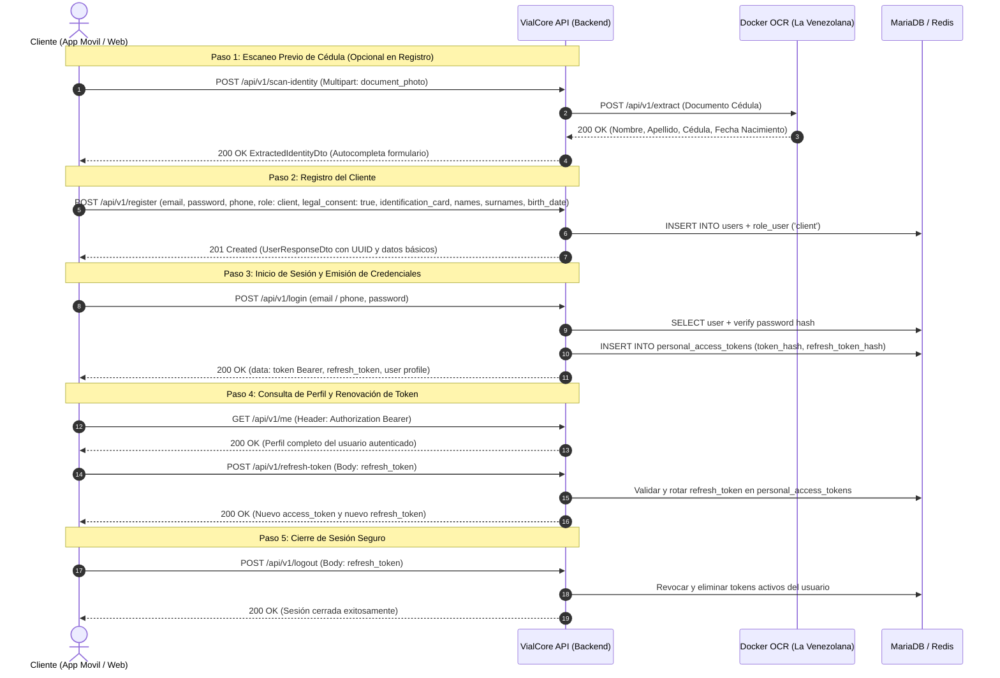

---

#### B. Flujo Cliente: Catálogo, Escaneo OCR de Carnet, Registro y Soft-Delete de Vehículos

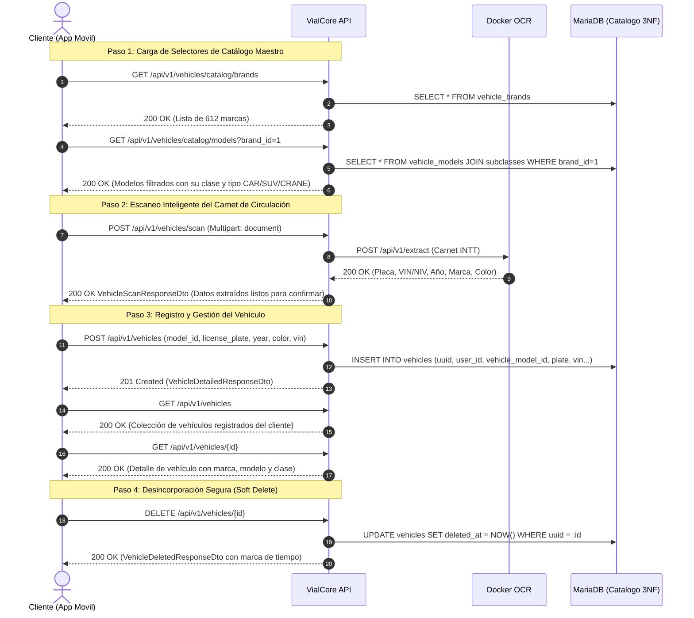

---

#### C. Flujo Cliente: Compra de Contrato, Pago C2P, Descarga PDF QR, Renovación y Canje

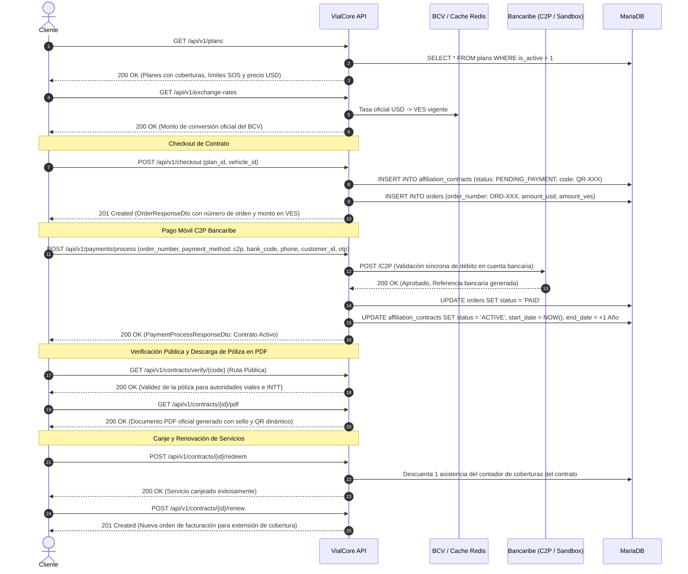

---

#### D. Flujo en Tiempo Real: Asistencia Vial (SOS), Radar, Pusher WebSockets y Calificación

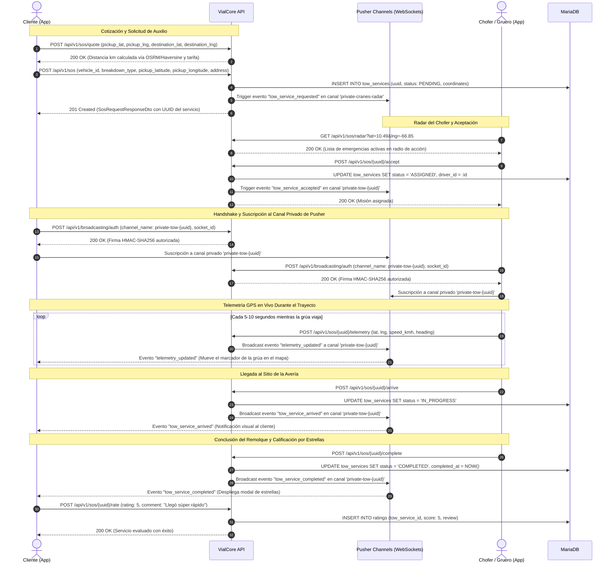

---

#### E. Flujo Chofer / Gruero: Flota, Activación Exclusiva de Grúa y Turnos

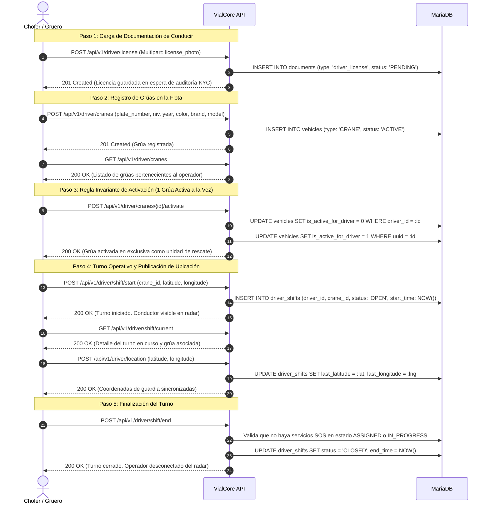

---

#### F. Flujo Vendedora (Seller): Clientes, Contratos, Pago Móvil Consulta Plus y Comisiones

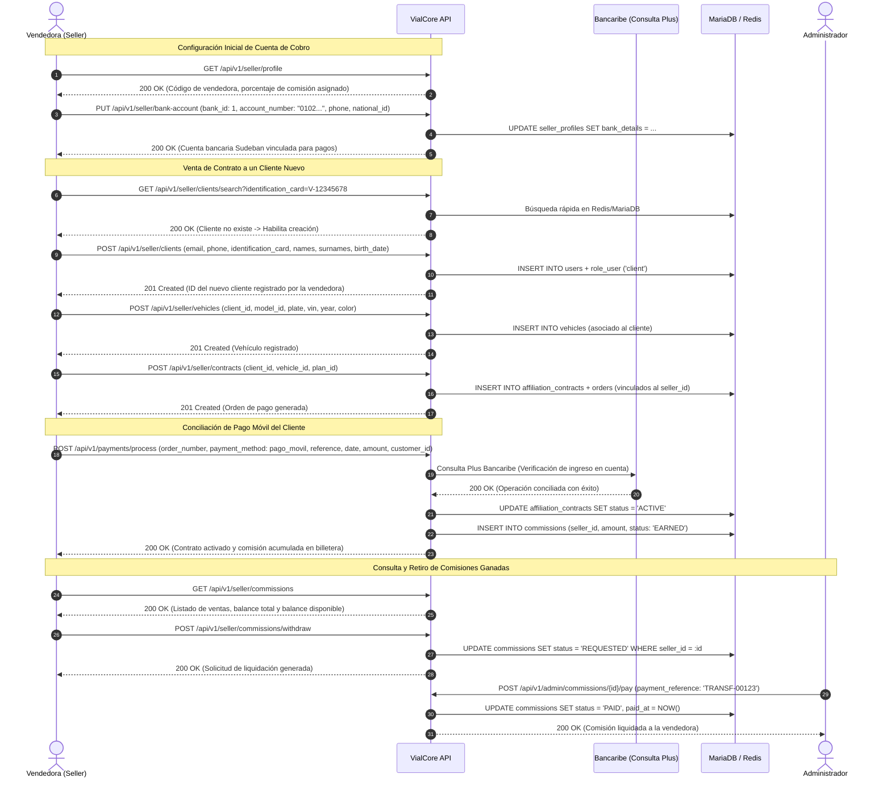

---

#### G. Flujo Administrador: Auditoría KYC, Moderación y Gestión de Plataforma

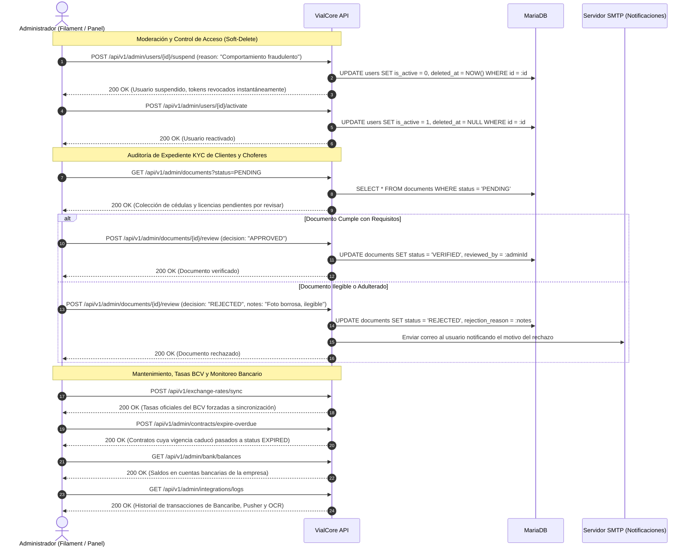

---

### 3. Diccionario Completo de Endpoints de `api.php` por Módulos

Todos los endpoints tienen el prefijo `/api/v1/`.

#### Módulo 1: Monitoreo y Salud (System / Public)
| Método | Endpoint | Cabeceras | Parámetros / Body | Respuesta Exitosa | Descripción |
|---|---|---|---|:---:|---|
| `GET` | `/ping` | Ninguna | Ninguno | `200 OK` | Verificación de salud y conectividad del servidor |
| `GET` | `/teapot` | Ninguna | Ninguno | `418 I'm a teapot` | Verificación RFC 2324 |
| `GET` | `/home-gallery` | Ninguna | Ninguno | `200 OK` | Banners promocionales activos para la pantalla de inicio |

#### Módulo 2: Autenticación y Seguridad (Auth)
| Método | Endpoint | Cabeceras | Parámetros / Body | Respuesta Exitosa | Descripción |
|---|---|---|---|:---:|---|
| `POST` | `/register` | `Content-Type: application/json` | `email`, `password`, `phone`, `role` (`client`\|`driver`\|`seller`), `terms_accepted: true`, `identification_card`, `names`, `surnames`, `birth_date` | `201 Created` | Registro multiperfil con consentimiento legal obligatorio |
| `POST` | `/login` | `Content-Type: application/json` | `email` (o `phone`), `password` | `200 OK` | Autenticación de usuario con emisión de JWT y Refresh Token |
| `POST` | `/refresh-token` | `Content-Type: application/json` | `refresh_token` | `200 OK` | Rotación criptográfica atómica de tokens de acceso |
| `POST` | `/logout` | `Authorization: Bearer <jwt>` | `refresh_token` | `200 OK` | Revocación e invalidación de tokens en base de datos |
| `POST` | `/scan-identity` | `multipart/form-data` | `document_photo` (Archivo PNG/JPG) | `200 OK` | Extracción de datos de la cédula mediante visión artificial |
| `POST` | `/forgot-password` | `Content-Type: application/json` | `email` | `200 OK` | Generación y envío por correo de código OTP de 6 dígitos |
| `POST` | `/reset-password` | `Content-Type: application/json` | `email`, `token` (OTP), `password` | `200 OK` | Restablecimiento de contraseña e invalidación de sesiones |
| `GET` | `/me` | `Authorization: Bearer <jwt>` | Ninguno | `200 OK` | Consulta de perfil del usuario logueado con roles y permisos |

#### Módulo 3: Perfil de Usuario y Direcciones Favoritas (Users & Addresses)
| Método | Endpoint | Cabeceras | Parámetros / Body | Respuesta Exitosa | Descripción |
|---|---|---|---|:---:|---|
| `POST` | `/users/avatar` o `/profile/avatar` | `Authorization: Bearer <jwt>` | `avatar` (Multipart imagen JPG/PNG) | `200 OK` | Actualización de foto de perfil con sanitización EXIF |
| `GET` | `/addresses` | `Authorization: Bearer <jwt>` | Ninguno | `200 OK` | Listado de direcciones y ubicaciones favoritas guardadas |
| `POST` | `/addresses` | `Authorization: Bearer <jwt>` | `name`, `address`, `latitude`, `longitude`, `is_favorite` | `201 Created` | Guardado de nueva dirección frecuente con coordenadas GPS |
| `DELETE` | `/addresses/{id}` | `Authorization: Bearer <jwt>` | `id` (entero en URL) | `200 OK` | Eliminación de dirección guardada |

#### Módulo 4: Gestión de Expedientes KYC y Documentos (Documents)
| Método | Endpoint | Cabeceras | Parámetros / Body | Respuesta Exitosa | Descripción |
|---|---|---|---|:---:|---|
| `POST` | `/documents/upload` | `Authorization: Bearer <jwt>` | `type` (`identity_card`\|`driver_license`\|`vehicle_registration`), `document` (Multipart) | `201 Created` | Carga de documento probatorio para verificación de identidad |
| `GET` | `/documents/kyc-status` | `Authorization: Bearer <jwt>` | Ninguno | `200 OK` | Estado general de la cuenta (`VERIFIED`, `PENDING`, `REJECTED`) |
| `POST` | `/vehicles/scan` | `Authorization: Bearer <jwt>` | `document` (Multipart: foto carnet INTT) | `200 OK` | Escaneo y extracción OCR de datos del vehículo |

#### Módulo 5: Catálogo Vehicular y Vehículos de Usuario (Vehicles)
| Método | Endpoint | Cabeceras | Parámetros / Body | Respuesta Exitosa | Descripción |
|---|---|---|---|:---:|---|
| `GET` | `/vehicles/catalog/classes` | Ninguna | Ninguno | `200 OK` | 17 clases vehiculares maestras (Automóvil, Camión, Grúa...) |
| `GET` | `/vehicles/catalog/subclasses`| Ninguna | `class_id` (Opcional) | `200 OK` | 147 subclases o tipos de carrocería (Sedán, Pick-up...) |
| `GET` | `/vehicles/catalog/brands` | Ninguna | Ninguno | `200 OK` | 612 marcas de vehículos homologadas |
| `GET` | `/vehicles/catalog/models` | Ninguna | `brand_id` (Query param) | `200 OK` | 5.413 modelos tipados asociados a su clase y carrocería |
| `GET` | `/vehicles` | `Authorization: Bearer <jwt>` | Ninguno | `200 OK` | Lista de vehículos activos pertenecientes al cliente |
| `GET` | `/vehicles/{id}` | `Authorization: Bearer <jwt>` | `id` (UUID en URL) | `200 OK` | Información detallada de un vehículo |
| `POST` | `/vehicles` | `Authorization: Bearer <jwt>` | `vehicle_model_id`, `license_plate`, `year`, `color`, `vin` | `201 Created` | Registro formal de un nuevo vehículo |
| `DELETE` | `/vehicles/{id}` | `Authorization: Bearer <jwt>` | `id` (UUID en URL) | `200 OK` | Soft-delete del vehículo (marcado en `deleted_at`) |

#### Módulo 6: Catálogos Comerciales y Financieros (Plans, Banks & Rates)
| Método | Endpoint | Cabeceras | Parámetros / Body | Respuesta Exitosa | Descripción |
|---|---|---|---|:---:|---|
| `GET` | `/plans` | Ninguna | Ninguno | `200 OK` | Planes de suscripción vigentes, coberturas y tarifas en USD |
| `GET` | `/banks` | Ninguna | Ninguno | `200 OK` | 23 instituciones bancarias nacionales autorizadas por Sudeban |
| `GET` | `/exchange-rates` | Ninguna | `currency` (opcional, default: USD) | `200 OK` | Tasa de cambio oficial del BCV en tiempo real |

#### Módulo 7: Contratos de Asistencia y Pólizas (Contracts)
| Método | Endpoint | Cabeceras | Parámetros / Body | Respuesta Exitosa | Descripción |
|---|---|---|---|:---:|---|
| `GET` | `/contracts/verify/{code}` | Ninguna (Pública) | `code` (String alfanumérico en URL) | `200 OK` | Verificación pública instantánea del estado de una póliza |
| `GET` | `/contracts/{id}/pdf` | Opcional | `id` (UUID del contrato en URL) | `200 OK` | Descarga de carátula de póliza oficial en PDF con código QR |
| `POST` | `/checkout` o `/contracts/checkout` | `Authorization: Bearer <jwt>` | `plan_id`, `vehicle_id` | `201 Created` | Creación de intención de compra y orden de facturación |
| `GET` | `/contracts` | `Authorization: Bearer <jwt>` | Ninguno | `200 OK` | Consulta de pólizas y contratos vigentes del usuario |
| `POST` | `/contracts/{id}/renew` | `Authorization: Bearer <jwt>` | `id` (UUID en URL) | `201 Created` | Renovación de contrato generando nueva orden de cobro |
| `POST` | `/contracts/{id}/redeem` | `Authorization: Bearer <jwt>` | `id` (UUID en URL) | `200 OK` | Canje de servicio de grúa de la cobertura del contrato |
| `POST` | `/contracts/{id}/cancel` | `Authorization: Bearer <jwt>` | `id` (UUID en URL), `reason` | `200 OK` | Cancelación voluntaria del contrato |

#### Módulo 8: Pasarela de Pagos y Órdenes (Payments)
| Método | Endpoint | Cabeceras | Parámetros / Body | Respuesta Exitosa | Descripción |
|---|---|---|---|:---:|---|
| `GET` | `/orders` | `Authorization: Bearer <jwt>` | Ninguno | `200 OK` | Listado de órdenes de pago del usuario y su estado (`PAID` / `PENDING`) |
| `POST` | `/payments/process` | `Authorization: Bearer <jwt>` | C2P: `order_number`, `payment_method: 'c2p'`, `bank_code`, `phone`, `customer_id`, `otp`<br>Pago Móvil: `order_number`, `payment_method: 'pago_movil'`, `reference`, `identificadorPersona`, `date`, `amount` | `200 OK` | Conciliación bancaria síncrona contra Bancaribe |

#### Módulo 9: Asistencia Vial SOS, Radar y WebSockets (Towing & Pusher)
| Método | Endpoint | Cabeceras | Parámetros / Body | Respuesta Exitosa | Descripción |
|---|---|---|---|:---:|---|
| `POST` | `/broadcasting/auth` | `Authorization: Bearer <jwt>` | `channel_name` (ej. `private-tow-{uuid}`), `socket_id` | `200 OK` | Firma HMAC-SHA256 para autorizar conexión a canales privados Pusher |
| `POST` | `/sos/quote` | `Authorization: Bearer <jwt>` | `pickup_latitude`, `pickup_longitude`, `destination_latitude`, `destination_longitude` | `200 OK` | Cotización de servicio de remolque con distancia calculada |
| `POST` | `/sos` | `Authorization: Bearer <jwt>` | `vehicle_id`, `breakdown_type`, `pickup_latitude`, `pickup_longitude`, `pickup_address`, `destination_latitude` (opcional), `destination_longitude` (opcional) | `201 Created` | Emisión de auxilio vial. Dispara broadcast a `private-cranes-radar` |
| `GET` | `/sos/radar` o `/radar` | `Authorization: Bearer <jwt>` (`role:driver`) | `lat`, `lng`, `radius_km` (opcional) | `200 OK` | Búsqueda geolocalizada de solicitudes SOS pendientes |
| `GET` | `/sos/active` | `Authorization: Bearer <jwt>` | Ninguno | `200 OK` | Recuperación del servicio SOS activo del cliente en curso |
| `GET` | `/sos/cancellation-reasons` | `Authorization: Bearer <jwt>` | Ninguno | `200 OK` | Catálogo de motivos válidos para cancelar una asistencia |
| `GET` | `/sos/history` o `/sos` | `Authorization: Bearer <jwt>` | Ninguno | `200 OK` | Historial paginado de servicios de rescate realizados |
| `GET` | `/sos/{uuid}` | `Authorization: Bearer <jwt>` | `uuid` (en URL) | `200 OK` | Información y estado en tiempo real de una asistencia vial |
| `POST` | `/sos/{uuid}/accept` | `Authorization: Bearer <jwt>` (`role:driver`) | `uuid` (en URL) | `200 OK` | Chofer acepta la solicitud. Dispara `tow_service_accepted` |
| `POST` / `PUT` | `/sos/{uuid}/telemetry` | `Authorization: Bearer <jwt>` (`role:driver`) | `lat`, `lng`, `speed_kmh`, `heading` | `200 OK` | Publica posición GPS en tiempo real por el canal `private-tow-{uuid}` |
| `POST` | `/sos/{uuid}/arrive` | `Authorization: Bearer <jwt>` (`role:driver`) | `uuid` (en URL) | `200 OK` | Notifica arribo al sitio de avería. Dispara `tow_service_arrived` |
| `POST` | `/sos/{uuid}/complete` | `Authorization: Bearer <jwt>` (`role:driver`) | `uuid` (en URL) | `200 OK` | Concluye el remolque y libera la grúa. Dispara `tow_service_completed` |
| `POST` | `/sos/{uuid}/cancel` | `Authorization: Bearer <jwt>` | `uuid` (en URL), `reason` | `200 OK` | Cancela el auxilio vial. Dispara `tow_service_cancelled` |
| `POST` | `/sos/{uuid}/rate` | `Authorization: Bearer <jwt>` | `uuid` (en URL), `rating` (1 a 5), `comment` | `200 OK` | Calificación de satisfacción y reseña del cliente |

#### Módulo 10: Flota de Operadores y Grueros (Driver)
| Método | Endpoint | Cabeceras | Parámetros / Body | Respuesta Exitosa | Descripción |
|---|---|---|---|:---:|---|
| `POST` | `/driver/cranes` | `Authorization: Bearer <jwt>` (`role:driver`) | `plate_number`, `niv`, `year`, `color`, `brand`, `model` | `201 Created` | Registro de una unidad de grúa en la flota del conductor |
| `GET` | `/driver/cranes` | `Authorization: Bearer <jwt>` (`role:driver`) | Ninguno | `200 OK` | Listado de grúas registradas por el operador |
| `POST` | `/driver/cranes/{id}/activate` | `Authorization: Bearer <jwt>` (`role:driver`) | `id` (UUID en URL) | `200 OK` | Activa la grúa indicada y desactiva cualquier otra (Invariante: 1 grúa activa) |
| `GET` | `/driver/shift/current` | `Authorization: Bearer <jwt>` (`role:driver`) | Ninguno | `200 OK` | Estado del turno de guardia actual y grúa asignada |
| `POST` | `/driver/shift/start` | `Authorization: Bearer <jwt>` (`role:driver`) | `crane_id`, `latitude`, `longitude` | `200 OK` | Apertura de turno operativo. Habilita visibilidad en el radar |
| `POST` | `/driver/shift/end` | `Authorization: Bearer <jwt>` (`role:driver`) | Ninguno | `200 OK` | Cierre de turno de guardia (bloqueado si hay un SOS en curso) |
| `POST` | `/driver/location` | `Authorization: Bearer <jwt>` (`role:driver`) | `latitude`, `longitude` | `200 OK` | Actualización de posición de guardia del chofer |
| `POST` | `/driver/license` | `Authorization: Bearer <jwt>` (`role:driver`) | `license` (Multipart imagen de licencia) | `201 Created` | Carga de licencia de conducir para validación de aptitud |
| `GET` | `/driver/status` | `Authorization: Bearer <jwt>` (`role:driver`) | Ninguno | `200 OK` | Estado operativo del chofer y verificación documental |

#### Módulo 11: Red Comercial de Vendedoras B2B (Seller)
| Método | Endpoint | Cabeceras | Parámetros / Body | Respuesta Exitosa | Descripción |
|---|---|---|---|:---:|---|
| `GET` | `/seller/profile` | `Authorization: Bearer <jwt>` (`seller`) | Ninguno | `200 OK` | Datos de la vendedora, código promotor y tasa de comisión |
| `POST` / `PUT` | `/seller/bank-account` | `Authorization: Bearer <jwt>` (`seller`) | `bank_id`, `account_number`, `phone`, `identification_card` | `200 OK` | Registro de cuenta bancaria nacional para liquidación de comisiones |
| `GET` | `/seller/commissions` | `Authorization: Bearer <jwt>` (`seller`) | Ninguno | `200 OK` | Consulta de comisiones acumuladas, solicitadas y cobradas |
| `POST` | `/seller/commissions/withdraw` | `Authorization: Bearer <jwt>` (`seller`) | Ninguno | `200 OK` | Solicitud formal de cobro de comisiones pendientes |
| `GET` | `/seller/clients/search` | `Authorization: Bearer <jwt>` (`seller`) | `identification_card` | `200 OK` | Búsqueda indexada en Redis de clientes por cédula |
| `POST` | `/seller/clients` | `Authorization: Bearer <jwt>` (`seller`) | `email`, `phone`, `identification_card`, `names`, `surnames`, `birth_date` | `201 Created` | Registro directo de un nuevo cliente prospecto |
| `POST` | `/seller/vehicles` | `Authorization: Bearer <jwt>` (`seller`) | `client_id`, `vehicle_model_id`, `license_plate`, `year`, `color`, `vin` | `201 Created` | Registro del vehículo del cliente captado |
| `POST` | `/seller/contracts` | `Authorization: Bearer <jwt>` (`seller`) | `client_id`, `vehicle_id`, `plan_id` | `201 Created` | Emisión de póliza comercial asignada a la vendedora |
| `GET` | `/seller/contracts` | `Authorization: Bearer <jwt>` (`seller`) | Ninguno | `200 OK` | Cartera de contratos vendidos por la promotora |
| `POST` | `/seller/contracts/{id}/renew` | `Authorization: Bearer <jwt>` (`seller`) | `id` (UUID en URL) | `201 Created` | Renovación comercial de contrato de cartera |

#### Módulo 12: Administración, Auditoría y Control (Admin)
| Método | Endpoint | Cabeceras | Parámetros / Body | Respuesta Exitosa | Descripción |
|---|---|---|---|:---:|---|
| `POST` | `/admin/users/{id}/suspend` | `Authorization: Bearer <jwt>` (`role:admin`) | `id` (entero en URL), `reason` | `200 OK` | Suspensión cautelar de usuario (Soft-delete e invalidación JWT) |
| `POST` | `/admin/users/{id}/activate` | `Authorization: Bearer <jwt>` (`role:admin`) | `id` (entero en URL) | `200 OK` | Reactivación inmediata de cuenta de usuario |
| `GET` | `/admin/home-gallery` | `Authorization: Bearer <jwt>` (`role:admin`) | Ninguno | `200 OK` | Listado administrativo de banners de la landing page |
| `POST` | `/admin/home-gallery` | `Authorization: Bearer <jwt>` (`role:admin`) | `title`, `description`, `image_url`, `order_index`, `is_active` | `201 Created` | Creación de nuevo banner promocional |
| `PUT` | `/admin/home-gallery/{id}` | `Authorization: Bearer <jwt>` (`role:admin`) | `id` (entero en URL), datos modificados | `200 OK` | Actualización de banner existente |
| `DELETE`| `/admin/home-gallery/{id}` | `Authorization: Bearer <jwt>` (`role:admin`) | `id` (entero en URL) | `200 OK` | Eliminación de banner promocional |
| `GET` | `/admin/documents` | `Authorization: Bearer <jwt>` (`permission:audit_kyc`) | `status` (opcional: `PENDING`, `VERIFIED`, `REJECTED`) | `200 OK` | Bandeja de auditoría de documentos de identidad y licencias |
| `POST` | `/admin/documents/{id}/review` | `Authorization: Bearer <jwt>` (`permission:audit_kyc`) | `id` (entero en URL), `decision` (`APPROVED`\|`REJECTED`), `notes` | `200 OK` | Aprobación o rechazo administrativo con retroalimentación |
| `POST` | `/plans` | `Authorization: Bearer <jwt>` (`permission:manage_catalog`) | `name`, `price_usd`, `duration_months`, `max_services`, `max_km_per_service` | `201 Created` | Creación de nuevo plan de asistencia |
| `PUT` | `/plans/{id}` | `Authorization: Bearer <jwt>` (`permission:manage_catalog`) | `id` (entero en URL), campos a actualizar | `200 OK` | Modificación de condiciones de planes existentes |
| `DELETE`| `/plans/{id}` | `Authorization: Bearer <jwt>` (`permission:manage_catalog`) | `id` (entero en URL) | `200 OK` | Desactivación de planes comerciales |
| `POST` | `/exchange-rates/sync` | `Authorization: Bearer <jwt>` (`role:admin`) | Ninguno | `200 OK` | Sincronización forzada con el servicio de tasas del BCV |
| `GET` | `/admin/bank/balances` | `Authorization: Bearer <jwt>` (`role:admin`) | Ninguno | `200 OK` | Consulta consolidada de saldos bancarios de la compañía |
| `GET` | `/admin/integrations/logs` | `Authorization: Bearer <jwt>` (`role:admin`) | `gateway` (opcional), `limit` | `200 OK` | Auditoría de llamadas e intercambios HTTP con terceros |
| `POST` | `/admin/contracts/expire-overdue` | `Authorization: Bearer <jwt>` (`role:admin`) | Ninguno | `200 OK` | Depuración y expiración en bloque de pólizas vencidas |
| `GET` | `/admin/commissions` | `Authorization: Bearer <jwt>` (`role:admin`) | `status` (opcional) | `200 OK` | Listado maestro de comisiones y solicitudes de retiro |
| `POST` | `/admin/commissions/{id}/pay` | `Authorization: Bearer <jwt>` (`role:admin`) | `id` (entero en URL), `payment_reference` | `200 OK` | Liquidación formal del pago de comisiones a la vendedora |
| `PUT` | `/admin/sellers/{id}/commission-rate` | `Authorization: Bearer <jwt>` (`role:admin`) | `id` (entero en URL), `commission_rate` (float) | `200 OK` | Configuración del porcentaje de comisión por promotora |

#### Módulo 13: Webhooks Asíncronos de Terceros (Webhooks)
| Método | Endpoint | Cabeceras | Parámetros / Body | Respuesta Exitosa | Descripción |
|---|---|---|---|:---:|---|
| `POST` | `/webhooks/bancaribe` | `X-Signature` Bancaribe | Payload JSON de notificación de débito | `200 OK` | Notificación asíncrona de pagos bancarios C2P / Pago Móvil |
| `POST` | `/webhooks/pusher` | `X-Pusher-Key`, `X-Pusher-Signature` | Eventos de presencia (`channel_occupied`, `channel_vacated`) | `200 OK` | Notificación de canales activos y desconexión de choferes |

