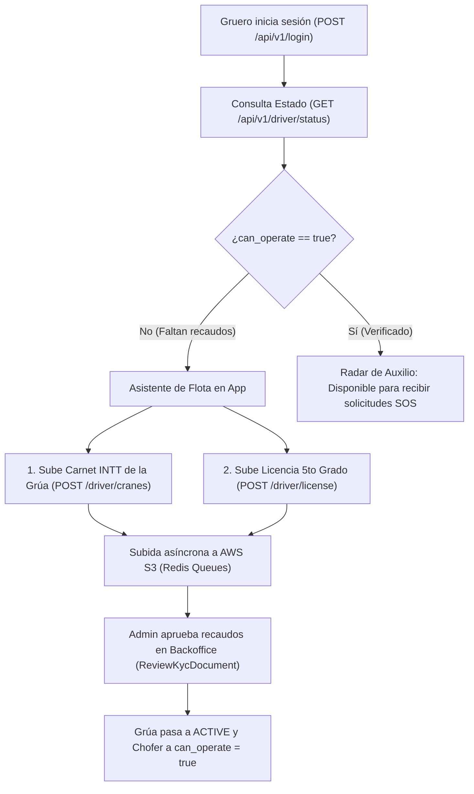

# UbikGo Core API (`vial-core-api`)

API transaccional y robusta para la plataforma de asistencia vial y gestión de grúas **UbikGo**, desarrollada en **PHP 8.5+ puro** con **Arquitectura Hexagonal (Ports & Adapters)** y **Domain-Driven Design (DDD)** sin dependencias pesadas de terceros (Zero Composer en runtime).

---

## 🏛️ Arquitectura del Sistema

```
vial-core-api/
├── bin/                        # Binarios de testing (phpunit.phar)
├── bootstrap/                  # Contenedor de inyección de dependencias (PSR-11 nativo)
│   └── container.php
├── config/                     # Configuraciones del entorno
├── database/                   # Definición de esquemas MariaDB
├── public/                     # Punto de entrada HTTP y activos públicos
│   ├── docs/                   # Swagger UI interactivo (/docs/index.html)
│   ├── index.php               # Front Controller
│   └── openapi.yaml            # Contrato canónico OpenAPI 3.0.3
├── scripts/                    # Scripts de mantenimiento (migraciones, seeders, workers y cronjobs)
│   ├── migrate.php             # Gestor de migraciones con soporte para steps y rollback controlado
│   ├── seed.php                # Seeder de clases, marcas y modelos de vehículos
│   ├── sync_bank_token.php     # Renovación proactiva de token OAuth2 Bancaribe
│   ├── sync_exchange_rates.php # Sincronización de tasas oficiales BCV (USD/EUR)
│   ├── expire_contracts.php    # Expiración automática de contratos de servicio vencidos
│   ├── expire_sos_timeouts.php # Cancelación de auxilios SOS tras 10 min y reintegro a wallet (FR-24-C)
│   ├── process_s3_queue.php    # Worker asíncrono de subida de documentos a AWS S3
│   └── run_cronjobs.php        # Ejecutor maestro de tareas programadas
├── src/
│   ├── Application/            # Casos de uso (Use Cases) y DTOs organizados por Subdominio
│   │   ├── Auth/               # Login, Registro, Tokens, Recuperación, KYC & OCR
│   │   ├── Users/              # Perfil y Libreta de Direcciones Guardadas
│   │   ├── Vehicles/           # Registro, Escaneo OCR y Catálogo de Vehículos
│   │   ├── Contracts/          # Planes, Membresías y Checkout de Contratos Anuales
│   │   ├── Payments/           # Procesamiento C2P, Pago Móvil Plus y Webhooks Bancaribe
│   │   ├── Commissions/        # Billetera de comisiones de vendedoras y retiros bancarios
│   │   └── Towing/             # Auxilio SOS, matching con grúas, telemetría y timeouts (FR-20 - FR-27)
│   ├── Controllers/            # Adaptadores primarios HTTP (REST Controllers)
│   ├── Core/                   # Micro-framework nativo (Kernel, Router, Request, Response)
│   ├── Domain/                 # Núcleo del negocio organizado por Subdominios (Bounded Contexts)
│   │   ├── Shared/             # Primitivas transversales (Uuid, Money, Coordinates, Currency)
│   │   ├── Auth/               # Autenticación, RBAC (Roles/Permissions), Tokens y Documentos KYC
│   │   ├── Users/              # Usuario, Direcciones y Value Objects de Identidad
│   │   ├── Vehicles/           # Vehículos, Catálogo Maestro y Servicio de Matching OCR
│   │   ├── Contracts/          # Planes y Contratos de Servicio Anual
│   │   ├── Payments/           # Órdenes Polimórficas, Pagos, Tasas BCV y Puertos Bancaribe
│   │   ├── Commissions/        # Comisiones comerciales y perfiles de vendedoras
│   │   └── Towing/             # Servicios de grúa, telemetría, geocercas y ratings
│   ├── Infrastructure/         # Adaptadores secundarios (MariaDB, Redis, Bancaribe, Pusher, OCR)
│   │   ├── Broadcasting/       # Adaptador Pusher Channels con firma HMAC-SHA256 en PHP puro
│   │   ├── Database/
│   │   │   ├── Migrations/     # Migraciones transaccionales con control de steps (m000001 - m000032)
│   │   │   ├── Repositories/   # Repositorios MariaDB/Redis por Subdominio (Auth, Users, Vehicles, Contracts, Payments, Towing)
│   │   │   └── Seeders/        # Seeders de roles, catálogo automotriz, bancos y planes
│   │   ├── Http/
│   │   ├── Logging/            # IntegrationLogger para auditoría de servicios de terceros
│   │   └── Services/
│   ├── Middlewares/            # Filtros de petición (JWT Auth, RBAC, KYC verification)
│   └── Routes/                 # Definición de rutas (/api/v1)
├── storage/                    # Archivos subidos KYC y logs de integraciones (integrations.jsonl)
└── tests/                      # Suite de pruebas automatizadas PHPUnit
    ├── Doubles/                # Fakes y repositorios en memoria (InMemory)
    └── Unit/                   # Pruebas unitarias de Dominio, Aplicación y Middlewares
```

---

## 🚀 Requisitos del Entorno

- **PHP**: 8.5+ con extensiones `pdo_mysql`, `curl`, `mbstring`, `fileinfo`, `openssl`, `sodium`.
- **Base de Datos**: MariaDB 10.11+ / MySQL 8.0+.
- **Caché y Throttling**: Redis 6+ / Memurai (puerto 6379).
- **Microservicio OCR**: Contenedor Docker de extracción de documentos (puerto 8080).
- **Servidor SMTP**: Mailpit / Mailtrap o SMTP corporativo para recuperación de contraseñas.

---

## 🛠️ Configuración Inicial

1. **Variables de Entorno**:
   Copiar `.env.example` a `.env` y configurar las credenciales:
   ```env
   DB_HOST=127.0.0.1
   DB_PORT=3306
   DB_DATABASE=ubikgo_core
   DB_USERNAME=root
   DB_PASSWORD=

   REDIS_HOST=127.0.0.1
   REDIS_PORT=6379

   OCR_SERVICE_URL=http://127.0.0.1:8080
   JWT_SECRET=super_secret_jwt_key_32_characters_minimum
   ```

2. **Gestión de Migraciones de Base de Datos (con Control de Steps)**:
   La Core API cuenta con un migrador con control de lotes (`step`), garantizando que un `rollback` nunca borre toda la base de datos por accidente:
   ```bash
   # Aplica todas las migraciones pendientes y les asigna el siguiente número de step
   php scripts/migrate.php

   # Muestra la tabla histórica de migraciones ejecutadas con su ID, Step y fecha
   php scripts/migrate.php status

   # Revierte ÚNICAMENTE las migraciones aplicadas en el último step (conservando los datos previos)
   php scripts/migrate.php rollback

   # Revierte las migraciones correspondientes a los últimos N steps
   php scripts/migrate.php rollback 2

   # Revierte todas las migraciones registradas (rollback integral)
   php scripts/migrate.php rollback --all
   ```

3. **Ejecutar Seeders del Catálogo Automotriz**:
   ```bash
   php scripts/seed.php
   ```

4. **Iniciar Servidor de Desarrollo**:
   ```bash
   php -S 0.0.0.0:8088 server.php
   ```

---

## 📖 Documentación OpenAPI / Swagger

La documentación interactiva completa con Swagger UI está disponible directamente en el navegador:
- **URL**: `http://localhost:8088/docs/index.html`
- **Especificación OpenAPI 3.0.3**: `http://localhost:8088/openapi.yaml`

---

## 📡 Endpoints Implementados (API v1)

### 1. Sistema
| Método | Endpoint | Descripción |
|---|---|---|
| `GET` | `/api/v1/ping` | Smoke test / Comprobación de salud |
| `GET` | `/api/v1/teapot` | Verificación de conformidad RFC 2324 |

### 2. Autenticación y Perfil
| Método | Endpoint | Auth | Descripción |
|---|---|---|---|
| `POST` | `/api/v1/scan-identity` | No | Pre-escaneo OCR de Cédula de Identidad con autocompletado y validación previa |
| `POST` | `/api/v1/register` | No | Registro multi-rol (`client`, `driver`, `seller`), validación KYC y corrección manual |
| `POST` | `/api/v1/login` | No | Inicio de sesión con Bcrypt y emisión de JWT + Refresh Token (Rate Limit: 5/min) |
| `GET`  | `/api/v1/me` | Bearer | Consulta del perfil del usuario autenticado, roles y balance de billetera |
| `POST` | `/api/v1/refresh-token` | No | Renovación y rotación atómica de tokens |
| `POST` | `/api/v1/logout` | Bearer | Revocación inmediata del Refresh Token en base de datos |
| `POST` | `/api/v1/forgot-password` | No | Envío de código OTP de 6 dígitos vía SMTP (TTL: 15 min en Redis) |
| `POST` | `/api/v1/reset-password` | No | Restablecimiento de contraseña con OTP y revocación de sesiones |

### 3. Documentos KYC y Auditoría Admin
| Método | Endpoint | Auth | Descripción |
|---|---|---|---|
| `POST` | `/api/v1/documents/upload` | Bearer | Carga o reenvío de documentos de identidad o vehiculares |
| `GET`  | `/api/v1/documents/kyc-status` | Bearer | Estado consolidado de verificación KYC del usuario |
| `GET`  | `/api/v1/admin/documents?status=PENDING` | Bearer (`audit_kyc`) | Listado de documentos KYC pendientes de revisión por un administrador |
| `POST` | `/api/v1/admin/documents/{id}/review` | Bearer (`audit_kyc`) | Aprueba (`VERIFIED`) o rechaza (`REJECTED`) un documento (activa el vehículo automáticamente) |

### 4. Direcciones Guardadas (FR-19)
| Método | Endpoint | Auth | Descripción |
|---|---|---|---|
| `GET`    | `/api/v1/addresses` | Bearer | Listado de direcciones favoritas con coordenadas GPS |
| `POST`   | `/api/v1/addresses` | Bearer | Creación de nueva dirección favorita |
| `DELETE` | `/api/v1/addresses/{id}` | Bearer | Eliminación de dirección favorita por UUID v7 |

### 5. Catálogo de Vehículos (Lectura con Caché Redis)
| Método | Endpoint | Auth | Descripción |
|---|---|---|---|
| `GET` | `/api/v1/vehicles/catalog/classes` | No | Lista de clases vehiculares maestras (Automóvil, Camión, Moto, etc.) |
| `GET` | `/api/v1/vehicles/catalog/brands?q=toy` | No | Búsqueda y listado de marcas automotrices |
| `GET` | `/api/v1/vehicles/catalog/models?brand_id=531&q=cor` | No | Búsqueda y listado de modelos por marca |

### 6. Gestión de Vehículos (FR-18)
| Método | Endpoint | Auth | Descripción |
|---|---|---|---|
| `POST`   | `/api/v1/vehicles/scan` | Bearer | Escaneo OCR de Carnet de Circulación o Título con normalización de catálogo |
| `GET`    | `/api/v1/vehicles` | Bearer | Listado de vehículos propios registrados por el usuario |
| `POST`   | `/api/v1/vehicles` | Bearer (RBAC) | Registro de vehículo propio (requiere permiso `register_vehicle`) |
| `DELETE` | `/api/v1/vehicles/{id}` | Bearer | Desactivación lógica (Soft Delete) de vehículo por UUID v7 |

### 7. Planes, Membresías y Tasas BCV (FR-11, FR-13, FR-31)
| Método | Endpoint | Auth | Descripción |
|---|---|---|---|
| `GET`    | `/api/v1/plans` | No | Catálogo de planes anuales en USD con conversión dinámica a VES (Redis Cache) |
| `POST`   | `/api/v1/plans` | Bearer (`manage_catalog`) | Crear nuevo plan en USD e invalidar caché |
| `PUT`    | `/api/v1/plans/{id}` | Bearer (`manage_catalog`) | Actualizar plan existente por UUID v7 |
| `DELETE` | `/api/v1/plans/{id}` | Bearer (`manage_catalog`) | Desactivar plan de membresía |
| `GET`    | `/api/v1/banks` | No | Catálogo de 23 bancos nacionales Sudeban (código de 4 dígitos) |
| `GET`    | `/api/v1/exchange-rates` | No | Tasas oficiales de compra/venta BCV (USD y EUR) cacheadas en Redis |
| `POST`   | `/api/v1/exchange-rates/sync` | Bearer (`admin`) | Forzar sincronización de tasas BCV con el API de Bancaribe |

### 8. Contratos de Asistencia Vial, Renovación, Canje y Verificación QR (`ContractController`, FR-12, FR-14, FR-30)
| Método | Endpoint | Auth | Descripción |
|---|---|---|---|
| `POST` | `/api/v1/checkout` | Bearer | Genera contrato en `PENDING_PAYMENT` y orden polimórfica con tasa BCV |
| `POST` | `/api/v1/contracts/checkout` | Bearer | Alias canónico de checkout de contratos de servicio |
| `GET`  | `/api/v1/contracts` | Bearer | Listado de contratos del usuario con timestamps exactos (`starts_at`, `expires_at`) y cupos disponibles |
| `GET`  | `/api/v1/contracts/verify/{code}` | Público | Validación autoritativa antifraude y cotejo de placa (`?plate=AB123CD`) con soporte Redis |
| `GET`  | `/api/v1/contracts/{id}/pdf` | Público (UUID) / Bearer | Descarga o visualiza el Contrato en PDF (2 páginas con QR y marca de agua dinámica según estado) |
| `POST` | `/api/v1/contracts/{id}/renew` | Bearer | Genera una nueva Orden de Pago anual para renovar un contrato (extiende 1 año y restaura km/viajes) |
| `POST` | `/api/v1/contracts/{id}/redeem` | Bearer | Canjea 1 servicio de grúa y descuenta los kilómetros recorridos sobre un contrato activo |
| `POST` | `/api/v1/contracts/{id}/cancel` | Bearer | Cancela un contrato de servicio (aplica marca de agua `CANCELADO` conservando el sello de pago) |
| `POST` | `/api/v1/admin/contracts/expire-overdue` | Bearer (`admin`) | Ejecuta barrido manual de expiración de contratos cuyo timestamp `expires_at` haya vencido |

### 9. Pasarela Bancaria Bancaribe, Órdenes y Pagos C2P (`PaymentController`, FR-28, FR-29)
| Método | Endpoint | Auth | Descripción |
|---|---|---|---|
| `GET`  | `/api/v1/orders` | Bearer | Historial de órdenes de pago del usuario |
| `POST` | `/api/v1/payments/process` | Bearer | Procesa cobro `c2p` (solo cliente) o `pago_movil` (cliente y vendedora vía Operaciones Plus) y activa/renueva el contrato |
| `POST` | `/api/v1/webhooks/bancaribe` | Firma HMAC | Webhook asíncrono de Bancaribe para confirmación/rechazo de pagos |
| `GET`  | `/api/v1/admin/bank/balances` | Bearer (`admin`) | Consulta de saldos disponibles/bloqueados de las cuentas recaudadoras en Bancaribe |
| `GET`  | `/api/v1/admin/integrations/logs` | Bearer (`role:admin`) | Visor de logs de integraciones de terceros (`bancaribe`, `ocr`, `osrm`, `pusher`, `s3`) |

### 10. Módulo Comercial de Vendedoras y Comisiones B2B (`role:seller`, FR-14, FR-15, FR-34)
| Método | Endpoint | Auth | Descripción |
|---|---|---|---|
| `GET`  | `/api/v1/seller/profile` | Bearer (`sell_service_contract`) | Perfil comercial, tasa de comisión asignada (`commission_rate`) y estado de datos bancarios |
| `POST` / `PUT` | `/api/v1/seller/bank-account` | Bearer (`sell_service_contract`) | Registra o actualiza cuenta bancaria nacional (20 dígitos con validación de código Sudeban, tipo, titular, CI/RIF y Pago Móvil) |
| `GET`  | `/api/v1/seller/commissions?status=...` | Bearer (`withdraw_commissions`) | Historial de comisiones generadas por venta de contratos y balance de billetera (`total_earned_usd`, `pending_balance_usd`, `withdrawal_requested_usd`, `paid_balance_usd`) |
| `POST` | `/api/v1/seller/commissions/withdraw` | Bearer (`withdraw_commissions`) | Solicita liquidación de comisiones acumuladas (exige tener cuenta bancaria registrada) |
| `GET`  | `/api/v1/seller/clients/search?identification_card=V-...` | Bearer (`sell_service_contract`) | Busca cliente por cédula (Redis + Índice Único MariaDB) y retorna sus vehículos y contratos |
| `POST` | `/api/v1/seller/clients` | Bearer (`sell_service_contract`) | Registra cliente (OCR o manual), aprueba su cédula (`VERIFIED`) y envía correo con clave aleatoria |
| `POST` | `/api/v1/seller/vehicles` | Bearer (`sell_service_contract`) | Registra vehículo para el cliente y lo aprueba automáticamente (`VERIFIED`) sin revisión de admin |
| `POST` | `/api/v1/seller/contracts` | Bearer (`sell_service_contract`) | Genera contrato preliminar (`NO PAGADO`) y orden anual vinculada a la vendedora (`seller_id`) (exige datos bancarios previos) |
| `GET`  | `/api/v1/seller/contracts?status=EXPIRED` | Bearer (`sell_service_contract`) | Lista contratos vendidos por la vendedora (y contratos vencidos para gestionar renovaciones) |
| `POST` | `/api/v1/seller/contracts/{id}/renew` | Bearer (`sell_service_contract`) | Genera nueva orden anual de renovación para un contrato vencido |
| `GET`  | `/api/v1/admin/commissions` | Bearer (`role:admin`) | Visor global de comisiones, resumen consolidado de billeteras y filtros por vendedor y estado |
| `POST` | `/api/v1/admin/commissions/{id}/pay` | Bearer (`role:admin`) | Liquida comisión a la vendedora registrando la referencia de transferencia bancaria |
| `PUT`  | `/api/v1/admin/sellers/{id}/commission-rate` | Bearer (`role:admin`) | Configura porcentaje de comisión personalizado acordado con la vendedora (ej: 15.00%) |

### 11. Operadores de Grúa y Validación de Flota (`role:driver`, FR-09, FR-10)
| Método | Endpoint | Auth | Descripción |
|---|---|---|---|
| `POST` | `/api/v1/driver/cranes` | Bearer (`role:driver`) | Registra unidad de grúa (`type: CRANE`) con Carnet INTT vía OCR y encola a AWS S3 (FR-09) |
| `GET`  | `/api/v1/driver/cranes` | Bearer (`role:driver`) | Lista las unidades de grúa registradas para el operador |
| `POST` | `/api/v1/driver/license` | Bearer (`role:driver`) | Carga o actualiza Licencia de Conducir profesional del chofer y encola a AWS S3 (FR-09) |
| `GET`  | `/api/v1/driver/status` | Bearer (`role:driver`) | Consulta estado integral de flota y habilitación (`can_operate`) para despacho SOS (FR-09, FR-10) |

### 12. Landing Page y Moderación Administrativa (FR-35, FR-36)
| Método | Endpoint | Auth | Descripción |
|---|---|---|---|
| `GET`    | `/api/v1/home-gallery` | Público | Lista los banners dinámicos activos para la Landing Page de Vue.js ordenados por prioridad |
| `GET`    | `/api/v1/admin/home-gallery` | Bearer (`role:admin`) | Lista todos los banners (activos e inactivos) para gestión en el panel administrativo |
| `POST`   | `/api/v1/admin/home-gallery` | Bearer (`role:admin`) | Crea un nuevo banner y sube su imagen a AWS S3 (asociada a la tabla polimórfica `images`) |
| `PUT`    | `/api/v1/admin/home-gallery/{id}` | Bearer (`role:admin`) | Actualiza textos, orden de prioridad o estado activo/inactivo de un banner |
| `DELETE` | `/api/v1/admin/home-gallery/{id}` | Bearer (`role:admin`) | Elimina un banner de la galería dinámica |
| `POST`   | `/api/v1/users/avatar` | Bearer | Sube la foto de perfil del usuario a AWS S3 y la asocia a `images` (`type: avatar`) |
| `POST`   | `/api/v1/admin/users/{id}/suspend` | Bearer (`role:admin`) | Suspende/banea un usuario, revoca todos sus Refresh Tokens e inserta auditoría con motivo (FR-35) |
| `POST`   | `/api/v1/admin/users/{id}/activate` | Bearer (`role:admin`) | Reactiva una cuenta de usuario previamente suspendida (FR-35) |

### 13. Arquitectura de Almacenamiento y Caché de Imágenes (AWS S3 + Redis)
1. **Ciclo de Vida de Imágenes y Purga Local**:
   * Las carpetas locales (`storage/documents`, `storage/temp`) operan únicamente como área de aterrizaje temporal para procesar el OCR y validar el archivo.
   * Al completarse la subida a **Amazon S3** (vía worker asíncrono o caso de uso directo), el archivo local es **eliminado de inmediato** (`unlink`), evitando el consumo innecesario de almacenamiento en disco en los servidores de la API.
   * Cualquier consulta posterior apunta directamente a la URL pública/firmada de S3 (`https://ubik-go.s3.amazonaws.com/...`).
2. **Relación Polimórfica 1 a 1 (`UNIQUE KEY (imageable_type, imageable_id)`)**:
   * Cada entidad del sistema tiene **estrictamente una imagen** asociada en la tabla `images`:
     - Usuario (`user`): Exactamente un avatar de perfil.
     - Documento (`document`): Exactamente la imagen escaneada del documento (cédula, licencia o carnet INTT).
     - Galería (`home_gallery`): Exactamente un banner publicitario.
   * **Re-envío tras Rechazo**: Si un administrador rechaza un documento o el usuario actualiza su foto de perfil, el sistema **sobrescribe** el registro existente mediante `UPDATE` in-place (`ON DUPLICATE KEY UPDATE`), sin duplicar filas en base de datos.
3. **Capa de Caché de Imágenes en Redis (`CachedImageRepository`)**:
   * Al igual que los planes y bancos, las rutas de imágenes se cachean en memoria en Redis con una vigencia TTL de 24 horas (`images:single:{type}:{id}`, `catalog:home_gallery:active`).
   * Cualquier actualización o eliminación invalida automáticamente la caché para reflejar los cambios en tiempo real.
   * La llamada `GET /api/v1/me` resuelve la clave `avatar_url` directamente desde Redis a velocidad de submilisegundos.

### 14. Asistencia Vial SOS, Matching de Grúas, Telemetría y Calificaciones (`TowingController`, FR-20 al FR-27, NFR-11-B)
| Método | Endpoint | Auth | Descripción |
|---|---|---|---|
| `POST` | `/api/v1/sos` | Bearer | Inicia auxilio SOS: valida geocerca Gran Caracas (FR-22), calcula distancia OSRM, valida cobertura de contrato anual o emite orden de excedente en USD/VES, y difunde `new-sos-request` al canal Pusher `cranes-radar` (FR-20, FR-23) |
| `GET`  | `/api/v1/sos/radar` | Bearer (`role:driver`) | Radar geoespacial de solicitudes `PENDING` para choferes de grúa (Haversine optimizado en MariaDB < 200 ms, NFR-02) |
| `GET`  | `/api/v1/radar` | Bearer (`role:driver`) | Alias abreviado de radar para la aplicación móvil |
| `GET`  | `/api/v1/sos/{uuid}` | Bearer | Detalle y estado en tiempo real del auxilio (UUID v7 público, cero IDs internos) |
| `POST` | `/api/v1/sos/{uuid}/accept` | Bearer (`role:driver`) | Aceptación de servicio con bloqueo pesimista MariaDB (`SELECT ... FOR UPDATE`, NFR-11-B): el primer chofer se lo adjudica (`IN_ROUTE`), los concurrentes reciben `409 Conflict` |
| `PUT` / `POST` | `/api/v1/sos/{uuid}/telemetry` | Bearer (`role:driver`) | Emisión GPS de alta frecuencia (5-10 s), guarda historial en `tow_service_logs` y difunde `location-updated` al canal privado del cliente (`tow-channel-{uuid}`) |
| `POST` | `/api/v1/sos/{uuid}/arrive` | Bearer (`role:driver`) | Notifica la llegada física de la grúa al punto de avería (`IN_PROGRESS`) |
| `POST` | `/api/v1/sos/{uuid}/complete` | Bearer (`role:driver`) | Finaliza el remolque (`COMPLETED`), descuenta automáticamente 1 servicio y km del contrato de asistencia (`service_contracts`) y exige calificación mutua (FR-27) |
| `POST` | `/api/v1/sos/{uuid}/cancel` | Bearer | Cancela el auxilio. Si el chofer cancela en ruta por avería con `reassign: true`, vuelve automáticamente a `PENDING` y reanuda el radar (FR-24-B) |
| `POST` | `/api/v1/sos/{uuid}/rate` | Bearer | Calificación de 1 a 5 estrellas con comentario opcional e invalidación de caché de promedios en Redis (FR-27) |

---

## 📱 Flujos de Usuario Móvil: Cliente vs. Operador de Grúa (Gruero)

La Core API proporciona un diseño desacoplado que unifica la seguridad pero bifurca la experiencia según el rol del usuario:

### 1. Inicio de Sesión Unificado (`POST /api/v1/login`)
El login es el mismo para todos los usuarios. Al autenticarse con correo o teléfono, el JWT y la respuesta devuelven el campo `role`:
* **Si `role: "client"`**: La aplicación móvil abre la interfaz de **Conductor Particular** (mapa de auxilio SOS, compra de planes anuales, libreta de direcciones y sus carros registrados).
* **Si `role: "driver"`**: La aplicación móvil abre la interfaz de **Operador de Grúa** (consulta de flota en `GET /api/v1/driver/status`, botón de disponibilidad/guardia y radar de solicitudes cercanas de auxilio).

### 2. Registro de Usuario (`POST /api/v1/register`)
* **Cliente (`role: "client"`)**:
  - Puede pre-escanear su cédula con `POST /api/v1/scan-identity` para autocompletar nombres y fecha de nacimiento.
  - Al registrarse, si la cédula coincide con el OCR queda verificada de inmediato, emitiéndose el JWT para uso instantáneo.
* **Gruero (`role: "driver"`)**:
  - Se registra con sus datos y foto de cédula. Su cuenta queda creada pero en estado preliminar hasta completar la documentación de su grúa y licencia.

### 3. Registro de Vehículos vs. Unidades de Grúa
| Parámetro | Cliente Particular | Operador de Grúa (Gruero) |
| :--- | :--- | :--- |
| **Endpoint** | `POST /api/v1/vehicles` | `POST /api/v1/driver/cranes` |
| **Tipo (`type`)** | `CAR` (Carro), `SUV` (Camioneta/Rústico), `MOTO` | `CRANE` (Grúa de plataforma o gancho) |
| **Recaudo del Vehículo** | Carnet de Circulación o Título de Propiedad | Certificado de Registro INTT de la Grúa (OCR obligatorio) |
| **Recaudo Conductor** | Cédula de Identidad | **Licencia de Conducir (4to o 5to grado)** en `POST /api/v1/driver/license` |
| **Almacenamiento** | Guardado local y subida asíncrona a **AWS S3** | Guardado local y subida asíncrona a **AWS S3** |
| **Habilitación Operativa** | Inmediata para comprar planes y pedir SOS | Requiere `can_operate: true` en `GET /api/v1/driver/status` tras aprobación del Admin |

### Diagrama de Ciclo de Vida del Gruero:


---

## 🛡️ Arquitectura de Seguridad Antifraude, Anti-IA y Firma Digital de Contratos

Para evitar que los contratos de adhesión de UbikGo en PDF sean alterados, adulterados mediante herramientas de edición/IA (inpainting, clone stamp) o clonados para reclamar servicios ilícitos de grúa con vehículos no asegurados, la plataforma implementa una estrategia de **seguridad en profundidad de 4 capas**:

```
+---------------------------------------------------------------------------------------------------+
| 1. CRIPTOGRAFÍA X.509 RSA-2048 & FIRMA BINARIA                                                     |
|    - Firma digital PKCS#7 estampada en el trailer del PDF con la clave privada de UBIK SERVICE C.A.|
|    - Modificar 1 solo byte o metadato corrompe la firma y hace fallar la verificación criptográfica|
+---------------------------------------------------------------------------------------------------+
| 2. SELLO DE INTEGRIDAD HMAC SHA-256 EN MARIADB                                                     |
|    - Hash criptográfico almacenado en columna `integrity_hash` (m000028)                          |
|    - Sella id, uuid, titular, plan, vigencia, cupos y placa del vehículo usando APP_KEY           |
+---------------------------------------------------------------------------------------------------+
| 3. CÓDIGO ÚNICO `UBKMMYY-XXXX-ZZZZ` & VALIDACIÓN PÚBLICA OFICIAL                                  |
|    - Código estructurado con mes/año (ej: UBK1026-8F2A-99C1) y columna única `verification_code`   |
|    - QR vectorial con aviso anti-phishing enlazando estrictamente a `ubikgo.com/verificar`         |
|    - Endpoint autoritativo GET /api/v1/contracts/verify/{code}?plate=... con caché en Redis       |
|    - Detección inmediata de fraude (409 Conflict) si la placa física no coincide con el contrato  |
+---------------------------------------------------------------------------------------------------+
| 4. TRAMA DE MICRO-SEGURIDAD ANTI-IA & PRIVACIDAD (GDPR/LPDP)                                      |
|    - Patrón microscópico repetitivo de fondo con datos del contrato (evita borrado y edición IA)  |
|    - Enmascaramiento de identidad en la validación pública (ej: "J*** P***", "V-***5678")         |
+---------------------------------------------------------------------------------------------------+
```

---

## ⏰ Cronjobs Obligatorios del Servidor

> [!IMPORTANT]
> **Requisitos Operativos Indispensables:** El servidor centraliza en segundo plano mediante cronjobs y workers las tareas críticas de sincronización, vigencia y almacenamiento para que ninguna petición de usuario sufra bloqueos:
> 1. **`php scripts/sync_bank_token.php`**: Renueva proactivamente el token OAuth2 de Bancaribe en MariaDB (`bank_tokens`) y Redis (`bancaribe:access_token`).
> 2. **`php scripts/sync_exchange_rates.php`**: Sincroniza las tasas oficiales BCV (USD y EUR) con Bancaribe en MariaDB y Redis e invalida la caché de planes.
> 3. **`php scripts/expire_contracts.php`**: Transiciona automáticamente de `ACTIVE` a `EXPIRED` los contratos cuyo timestamp exacto `expires_at` (`YYYY-MM-DD HH:MM:SS`) haya vencido.
> 4. **`php scripts/expire_sos_timeouts.php`**: Cancela solicitudes SOS pendientes con más de 10 min de inactividad, acredita el dinero pagado al `wallet_balance` del usuario y notifica vía Pusher (FR-24-C).
> 5. **`php scripts/process_s3_queue.php`**: Procesa la cola en Redis (`queue:s3_document_uploads`), eliminando metadatos EXIF (NFR-17) y subiendo de forma persistente los documentos a AWS S3 (bucket `ubik-go`).

### Ejecución manual conjunta o individual por CLI:
```bash
php scripts/run_cronjobs.php
# O individualmente:
php scripts/sync_bank_token.php
php scripts/sync_exchange_rates.php
php scripts/expire_contracts.php
php scripts/expire_sos_timeouts.php        # Cancela SOS vencidos (tolerancia default: 10 min)
php scripts/process_s3_queue.php          # Procesa lote de hasta 50 trabajos
php scripts/process_s3_queue.php --daemon # Modo Daemon continuo en segundo plano
php scripts/enqueue_existing_documents.php # Migra archivos locales existentes en storage/documents hacia S3
```

### Configuración en Linux (`crontab -e` / Supervisor):
```cron
*/25 * * * * /usr/bin/php /ruta/al/proyecto/vial-core-api/scripts/sync_bank_token.php >> /ruta/al/proyecto/vial-core-api/storage/logs/cron.log 2>&1
0 * * * * /usr/bin/php /ruta/al/proyecto/vial-core-api/scripts/sync_exchange_rates.php >> /ruta/al/proyecto/vial-core-api/storage/logs/cron.log 2>&1
*/5 * * * * /usr/bin/php /ruta/al/proyecto/vial-core-api/scripts/expire_contracts.php >> /ruta/al/proyecto/vial-core-api/storage/logs/cron.log 2>&1
*/2 * * * * /usr/bin/php /ruta/al/proyecto/vial-core-api/scripts/expire_sos_timeouts.php >> /ruta/al/proyecto/vial-core-api/storage/logs/cron.log 2>&1
* * * * * /usr/bin/php /ruta/al/proyecto/vial-core-api/scripts/process_s3_queue.php >> /ruta/al/proyecto/vial-core-api/storage/logs/s3_worker.log 2>&1
```

---

## 🧪 Pruebas Automatizadas

El proyecto cuenta con una cobertura exhaustiva de pruebas unitarias, de integración, arquitectura DDD y prevención de regresiones ejecutada con **PHPUnit 13+**:

```bash
# Ejecutar todas las pruebas del proyecto
php bin/phpunit.phar

# En entornos Windows alternativos:
.\phpunit.bat --colors=never
```

**Resultado de la Suite:**
```text
PHPUnit 13.4.2 by Sebastian Bergmann and contributors.
Runtime:       PHP 8.5.11
Configuration: phpunit.xml

OK (274 tests, 1005 assertions) - 100% Passing
```

### Cobertura de Pruebas por Módulo de Dominio:
| Módulo / Capa | Tests | Aserciones | Aspectos Validados |
|---|:---:|:---:|---|
| **Shared & Primitivas DDD** | 18 | 72 | Inmutabilidad de `Uuid` v7, `Money` multimoneda, `Coordinates`, validaciones de `Currency`. |
| **Identidad, Auth & JWT** | 35 | 134 | Login seguro Bcrypt, rotación atómica de Refresh Tokens, bloqueo por fuerza bruta (5 intentos), recuperación SMTP con OTP. |
| **Documentos KYC & OCR** | 22 | 81 | Pre-escaneo Cédula y Carnet INTT con La Venezolana, auditoría manual por Admin, encolado a AWS S3. |
| **Vehículos & Catálogo** | 24 | 93 | Registro con clase/marca/modelo, caché Redis, serial de motor/NIV, soft deletes. |
| **Direcciones Guardadas** | 12 | 48 | Geocodificación de favoritos, unicidad por usuario, eliminación lógica. |
| **Planes & Tasas BCV** | 20 | 79 | Catálogo multimoneda, conversión USD a VES según tasa oficial BCV, invalidación de caché Redis y guardrails de vigencia máxima de 1 día (HTTP 503 en caídas). |
| **Contratos & Antifraude** | 38 | 145 | Checkout de contratos anuales, firmas criptográficas RSA-2048 / HMAC-SHA256, folios antifraude `UBKMMYY-XXXX-ZZZZ`, marcas de agua dinámicas y generación de PDF. |
| **Pasarela Bancaribe & C2P** | 28 | 108 | Cobro C2P, conciliación Pago Móvil Plus, Webhook asíncrono con firma HMAC, órdenes polimórficas, consulta de saldos CtasSaldos y bloqueo de sandbox en producción. |
| **Comisiones & Billetera B2B** | 26 | 97 | Tasa porcentual acordada, cálculo automático por contrato vendido, cuentas bancarias Sudeban de 20 dígitos y solicitud/pago de liquidación. |
| **Asistencia SOS & Telemetría** | 30 | 113 | Geocerca Gran Caracas (FR-22), cálculo de ruta OSRM, emisión GPS continua, broadcast Pusher Channels con telemetría de latencia, calificaciones 1-5 estrellas y reasignación por avería (FR-24-B). |
| **Timeouts SOS & Reintegro** | 14 | 52 | Cancelación automática tras 10 min de inactividad (`CANCELLED_BY_TIMEOUT`), reembolso financiero inmediato a `wallet_balance` y aviso WebSockets (FR-24-C). |
| **Pusher Webhooks & Presencia** | 3 | 9 | Validación de firma criptográfica HMAC-SHA256, eventos de ciclo de vida de canales (`channel_occupied`, `channel_vacated`). |
| **Infraestructura & Migrator** | 4 | 28 | Control de lotes por `step`, rollback granular del último lote sin destruir datos y migración atómica. |
| **Total Consolidado** | **274** | **1005** | **100% Passing (0 errores, 0 fallos)** |

---

## 🏦 Verificación de Integración Bancaribe (Smoke Test)

Para validar la comunicación con Bancaribe (requiere VPN bancaria activa en entornos de pruebas/QA):

```bash
# Ejecutar suite de pruebas de integración en vivo con Bancaribe
php scripts/test_bancaribe_smoke.php
```

Aspectos cubiertos por el smoke test:
1. **OAuth2 Token:** Obtención contra el endpoint de producción (`oauth2/token`), guardado en `bank_tokens` y caché Redis.
2. **Tasas Oficiales BCV:** Sincronización en vivo con `BCVMicro/1.0.0/consultaTasa/tasa`, guardado en `exchange_rates` y caché Redis.
3. **Consulta de Saldos:** Llamada en vivo a `CtasSaldos/1.0.0/ctasConsultaSaldos` y normalización de cuentas sin exponer datos sensibles.
4. **Pagos C2P y Operaciones Plus:** Simulación en modo sandbox verificando estructura de respuesta.
5. **Guardrails de Producción:** Verificación de excepción `LogicException` si sandbox está activo fuera de `local`, y respuesta `HTTP 503` si las tasas caen y tienen más de 1 día de antigüedad.


